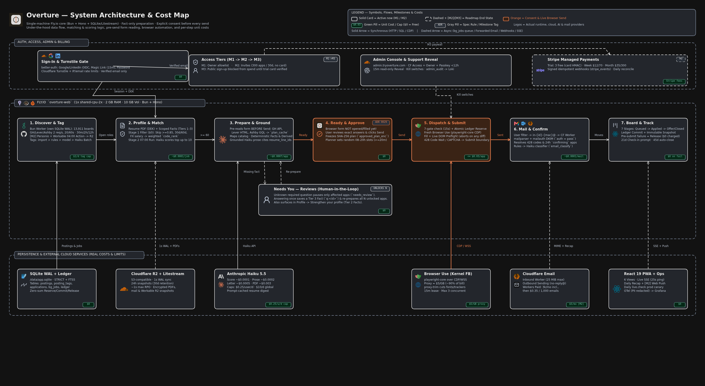

# Overture

A job-search agent that finds jobs for one person, prepares every application and sends it when you approve,
and shows its work. It finds postings from ATS job feeds, scores them against the user's resume, prepares each
application from the user's own facts, writes the cover letter, and, once the user approves it, submits it
through the employer's real ATS form in a managed cloud browser.

Bun and Hono serve the API and the Vite, React 19 and Tailwind SPA (shadcn/Radix components, React Query and Zod
on every response). SQLite runs through Drizzle as two files, `app.sqlite` and `catalog.sqlite` (ADR 0036), with
migrations applied at boot and Litestream replication; the health route answers at `/api/health`. The app's Home is
`/` today; the rebuild makes `/` the public landing and moves Home to `/home` (ADR 0037, proposed).
`docs/SPEC.md` is the product, `DESIGN.md` the look, `GLOSSARY.md` the words and `docs/adr/` the decisions.

## Architecture



Source diagram: [diagrams/architecture.excalidraw](diagrams/architecture.excalidraw)

## Running it

```sh
bun install
bun run build
bun run start        # http://localhost:3000
```

For the development loop run `bun run dev` (API on `:3000`) and `bun run dev:web` (Vite on `:5173`,
proxying `/api` and `/__test__`).

Checks: `bun run lint`, `bun run lint:config`, `bun run format:check`, `bun run typecheck`,
`bun run test:unit` and `bun run test:e2e` (run `bun run build` first).

| Where | What |
|---|---|
| GitHub Issues | Specs and tickets: the source of truth for what is being built |
| `docs/SPEC.md` | Product and architecture reference |
| `diagrams/` | System architecture Excalidraw diagram and PNG export |
| `DESIGN.md` | Visual design system, with the canvas boards as the wireframe |
| `GLOSSARY.md` | The words, used exactly in code, copy, issues and commits |
| `docs/adr/` | Decisions that are hard to reverse, and why |
| `docs/SALVAGE.md` | The only v1 logic that may be ported, and where it goes |
| `docs/research/` | Evidence behind the browser and tagging choices |
| `docs/agents/` | Configuration for the engineering skills: issue tracker, labels, domain docs |
| `profile/` | The owner's resume, answer bank and cover-letter template, seed data for the importer |
| `AGENTS.md` (`CLAUDE.md` links to it) | The contract for coding agents |

Precedence: the spec beats the code, and `DESIGN.md` beats the code on appearance.
