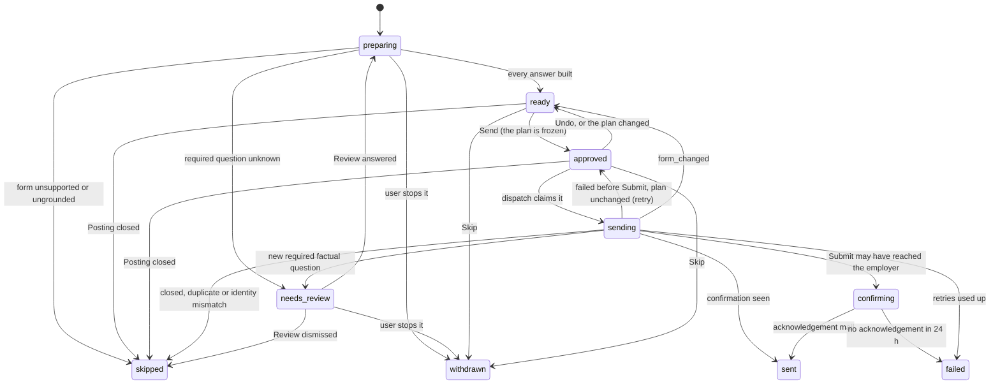

# Overture v2 — specification

Status: **near-final**, 2026-11-19; M2 brought up to date 2026-11-21. Nothing is set in stone. The decisions behind this file are ADRs in `docs/adr/`;
a change to one is a new ADR first, then this file. A worker implements one ticket at a time and must not need to ask
a product question; if a ticket does need one, the gap is a spec bug: raise it on the issue tracker, do not guess.

Companion files: `GLOSSARY.md` (words), `DESIGN.md` (appearance), `docs/adr/` (why), `docs/SALVAGE.md` (what is
ported from v1), `docs/research/*.md` (evidence). Specs and tickets for implementation live as GitHub issues.

**Words.** The banned words (`Hold` as a stage, runner, lease, provider, dispatch, attempt, ledger, credit, CAPTCHA,
Brain, Hands) never appear in anything a user can read: UI, copy, emails, push, error messages, the landing, the
admin's user-facing exports. Code uses the glossary's words for product concepts (Application, Review, Stage,
Posting) and may use precise engineering names for internals (`ledger`, `attempts`, `dispatch/`, `BrowserProvider`),
because renaming them would hide what they are.

Scale: a small side project being made into a SaaS. Prefer the simplest thing that works; no vendor outreach,
no enterprise process.

---

## 1. Product truth

Overture finds job postings from ATS job feeds, scores them against the user's resume, prepares every application
from the user's own facts, and sends it when you approve, through the employer's real ATS form in a managed cloud
browser (ADR 0029). Users never see a browser or a CAPTCHA.

Promises, in priority order:

1. **Never lie.** Every factual answer comes from a saved fact. The resume PDF is sent byte-for-byte unchanged.
   Cover letters and open-text answers only make claims traceable to the resume.
2. **Never embarrass.** Never apply to the current employer or a skipped company, never twice to the same role, never
   in bursts, never below the user's threshold.
3. **Never charge for failure.** An application uses one of "Applications left" only when it is actually sent.
4. **You approve every send.** No Application is submitted without the user's explicit approval of its exact plan
   (ADR 0029). Everything before that is automatic: the only other thing a user is asked is a factual question
   Overture cannot answer.
5. **Auditable.** Every sent application keeps an immutable record of the exact answers, letter, resume file and
   consent.

Who it is for: one person running a serious job search, ten roles a day, who will not hand-fill forms, will not
let a tool invent an answer, and wants to see each application before it goes. Primary persona on the boards: a
senior backend/platform engineer in Canada searching globally. Platform: a web app installable as a PWA,
phone-first for triage (answering a Review between meetings), desktop for reviewing proof.

Non-goals: native apps, Telegram/SMS, user-facing live browser, real-email mode, Workday/iCIMS/Taleo, teams/workspaces,
per-user AI keys, resume generation or restyling, annual plans.

---

## 2. Milestones and exit gates

| Milestone | Who | Scope | Exit gate |
|---|---|---|---|
| **M1 — Owner applies from the cloud** | owner only (allowlist) | catalog (Greenhouse, Lever, Ashby), tagging, profile via importer, matching, preparation, Reviews, Ready and approval (ADR 0029), owner's forwarded ATS mail (inbound, ADR 0028), Browser Use provider (Kernel adapter behind the same port, exercised in M2's synthetic lab), dispatch, ledger with admin grants, Board, Home, Review, minimal Profile, minimal admin, fixture capture job, observability | ≥ 25 real owner applications on Browser Use, each approved by the owner (ADR 0029); **≥ 85 % of attempted applications reach `sent`**; cost ≤ **$0.03 per completed application**; zero wrong-company or duplicate sends. *Attempted* and *cost* are defined in ADR 0026; an Application never approved is never attempted. Testing phase: keep spend minimal |
| **M2 — Invite-only beta** | invited users: the owner's friends and family; the owner keeps testing on a burner account | **Invites** replace the owner allowlist; each accepted invite gets an admin grant of 300 applications over 30 days, no card · **onboarding** in five steps (Sign in, Resume, Your facts, What you want, Forward ATS mail + consent + Start), resumable, with the forwarding-filter guide for Gmail and Outlook and the 10-minute code paste as a first-class path (ADR 0028) · a **forwarding address for every user** and the read-only **Inbox** of forwarded ATS mail · **email-driven Stage moves** with Undo, and **Check-ins** · **the daily 07:00 preparation run and one recap email** (M1 #198, #196) plus **push notifications** for the recap, Reviews, replies, interviews, offers, auto-moves and pauses, so a user approves from the phone (ADR 0029) · **full admin** (users and invites, Reveal, audit, support access log, mail health) · **export and delete** · **legal pages and consent versioning** (Terms, Privacy, business name "Overture", contact `admin@tryoverture.com`) · **Personio** (per-company XML) and **Workable** (bulk XML feed keyed by `referencenumber`) after a 20-form probe each, read by plain HTTP first and a Browser Use session only where a fill must be proven; Recruitee and SmartRecruiters are dropped (ADR 0028) · **the Browser Use SDK and proxy-cost levers** (#180) · **the synthetic lab and provider report** (#36) · **a one-command switch to Cloudflare Email Sending for every recipient** once Workers Paid is on (an idempotent operator script and a deploy and live-check guard) · the **security, scalability and cost reviews** (#182, #183, #184) run near the end, before the beta wave. Not in M2: replying to employers from Overture (the user replies from their own mailbox, ADR 0028), billing, public sign-up. Tickets are the sub-issues of #6 | M2 ends with two tickets for the owner: "M2: owner setup" (pay Cloudflare Workers Paid, run the sending-domain script, publish the Google OAuth consent screen) and then "M2 close-out: onboard the first wave of beta testers". Everything else in M2 is built and verified without the payment (gated by config, fake sender in tests). The first wave is then onboarded. Then **10 beta users for 14 days; submit rate holds ≥ 85 %; no P1 privacy/security finding**. Testing phase: keep spend minimal |
| **M3 — Public** | anyone | **Public sign-up** replaces invites (Turnstile, rate limits, nothing is prepared until a trial card is verified or a plan is paid, a global spend cap) · **Stripe Managed Payments** (Checkout, customer portal, signed webhooks processed once) behind the `Payments` port · **plans**: a trial of 3 applications once per card (HMAC card fingerprint that survives deletion), Week $12 → 70 over 7 days, Month $35 → 300 over 30 days, renewing, no rollover; each paid period issues a grant, unused ones expire, failures are never charged · plan changes (trial upgrade at once, Week/Month switch at renewal, cancel at period end) · payment-failure and plan-end pause · admin refunds and a per-user billing view · daily Stripe↔ledger reconciliation · measured cost and margin per application, then final prices · **public landing and pricing**, prerendered, redrawn for the current product (you approve every send, the real prices, Greenhouse, Lever, Ashby, Personio and Workable, no Workday) · Terms and Privacy extended for billing · plan and billing in Settings · M3 ends with two owner tickets: "M3: owner setup" (Stripe account and Managed Payments approval, live keys, webhook, tax, final prices) and "M3 close-out: open to the public" | first 20 paying users; Stripe reconciliation matches the ledger for 30 days. Users invited in M2 keep their admin grants and choose a plan when they run out |

Ledger tables and plan limits exist from M1 so nothing is rewritten in M3.

---

## 3. System architecture

### 3.1 Deployment

```
 users (browser/PWA) ──HTTPS──▶ Cloudflare (DNS, WAF, CDN, Turnstile, Access)
                                   │ tryoverture.com, admin.tryoverture.com
                                   ▼
                     Fly app `overture-web` (yyz, ONE machine, 1 volume)
                     ┌───────────────────────────────────────────────┐
                     │ litestream replicate -exec "bun run start"     │
                     │  Bun process: Hono API · SPA static · SSE      │
                     │  scheduler · bg_jobs workers · discovery       │
                     │  dispatch (playwright-core over CDP)           │
                     │  /data/app.sqlite (WAL, synchronous=FULL)      │
                     └───────────────────────────────────────────────┘
        │CDP/WSS        │HTTPS            │HTTPS          │OTLP           │S3 API
        ▼               ▼                 ▼               ▼               ▼
  Browser Use Cloud  Anthropic API    Cloudflare      Grafana Cloud      Cloudflare R2
  (Kernel fallback)  (Haiku 5.5)      Email Sending   (LGTM)             backups · files · mail
                                          ▲
  employers ──mail──▶ user's inbox ──ATS-only filter──▶ Email Routing + Worker (tryoverture.com) ──signed raw MIME──▶ overture-web
```

- One Fly app, one machine, one volume. `fly scale count` stays 1. Machine: `shared-cpu-2x`, 2 GB; volume 10 GB.
  No runner app: browsers are remote.
- Same origin for API and SPA. `admin.tryoverture.com` is the same process, routed by host, behind Cloudflare Access.
- Deploys cause ~10–30 s downtime; `kill_timeout = 300` (Fly's maximum). On `SIGTERM` the process stops claiming
  jobs and waits for in-flight jobs. A send that has not reached `submit_clicked_at` stops, releases and is
  rescheduled as `interrupted`, which does not use one of its two tries; a send past it waits for its confirmation
  signal. Anything still open at exit is recovered by lease expiry (§9.4).
- **Where traffic comes from.** Every request that loads or submits an employer's application form comes from a
  Browser Use browser on a residential IP in the user's country, controlled by `overture-web` over CDP. `overture-web`
  itself calls only the ATSes' public job-feed APIs (discovery §6, the liveness re-check §9.3), which exist for
  programmatic reading. The developer machine never contacts an ATS, a job site or a Browser Use session; it runs
  code and tests against the local fixture server only. Outside production the app and its catalog worker install an
  outbound guard (ADR 0016): a request to an ATS or paid-service host that is not a local fixture throws instead of
  leaving the machine.
- Litestream replicates continuously to R2 `overture-backups`; a nightly snapshot is kept 30 days; a restore drill
  runs in CI weekly against a throwaway machine.

### 3.2 External services and environment

| Service | Purpose | Env / secret | In tests (ADR 0013) |
|---|---|---|---|
| ATS job feeds and hosted forms (Greenhouse, Lever, Ashby) | catalog discovery (§6) and the plain form read in preparation (§8.3) | `GREENHOUSE_FEED_BASE_URL`, `LEVER_FEED_BASE_URL`, `LEVER_EU_FEED_BASE_URL`, `ASHBY_FEED_BASE_URL`, `LEVER_JOBS_BASE_URL`, `LEVER_EU_JOBS_BASE_URL`, `ASHBY_JOBS_BASE_URL` (test-only overrides of the real hosts) | local fixture server replaying recorded real responses captured by `scripts/record-feeds.ts`, and recorded Lever pages plus the Ashby `ApiJobPosting` shape for the form read |
| Workable XML feed, Personio XML (M2) | catalog discovery (§6.1) | `WORKABLE_FEED_URL` (the off-box Action only; the app never fetches the feed), `PERSONIO_FEED_BASE_URL` (test-only overrides of the real hosts) | local fixture server replaying recorded real responses (a trimmed Workable feed that keeps its real structure) |
| Cloudflare R2 | backups, encrypted files and mail | `R2_ACCOUNT_ID`, `R2_ACCESS_KEY_ID`, `R2_SECRET_ACCESS_KEY`, `R2_BUCKET_FILES`, `R2_BUCKET_BACKUPS`; `R2_ENDPOINT` overrides the endpoint for tests | disk object store adapter (real implementation, also used in local dev); the R2 adapter runs against a local S3-compatible server (`test/e2e/s3-server.ts`) |
| Cloudflare Turnstile | bot check on auth forms | `TURNSTILE_SITE_KEY`, `TURNSTILE_SECRET`, `TURNSTILE_HOSTNAMES` (optional, defaults to the `APP_ORIGIN` hostname; production must not list localhost or 127.0.0.1) | Cloudflare's published always-pass test keys; siteverify intercepted with recorded-shape responses (`test/e2e/turnstile-gate.test.ts`) |
| Cloudflare Access | admin host gate | `CF_ACCESS_AUD`, `CF_ACCESS_TEAM_DOMAIN`, `CF_ACCESS_JWKS_URL` (tests override the certs URL) | real verification against a test signing key |
| Cloudflare Email Routing + Email Worker | inbound mail (ADR 0028) | `INBOUND_HMAC_SECRET` (shared by the Worker and `overture-web`) | the Worker's handler run against recorded `.eml` fixtures; signed requests to the real `POST /internal/mail/inbound`; DKIM checked by `mailauth` against recorded keys |
| Browser Use Cloud | primary browser | `BROWSER_USE_API_KEY`, `BROWSER_USE_API_BASE_URL` (test-only override) | `local` provider: real local Chrome filling saved forms from the fixture server (§10.5); control API from recorded responses, through MSW in-process or a local recorded fixture server for the app |
| Kernel | fallback browser | `KERNEL_API_KEY`, `KERNEL_API_BASE_URL` (test-only override) | local recorded control-API server with real local Chrome behind it; lab only |
| Anthropic | LLM (prod) | `ANTHROPIC_API_KEY` | real adapter; API intercepted by MSW with responses recorded by the daily live check |
| OpenCode Go | LLM (local dev only) | `OPENCODE_API_KEY` | — |
| Cloudflare Email Sending | outbound mail (magic links, live check, later notices) | `CLOUDFLARE_EMAIL_API_TOKEN`, `CLOUDFLARE_ACCOUNT_ID` (both or neither); `CLOUDFLARE_EMAIL_API_BASE_URL` (test-only override of the real API host) | real adapter; the send endpoint is intercepted by MSW and the request body asserted (`test/e2e/cloudflare-email.test.ts`) |
| Stripe (M3) | Managed Payments | `STRIPE_SECRET_KEY`, `STRIPE_WEBHOOK_SECRET` | stripe-mock (Stripe's own local server) + signed webhook fixtures |
| Grafana Cloud | logs/metrics/traces | `OTEL_EXPORTER_OTLP_ENDPOINT`, `OTEL_EXPORTER_OTLP_HEADERS` | local LGTM docker |
| Web Push | notifications | `VAPID_PUBLIC_KEY`, `VAPID_PRIVATE_KEY` | real adapter; push endpoints via MSW |
| Master key | envelope encryption | `MASTER_KEY_V1` (32 bytes base64), `MASTER_KEY_CURRENT=1` | fixed test key |
| Google + LinkedIn (OIDC) | OAuth sign-in providers | `GOOGLE_CLIENT_ID` with `GOOGLE_CLIENT_SECRET`, `LINKEDIN_CLIENT_ID` with `LINKEDIN_CLIENT_SECRET`; each pair optional, both or neither (a half-set pair stops boot); an unset pair leaves that provider unregistered and hidden | local OIDC identity server; discovery URLs overridable via `OAUTH_GOOGLE_DISCOVERY_URL`, `OAUTH_LINKEDIN_DISCOVERY_URL` |
| Auth | better-auth sessions | `BETTER_AUTH_SECRET`, `AUTH_ALLOWED_HOSTS` | local test secret and loopback hosts |
| App | | `APP_ORIGIN=https://tryoverture.com`, `ADMIN_ORIGIN`, `MAIL_DOMAIN=tryoverture.com` (forwarding addresses), `OWNER_EMAIL`, `DATABASE_PATH=/data/app.sqlite`, `MAIL_FROM`, `TURNSTILE_SITE_KEY`, `TURNSTILE_SECRET`, `TURNSTILE_HOSTNAMES`, `ALERT_NTFY_URL` (optional) | |

All secrets are Fly secrets; local dev reads `.env` (chmod 600, never committed).
Overture's own mail (magic links, the daily live check) goes through the Cloudflare Email Sending adapter whenever
`CLOUDFLARE_EMAIL_API_TOKEN` and `CLOUDFLARE_ACCOUNT_ID` are both set; otherwise the in-memory sink is used, which is
the test and development adapter. A half-set pair stops the server at boot. The sender is a plain `fetch` to
`POST /accounts/{account_id}/email/sending/send` under `https://api.cloudflare.com/client/v4`, with the token in a
bearer header; the research and the Beta terms are in `docs/research/cloudflare-email-sending.md` and ADR 0028.
`CLOUDFLARE_ZONE_ID` scopes the M2-02 sending-domain script and guards. `REQUIRE_EMAIL_SENDING` gates the live
`mail.sending` guard: unset, the check records `status: "gated"` and does not alert; set, it verifies the sending
domain and alerts while a send to a non-owner recipient would be refused.
Email Sending includes 3,000 emails a month and no Cloudflare limit covers it, so the app counts every send in
`mail_usage` (one row per UTC month and kind) before the request leaves the machine. `mail.monthly_cap` (2,700)
refuses further sends and `mail.sign_in_reserve` (270) keeps the last sends for magic links, verification, resets and
the live check, so a Recap cannot starve them; a refused send fails closed like §8.6, and the owner is alerted at 80%
of the cap and at the first refusal. The admin overview shows the month's count. Tests reach Cloudflare only through
MSW (ADR 0013, 0016).
M1 keeps encrypted files in Cloudflare R2 (`R2_BUCKET_FILES`) through the R2 object store adapter whenever the bucket and the R2 credentials are set; they are sealed per user. The disk object store on `/data/objects` (`OBJECT_STORE_ROOT`) remains the default for local dev and tests. A half-set R2 files config stops the server at boot. `scripts/move-objects-to-r2.ts` copies the files that were already on the volume and verifies each sha256, and leaves the local files in place for the operator to delete.

### 3.3 Domains and DNS

- `tryoverture.com` is registered (Cloudflare Registrar, owner's account).
- `tryoverture.com`: app, marketing, Overture's own mail (`no-reply@` sent through Cloudflare Email Sending from the
  `cf-bounce` sending setup; `hello@` forwarded to the owner by Email Routing), the forwarding addresses
  `in-{id}-{mac}@` (ADR 0028), and the system address `live-check@` that maps to no user. MX → Cloudflare Email Routing,
  whose catch-all goes to the Email Worker. Email Sending adds its bounce MX, SPF and DKIM on
  `cf-bounce.tryoverture.com`; Email Routing keeps the apex MX and SPF include, and DMARC stays
  `p=reject; rua=…`.
- `mail.tryoverture.com` is not used (it was the ADR 0005 job-search address domain).
- `admin.tryoverture.com`: Cloudflare Access application (owner identity only).

---

## 4. Tech stack and repository

| Layer | Choice |
|---|---|
| Runtime | Bun 1.4.5 (pinned in `package.json`, CI and the Dockerfile), strict TypeScript (`bun check` for typecheck) |
| HTTP | Hono + `@hono/zod-validator`; Zod on every input, webhook and env var |
| DB | `bun:sqlite`, WAL, `synchronous=FULL`, `foreign_keys=ON`, STRICT tables; Drizzle ORM + drizzle-kit migrations; no SQLite-only SQL outside `server/platform/search` |
| Auth | better-auth (M1: Google, LinkedIn OIDC, magic link; M2 adds email + password; passkey for admin) with Drizzle adapter |
| Web | Vite 8, React 19, React Router 7 (library mode, Zod-typed search params), TanStack Query, Hono RPC client, Tailwind v4, shadcn/ui, 21st.dev, dnd-kit, lucide |
| Browser control | `playwright-core` `chromium.connectOverCDP` |
| PDF | `unpdf`; Haiku 5.5 PDF fallback |
| Mail | `mailparser`, `mailauth` (SPF/DKIM/DMARC verification), Cloudflare Email Sending over a small `fetch` to its REST endpoint |
| Telemetry | OpenTelemetry SDK (traces, metrics, logs) → OTLP |
| Lint/format | oxlint, every category at error + type-aware (`oxlint-tsgolint`), from Landmines' own configuration, plus `@interfere/landmines`, vendored anti-slop, React / `jsx-a11y` / Vitest plugins and architecture rules (ADR 0023), with the Cloudflare preset rules; `bun lint` runs Oxlint with `--deny-warnings`; `bun fmt` formats |
| Tests | Playwright e2e (sharded), `bun test` for the ADR 0013 invariant files, MSW at the network edge, daily live checks on Fly (ADR 0013) |

```
src/
  shared/            zod schemas, enums, fact catalog, tag taxonomy, copy strings, API types
  server/
    platform/        db, migrations, queue, sse, crypto, telemetry, settings, kill-switches, ports/*
    auth/            better-auth config, invites/allowlist, sessions
    catalog/         sources/*, boards, postings, tagging, questions catalog, search, census
    profile/         facts, resume, targets, skip list, forwarding address
    pipeline/        matching, scoring, preparation, reviews, check-ins, applications, stages
    dispatch/        scheduler, limits, browser providers, executor, ats flows, attempts
    billing/         ledger, grants, plans, stripe (M3)
    inbox/           ingest, linking, codes, classification, outbound
    notify/          push, digest, in-app notifications
    admin/           admin routes, reveal, audit
    app.ts           Hono app composition (host routing: app vs admin)
    main.ts          process entry: http + workers + scheduler, graceful shutdown
  web/               React app (routes/, features/, components/ui = shadcn)
drizzle/             generated migrations
scripts/             fetch-seed.ts, load-discovered-boards.ts, enqueue-backfill.ts, census.ts, record-feeds.ts, capture-fixtures.ts, pull-forms.ts, restore-drill.ts
test/e2e/           Playwright `*.test.ts` flows, fixture server, MSW handlers and recordings, `*.test-utils.ts`
                     (the eight unit tests sit beside their code as `*.test.ts`, per Landmines `colocated-tests`)
tools/oxlint/        vendored anti-slop plugin
```

No comments in source (Landmines `no-comments`; TSDoc on exported port interfaces is the one exception).

### 4.1 Ports (every external dependency)

```ts
interface LlmPort { complete<T>(req: LlmRequest<T>): Promise<LlmResult<T>>; batch<T>(reqs: LlmRequest<T>[]): Promise<BatchHandle> }
interface BrowserProvider { id: "browser_use" | "kernel" | "local"; open(o: { profileId: string | null; country: string; timeoutMinutes: number; attemptId: string }): Promise<RemoteBrowser>; listOpen(): Promise<{ sessionId: string; attemptId: string | null }[]>; stop(sessionId: string): Promise<void>; sessionUsage(sessionId: string): Promise<{ status: "active" | "stopped"; usage: UsageReport } | null>; ensureProfile(userId: string, country: string): Promise<string>; deleteProfile(profileId: string): Promise<void>; view(sessionId: string): Promise<{ liveViewUrl: string | null; recordingUrl: string | null; status: "active" | "stopped" } | null> }
interface RemoteBrowser { cdpUrl: string; sessionId: string; liveViewUrl: string | null; close(): Promise<UsageReport> }
interface MailSender { sendRaw(m: OutboundMime): Promise<{ providerMessageId: string }> }
interface ObjectStore { put(k: string, b: Uint8Array, meta?): Promise<void>; get(k: string): Promise<Uint8Array | null>; delete(k: string): Promise<void>; list(prefix: string): AsyncIterable<string> }
interface SearchIndex { indexPosting(p): void; removePosting(id): void; search(q: SearchQuery): SearchHit[] }
interface Payments { /* M3: checkout, portal, webhook verify */ }
interface PushSender { send(sub: PushSubscription, payload: PushPayload): Promise<"ok" | "gone"> }
interface FxRates { perUsd(currency: string, date: string): number | null }
interface Clock { now(): number }
```

Domain code imports ports only (enforced by `no-restricted-imports`). Each port has its production adapter and, where
a real local equivalent exists, a local adapter (`local` browser, disk object store) used in development and tests. No
port has a hand-written fake (ADR 0013). `Clock` reads system time plus an offset that only a test-only route, never
mounted in production, can move; a second test-only route runs every job that is due.

---

## 5. Data model

Conventions: ids are ULID `TEXT`; timestamps are `INTEGER` ms since epoch UTC; booleans `INTEGER 0/1`; money in
minor units `INTEGER`; enums are `TEXT` with `CHECK`; every table `STRICT`; every user-owned row has
`user_id … REFERENCES user(id) ON DELETE CASCADE`. Columns ending `_enc` are AES-256-GCM ciphertext under the user's
data key (§13.2). Drizzle schema in `src/server/**/schema.ts` is the source of truth; this section is its contract.

### 5.1 Auth (better-auth managed)

`user` (id, name, email UNIQUE, email_verified, image, role CHECK IN ('user','owner'), suspended_at, created_at,
updated_at) · `session` · `account` (provider: google, linkedin, credential) · `verification` · `passkey` (owner only)
· `invites` (id, email_hash UNIQUE, email_enc NULL, invited_by, created_at, accepted_at, accepted_user_id NULL, revoked_at NULL, grant_id NULL) — M1 allowlist = `OWNER_EMAIL`, M2 = invites (§13.1); the invited email is stored hashed and shown to the owner as typed only in the admin, from an encrypted copy sealed under the inviter's data key.

### 5.2 Profile

| Table | Columns |
|---|---|
| `user_keys` | user_id PK, wrapped_dek BLOB, master_key_version INTEGER, created_at. **Deleting this row is crypto-shredding.** |
| `profiles` | user_id PK, running, pause_reason CHECK IN ('user','onboarding','no_resume','plan_ended','payment_failed','suspended','no_mailbox') NULL, timezone (IANA, taken from the browser at sign-up; the first zone saved applies at once; a later change is stored in pending_timezone with pending_timezone_at = now + `limits.timezone_change_days` (7) and the current zone stays in force until then; every read of the zone applies a due pending change first, through one function), pending_timezone, pending_timezone_at, languages TEXT JSON (ISO 639-1), auto_threshold CHECK IN (50,60) DEFAULT 60, onboarding_step, onboarded_at, digest_enabled DEFAULT 1, push_prompted_at, consent_version, consent_at, created_at, updated_at. M1-14 creates the row with `languages`, `timezone` and the timestamps; the remaining columns arrive with the slices that read them. M1-22 adds `running` and `pause_reason`: `running` defaults to 0 and `pause_reason` to `onboarding`, so no send is planned until the owner presses Start; `POST /api/running {running:true}` clears the reason, and setting `running:false` records `user`. `consent_version` defaults to `m1` for the owner-only milestone; the wording it refers to lands with the M2 legal-pages ticket (#6) |
| `facts` | id, user_id, key, scope ('' or an ISO 3166-1 alpha-2 country), value_enc, source CHECK IN ('resume','user','review','import'), confirmed, revision, updated_at; UNIQUE(user_id,key,scope). Keys from the fact catalog (§7.1) or `q:<question_id>` for learned answers. `work_auth` and `sponsorship_required` are country-scoped; every other key has `scope=''` |
| `targets` | user_id PK, roles JSON (strings as typed), seniorities JSON, workplaces JSON, locations JSON (strings as typed), employment_types JSON, salary_floor_minor NULL, salary_currency NULL, salary_period CHECK IN ('year','month','hour') NULL, version INTEGER, updated_at |
| `skip_companies` | id, user_id, company_id NULL, name, name_norm, domain NULL, reason CHECK IN ('current_employer','user'), created_at; UNIQUE(user_id,name_norm). Matching rules in §8.1 |
| `resumes` | id, user_id, object_key, sha256, bytes, pages, filename_enc, text_enc, parsed_with CHECK IN ('unpdf','llm'), is_current, uploaded_at; partial UNIQUE(user_id) WHERE is_current=1 |
| `browser_profiles` | user_id, provider, provider_profile_id, country_code, created_at, last_used_at; PK(user_id, provider) |
| `mailboxes` | id (the forwarding id, `[a-z0-9]{8,32}`), user_id UNIQUE, local_part UNIQUE (the `in-{id}-{mac}` local part), status CHECK IN ('active','receive_only','closed'), receive_until NULL, first_forwarded_at NULL (set once by the first ATS mail that arrives; the API reads it as "forwarding works"), created_at |
| `retired_addresses` | local_part PK, retired_at — **a local part is never reassigned** |

### 5.3 Catalog

| Table | Columns |
|---|---|
| `companies` | id, name, name_norm, domain NULL, industry NULL, created_at; INDEX(name_norm) |
| `company_boards` | id, company_id, ats CHECK IN ('greenhouse','lever','ashby','smartrecruiters','recruitee','workable','personio'), board_token, region CHECK IN ('us','eu') DEFAULT 'us' (Lever's US and EU instances are separate boards; Greenhouse has one API), status CHECK IN ('active','empty','gone','disabled'), source CHECK IN ('v1_seed','discovered','import'), etag, last_modified, content_hash, last_polled_at, next_poll_at, backoff_level, consecutive_errors, created_at; UNIQUE(ats,region,board_token) |
| `postings` | id, board_id, company_id, ats, ats_job_id, url, apply_url, apply_url_norm, title, title_norm, department, location_raw, country_code, region, city, workplace CHECK IN ('remote','hybrid','onsite','unknown'), employment_type CHECK IN ('full_time','part_time','contract','internship','temporary','unknown'), language, salary_min_minor, salary_max_minor, salary_currency, salary_period, posted_at, source_updated_at, first_seen_at, last_seen_at, missing_polls, closed_at, description_gz BLOB NULL, description_hash, feed_content_hash NULL (sha256 of the normalized feed posting; set only for ATSs whose list feed carries the description, Lever, Ashby and Personio; a poll rewrites a posting only when this hash or `source_updated_at` changes), dedupe_key, tag_source CHECK IN ('rules','model','llm','import'), tagged_at, questions_fetched_at; UNIQUE(board_id, ats_job_id); INDEX(apply_url_norm); INDEX(closed_at); INDEX(dedupe_key); INDEX(ats, closed_at, last_seen_at) |
| `workable_ingests` | id, snapshot_key UNIQUE, fetched_at, source_last_modified NULL, rows, content_hash, added, updated, closed, ingested_at; INDEX(ingested_at). One row per ingested Workable snapshot, the row-drop history and the "second pass with no change" guard |
| `posting_tags` | posting_id, dimension CHECK IN ('role','subrole','seniority'), value, source; PK(posting_id,dimension,value) |
| `postings_fts` | FTS5(title, company, location, department) (short fields only): self-contained, kept in step with `postings` and `companies` by SQLite triggers (insert, update, delete, company rename); closed Postings leave the index |
| `questions` | id, text_display, text_norm_hash UNIQUE, field_type CHECK IN ('text','textarea','select','multiselect','radio','checkbox','file','date','number','email','phone','url'), options_hash NULL, fact_key NULL (a fact key, or a derivation key for `target`/`derived`), answer_kind CHECK IN ('fact','target','derived','open_text','consent','skip','unknown'), mapped_by CHECK IN ('rules','llm','owner'), seen_count, created_at |
| `question_variants` | variant_hash PK, question_id |
| `posting_questions` | posting_id, question_id, required, position, options JSON, field_name (the form input's name or id, taken from the ATS question fields and used to fill the live form); PK(posting_id,question_id) |
| `tag_imports` | id, source, file_sha256, rows, matched, uploaded_by, applied_at |

Descriptions (`description_gz`) are purged 90 days after `closed_at`.

### 5.4 Pipeline

| Table | Columns |
|---|---|
| `matches` | user_id, posting_id, code_rank REAL, score NULL, reason NULL, resume_id NULL, targets_version NULL, scored_at NULL; PK(user_id,posting_id). A score is valid only while `resume_id` and `targets_version` equal the user's current ones |
| `posting_user_state` | user_id, posting_id, state CHECK IN ('saved','hidden'), updated_at; PK(user_id,posting_id) |
| `applications` | id, user_id, posting_id, company_id, origin CHECK IN ('auto','manual'), status CHECK IN ('preparing','needs_review','ready','approved','sending','confirming','sent','failed','skipped','withdrawn'), status_reason NULL (§11), stage CHECK IN ('queued','ready','applied','screening','interviewing','offer','closed') NULL, stage_locked INTEGER DEFAULT 0, board_position REAL, score_at_queue, scheduled_for NULL, attempts INTEGER DEFAULT 0, ready_at NULL, approved_at NULL, approved_plan_sha256 NULL, approved_plan_enc NULL (the frozen send plan, sealed; §8.7), changes JSON NULL (what changed since the last approval, shown on the card), sent_at NULL, closed_reason CHECK IN ('rejected','no_response','withdrawn','offer_declined','offer_accepted','other') NULL, created_at, updated_at; UNIQUE(user_id,posting_id); partial UNIQUE(user_id) WHERE status='sending'. `withdrawn` applies only before `sent` (the user stops a queued application, or presses Skip on a Ready card); a sent application cannot be un-sent, so the user moves it to Closed with `closed_reason='withdrawn'` |
| `application_snapshots` | application_id PK, user_id, posting_url, posting_title, description_hash, answers_enc (JSON array `{question_id, label, answer, fact_key, fact_revision, kind, resume_line_ids, by_user}`), cover_letter_enc NULL (JSON `[{sentence, resume_line_ids, by_user}]`), resume_id, resume_sha256, consent_version, approved_at, approved_plan_sha256, provider, provider_session_id, submitted_at, confirmed_by CHECK IN ('page','email'), cost_micros. **Immutable**: a `BEFORE UPDATE` trigger always raises; a `BEFORE DELETE` trigger raises `WHEN EXISTS (SELECT 1 FROM user WHERE id = OLD.user_id)`, so rows go only when the user row is gone (account deletion cascade). Flow 29 proves both |
| `application_answers` | id, application_id, question_id, user_id, kind CHECK IN ('open_text','cover_letter'), sentences_enc (JSON `[{sentence, resumeLineIds, byUser?}]`, sealed), word_count, created_at, updated_at; UNIQUE(application_id,question_id). The generated, grounded open text and letter kept from preparation until the Snapshot takes them; `byUser: true` marks text the user edited on the card, which preparation keeps |
| `application_events` | id, application_id, user_id, at, kind CHECK IN ('status','stage','email','checkin','note'), from_value, to_value, source CHECK IN ('system','user','email','checkin','admin'), detail JSON; the card timeline and stage history |
| `attempts` | id, application_id, user_id, n, provider, provider_session_id, started_at, lease_until, ended_at NULL, submit_clicked_at NULL, submit_response_status INTEGER NULL, outcome CHECK IN ('sent','unconfirmed','captcha_blocked','code_timeout','posting_closed','form_changed','blocked','upload_failed','duplicate','needs_review','provider_error','timeout','crash','interrupted') NULL, browser_ms, proxy_bytes, captcha_seen, code_used, cost_micros, error_code NULL |
| `reviews` | id, user_id, question_id, fact_key NULL, scope ('' or an ISO 3166-1 alpha-2 country), prompt, field_type, options JSON, reason CHECK IN ('unknown_required','option_missing'), attempt_id NULL (the attempt whose live-form check opened it), status CHECK IN ('open','answered','dismissed'), created_at, resolved_at; UNIQUE(user_id,question_id,scope) WHERE status='open' |
| `review_applications` | review_id, application_id; PK(review_id,application_id) |
| `review_audit_events` | id, user_id, at, kind CHECK IN ('review_opened','review_resolved','auto_answer','snapshot_sent'), application_id NULL, review_id NULL, question_id NULL, ats NULL CHECK IN ('greenhouse','lever','ashby'), source NULL CHECK IN ('fact','target','derived','consent','file','open_text'), fact_key NULL, fact_revision NULL, scope, detail JSON; INDEX(user_id,at), INDEX(kind,at). Append-only by code: every Review opened and resolved, every automatic answer with its source, and every Snapshot sent. The owner's Review-rate and false-answer reports read it (§8.4) |
| `checkins` | id, application_id UNIQUE, user_id, due_at, status CHECK IN ('open','answered','expired'), answer CHECK IN ('rejected','interviewing','still_waiting') NULL, created_at |
| `plan_cache` | id, ats, form_signature, plan JSON (`{readPath, questions}`; each question carries its catalog `question_id`, label, field name, type, options, required and position), hits, failures, updated_at; UNIQUE(ats,form_signature). `hits` counts preparations served from the cache; `failures` counts a cached plan that no longer matched the live form or whose questions no longer exist. It never holds answers: they are rebuilt per user from Facts and Targets |
| `consent_versions` | version PK, text, published_at — the exact consent wording each `consent_version` refers to; rows are never edited |

### 5.5 Inbox

| Table | Columns |
|---|---|
| `mail_threads` | id, user_id, application_id NULL, subject_enc, employer_started, last_message_at |
| `messages` | id, thread_id, user_id, mailbox_id, direction CHECK IN ('in','out'), rfc_message_id, in_reply_to NULL, sender_domain, auth CHECK IN ('pass','fail','none'), from_enc, to_enc, subject_enc, text_enc, html_object_key NULL, snippet_enc, classification CHECK IN ('ack','code','rejection','screening','interview','offer','other') NULL, code_consumed_at NULL, read_at NULL, out_status CHECK IN ('queued','sent','bounced','failed') NULL, provider_message_id NULL, created_at; UNIQUE(mailbox_id, rfc_message_id) |
| `message_attachments` | id, message_id, filename_enc, mime, bytes, object_key |
| `code_waits` | id, user_id, mailbox_id, attempt_id NULL (no foreign key until the attempts slice links it), started_at, expires_at, resolved_at NULL, resolved_by CHECK IN ('mail','paste') NULL, resolved_message_id NULL, code_enc NULL |
| `mail_suppressions` | address_hash PK, reason CHECK IN ('bounce','complaint'), created_at |

### 5.6 Billing

| Table | Columns |
|---|---|
| `customers` | user_id PK, stripe_customer_id UNIQUE |
| `subscriptions` | id, user_id, stripe_subscription_id UNIQUE, plan CHECK IN ('week','month'), status, current_period_start, current_period_end, cancel_at_period_end, updated_at |
| `grants` | id, user_id, source CHECK IN ('trial','period','admin'), quantity, starts_at, expires_at, stripe_invoice_id UNIQUE NULL, created_at |
| `ledger` | id, user_id, kind CHECK IN ('grant','reserve','commit','release','expire','refund','adjust'), debit_account, credit_account, amount CHECK (amount > 0), grant_id, application_id NULL, idempotency_key UNIQUE, created_at. **Each row is one balanced transfer**, so the ledger is zero-sum by construction. No UPDATE/DELETE (triggers). |
| `stripe_events` | id PK (Stripe event id), type, received_at, processed_at NULL |
| `card_fingerprints` | hmac PK, trial_used_at — **not** user-linked; survives account deletion |

Accounts: `issued`, `available`, `reserved`, `used`, `expired`. The same no-UPDATE rule and the same user-gone `BEFORE DELETE` condition as snapshots apply. Transfers: grant `issued→available`; reserve
`available→reserved`; commit `reserved→used`; release `reserved→available`; expire `available→expired`. Balances are
per `(user_id, grant_id, account)`. Reserve draws from the grant expiring soonest. "Applications left" =
Σ available over unexpired grants. Daily usage = reservations made in the user's current local day that are still
reserved or committed (a release counts against the day its reservation was made, never against today). No separate
counters table. Expiry: `expire` moves only `available`; a reservation held on a grant that expires is released
and expired in the same transaction (`release` then `expire`), so it never returns to spendable.

### 5.7 Platform

| Table | Columns |
|---|---|
| `bg_jobs` | id, kind, payload JSON, run_at, priority, status CHECK IN ('queued','running','done','failed','dead'), attempts, max_attempts, locked_until NULL, last_error NULL, dedupe_key UNIQUE among queued rows NULL, created_at, updated_at |
| `events` | seq INTEGER PK AUTOINCREMENT, user_id NULL, topic, payload JSON, created_at — SSE outbox, purged after 24 h |
| `notifications` | id, user_id, kind, title, body, url, created_at, read_at, pushed_at, emailed_at |
| `push_subscriptions` | id, user_id, endpoint UNIQUE, p256dh, auth, created_at, last_ok_at |
| `settings` | key PK, value JSON, updated_at, updated_by — admin-tunable limits (§12) |
| `kill_switches` | scope CHECK IN ('global','ats','employer','provider'), key, enabled, reason, set_by CHECK IN ('auto','owner'), set_at; PK(scope,key) |
| `llm_usage` | id, user_id NULL, purpose, model, input_tokens, cached_tokens, output_tokens, cost_micros, created_at |
| `fx_rates` | date, currency, per_usd REAL; PK(date,currency) |
| `admin_audit` | id, at, actor_id, action, target_user_id NULL, reason, detail JSON — also shipped to Loki (off-box, append-only) |

Retention: `events` 24 h; `bg_jobs` done 7 days, dead 30 days; `attempts` 180 days; `llm_usage` 400 days;
`notifications` 90 days; descriptions 90 days after close; messages for account lifetime; `review_audit_events` and
Snapshots for account lifetime (the audit is only useful across a search).

---

## 6. Catalog: discovery and tagging

### 6.1 Sources

Ported from the v1 feed clients (`docs/SALVAGE.md`); Workable and Personio are new in M2 (Workable has its own feed ingest, below). Each board-based client implements
`fetchBoard(token, {etag, lastModified}, region) → {status: 'not_modified'} | {status: 'ok', postings, etag?, lastModified?} | {status: 'gone'}`.
`region` is the board's `company_boards.region`; only Lever uses it (its EU instance is a separate board, and a
board row's URL decides `eu` at seed time). Discovery runs from `overture-web` directly (no proxy).

| ATS | Region | Feed | Conditional GET | Per-ATS limits (default) |
|---|---|---|---|---|
| Greenhouse | one API | `boards-api.greenhouse.io/v1/boards/{token}/jobs` (light list; skips postings whose `internal_job_id` is null); the first poll of a board (no open postings yet), and any poll with more than five new or changed postings, fetches `/jobs?content=true` once and takes description, departments and location from it (that response carries no pay ranges, so salary stays null there until a later per-job detail fetch); otherwise one to five changed postings fetch `/jobs/{id}?content=true&pay_transparency=true`, with salary from `pay_input_ranges`; questions via `/jobs/{id}?questions=true`. `boards-api.eu.greenhouse.io` does not exist: EU tenants are served by the same API | ETag where returned, else content hash | 4 concurrent, 2 req/s |
| Lever | `us` | `api.lever.co/v0/postings/{token}?mode=json&limit=100&skip=N`, paging until a page returns fewer than 100 | content hash | 4 concurrent, 2 req/s |
| Lever | `eu` | `api.eu.lever.co/v0/postings/{token}?mode=json&limit=100&skip=N`, same paging; the same slug on each instance is a separate board | content hash | 4 concurrent, 2 req/s |
| Ashby | one API | `api.ashbyhq.com/posting-api/job-board/{token}` (slug lowercased) `?includeCompensation=true`; skips `isListed === false` | content hash | 4 concurrent, 2 req/s |
| Personio (M2) | one API | `{token}.jobs.personio.de/xml?language=en`; when an English description block is empty, the same board is read with `language=de` and the missing blocks are filled from it; no credentials; a missing board answers 404, and 3xx and 404 both mean `gone`; a posting's page is `{token}.jobs.personio.de/job/{id}` and its apply URL stays null until the apply flow lands (#232) | content hash | 2 concurrent, 1 req/s |
| Workable (M2) | one feed for every customer | `www.workable.com/boards/workable.xml`, gzip required, refreshed hourly, about 831 MiB uncompressed; carries a company display name and an apply shortcode, not a board slug, so it is ingested as a feed keyed by `<referencenumber>` with one `company_boards` row per company display name (the board token is the normalised name), not as a per-company feed. **Stream-parsed, never held in memory.** A daily GitHub Action at 04:00 UTC requests it with `Accept-Encoding: gzip` and `If-Modified-Since` from the previous manifest, streams it once, tags it with the repository's `htmlToText`/`tagPosting` (plus `<experience>` for missing seniority), keeps only Postings that could match the union of active users' Targets, and writes one gzipped JSONL snapshot plus `workable/manifest.json` (fetched-at, source `Last-Modified`, feed and distinct counts, row count and SHA-256 of the JSONL) to R2. The app ingests the latest snapshot at 05:00 UTC from `catalog.workable` in the catalog worker, upserts on `<referencenumber>` (keeping the display name and `https://apply.workable.com/j/<ref>`), stores the snapshot's tags, and closes Postings absent from the snapshot; it never fetches the feed (ADR 0032, `docs/research/workable-feed-ingest.md`). The app writes the Targets union to `workable-targets.json` (values only) for the next pass; Workable's `ats` kill switch is on (traffic off) until #235. Alerts fire when the Action fails, a snapshot is older than 26 hours, or the row count drops more than 20 %; the last snapshot stands | `If-Modified-Since` from the previous manifest (the feed returns no `ETag` and no `Content-Length`) | a recorded 300-job trim, passed through the real pass to a disk object store |

SmartRecruiters and Recruitee are not built: the SAP API Policy forbids systematic extraction by AI agents, and Recruitee's Careers API needs a per-company token from 2027-02-10 (ADR 0028). Their values stay in the `company_boards.ats` check only so a later decision needs no table rebuild; no client, sender list or probe exists for them. Pinpoint and Gem are the deferred replacements.

The apply link is the feed's own apply URL (`applyUrl` on Lever and Ashby) when present; the posting URL stays
`hostedUrl`/`jobUrl`. Greenhouse feeds have no apply URL, and its `absolute_url` may be the employer's own site, so the
send opens the Greenhouse embed form instead (§10.3 step 2). Greenhouse's `content` arrives double-encoded, so HTML entities are decoded and tags stripped
before the salary and location rules see the text. Lever and Ashby hand the feed's structured `workplaceType`
straight to tagging; Ashby's `isRemote` is ignored because Ashby sets it on hybrid roles.

### 6.2 Backfill and trickle

1. **Seed**: `scripts/fetch-seed.ts --dir <seed-dir>` downloads the pinned ats-scrapers manifest and
   `companies.parquet` (both sha256-pinned in `src/server/catalog/companies-parquet.ts`), then
   `scripts/load-discovered-boards.ts` loads the dataset's greenhouse, lever, ashby and personio rows as
   `source='discovered'` — 13,911 boards, in transactions of at most 500 boards with the event loop yielded
   between them, idempotent. v1 boards are not imported (the measured comparison is
   `docs/research/seed-comparison.md`; the runbook is `docs/research/m1-09-runbook.md`).
2. **Backfill**: one pass over every active board inside per-ATS limits; on production it is started with
   `bun run scripts/enqueue-backfill.ts --db /data/app.sqlite`, which enqueues the `catalog.backfill` job and
   prints the per-ATS request counts and the duration estimate at the 2 req/s per-ATS pace.
3. **Trickle**: each board gets `next_poll_at` from its activity: changed in last 24 h → 30 min; last 7 days → 2 h;
   otherwise → 12 h; errors → exponential backoff (cap 48 h). "Changed" is the feed's job `updated_at` when the
   feed has one (Greenhouse) and the newest posting's publish time when it does not (Lever, Ashby). `404` twice →
   `gone`. The `catalog.sweep` job claims its batch before polling: in the same statement that selects them, each
   claimed board's `next_poll_at` moves forward to a 15-minute claim, which the finished poll overwrites with its
   activity band, so a crashed process's board becomes due again when the claim lapses. Each sweep claims per ATS
   `sweep_interval_ms × the ATS's request rate` boards (120 per ATS at the 60 s default and 2 req/s), capped at
   `catalog.sweep_max_boards` (default 20) so a claimed batch finishes well inside the 15-minute claim; no ATS
   starves another. `catalog.sweep_batch` sets the total per-sweep batch instead (split across ATSes in proportion
   to their rates, and still capped per ATS by `catalog.sweep_max_boards`) and `catalog.sweep_interval_ms` sets the
   sweep chain interval. An ATS whose kill switch is engaged is not claimed and receives no batch.
4. **One sweep at a time**: the next sweep is enqueued when the current one *finishes*, not when it starts, so a
   sweep that outlasts the interval delays the next one instead of overlapping it. Its `dedupe_key` is
   `catalog.sweep` and `bg_jobs` is unique on a dedupe key among queued rows, so at most one is ever queued, and
   the worker never runs two jobs of a singleton kind (`catalog.sweep`) at once. A sweep killed mid-flight leaves
   its row running; the claim takes the row over once its lease expires, and only one process polls its boards
   because the board claim has not lapsed.
5. **Closed**: a posting absent from two consecutive successful polls gets `closed_at`; its `ready` and `approved`
   Applications are skipped with `status_reason='posting_closed'` and appear on Home as Couldn't apply. The liveness
   re-check at dispatch (§9.3) does the same for a Posting it finds closed.
6. **Dedupe**: `dedupe_key = company_id + title_norm + country_code + city`; duplicates across boards keep the
   earliest posting; users never see two cards for one role.
7. **Responsiveness**: writes never block the process. `catalog.sweep` (fetch, parse, tag and the writes of
   `company_boards`, `postings` and `posting_tags`) runs in a Bun Worker with its own SQLite connection (WAL, the same
   `busy_timeout` and `SQLITE_BUSY` retries); the main thread keeps its read-write connection for sign-in, settings,
   the ledger and dispatch and only schedules the sweep and receives results and metrics over `postMessage`. A board's
   postings are written in transactions of 50 with the event loop yielded between them, at most 500 rows per
   transaction, the comparison against stored postings reads only `id`, `ats_job_id`, `source_updated_at` and
   `closed_at` rather than whole rows with their descriptions, and the twice-missing close is two statements rather
   than one per posting. A crashed worker restarts with backoff, raises `catalog.worker` and never takes the server
   down; its board claim lapses so the next sweep retries it. A sweep over multi-megabyte feeds therefore leaves
   `/api/health` answering in milliseconds; the per-ATS limiter and its pacing are untouched.
8. **One-time re-tag**: `scripts/retag-feed-workplace.ts --db <overture.db>` clears the board and posting
   `content_hash`/`feed_content_hash` for Lever and Ashby once, so the next sweep rewrites every open posting from
   its feed and tags the feed's structured workplace. It clears at most 500 rows per transaction and yields between
   batches, so it never holds the write lock long enough to stall the server or exceed `busy_timeout`. It is
   idempotent (a second run only schedules the same rewrite) and is run once on production after the deploy that adds
   the structured workplace.

### 6.3 Tagging

Order of precedence for role/seniority: `import` (hiring.cafe file, if the owner provides one) > `rules` > `model` > `llm`.

1. **Structured normalisation (code)**: workplace from the feed's `workplaceType` when it has one (Lever
   `onsite`/`on-site`/`hybrid`/`remote`, Ashby `OnSite`/`Hybrid`/`Remote`; Ashby's `isRemote` is ignored because it is
   also set on hybrid roles), else the `isRemote` flag where a feed has one, else `remote`/`hybrid` tokens in the
   location or title, else the description; employment type from source enums or keyword map; location via an
   offline GeoNames cities15000 + admin1 table → `country_code/region/city`; language from source field, else a
   trigram detector on the title + first 500 characters; salary from structured fields (Greenhouse
   `pay_input_ranges` `min_cents`/`max_cents`, already minor units), else the pay-range regex set on the
   description (`$120,000 – $150,000`, `120k-150k`, `€50.000`, per hour/year).
2. **Rules**: title + department keyword dictionary built from the O\*NET title list (CC BY 4.0, attribution in the
   footer) mapped into §6.4 groups; seniority from title tokens (`intern`, `junior`, `senior`, `staff`, `principal`,
   `lead`, `manager`, `director`, `head of`, `vp`, roman numerals / levels) plus source experience fields.
3. **Title similarity (code)**: titles the rules leave unclassified are compared in code (normalised token and
   trigram similarity) against the O\*NET alternate-title list; accept when similarity ≥ the threshold set by the
   census. No ML runtime in the process: it must fit the 2 GB machine and stay deterministic. `tag_source='model'`.
4. **LLM**: what remains goes to Haiku 5.5 via the Batch API (thinking disabled, structured output
   `{role, subrole, seniority}`), title + department + first ~300 words. Daily cap `$1` (setting), backfill budget
   `$20` one-time. Over the cap, postings keep rules-only tags until the next day.
5. **Industry**: once per company (Haiku, batch) from company name + domain + one description; ~$3 total.
6. **hiring.cafe import seam**: `POST /admin/api/tag-imports` accepts JSONL rows
   `{apply_url, title, company, role?, subrole?, seniority?, workplace?, employment_type?, salary?}`; rows match a
   posting by `apply_url_norm`; matched rows set `tag_source='import'` and imported tags win over rules, model and
   llm tags for the dimensions they set. The import is recorded in `tag_imports` (who uploaded, when, row count,
   matched count). The route mounts behind the admin owner gate (§12) and its action is recorded on `admin_audit`;
   the same `importTags` module runs from the owner-run script `scripts/import-tags.ts --db <overture.db>
   --file <tags.jsonl>` and from a test-only route. `GET /admin/api/llm-usage` returns the recorded LLM usage
   (§6.3.4, `llm_usage`) behind the same gate, filterable by `purpose`. Overture ships no code that fetches hiring.cafe.

### 6.4 Taxonomy (starting lists; the census finalises them)

- **Role groups**: Software Engineering, Data & Analytics, Machine Learning & AI, Product Management, Design, DevOps
  & Infrastructure, Security, IT & Support Engineering, QA & Test, Hardware & Embedded, Sales, Customer Success,
  Customer Support, Marketing, Communications & PR, Finance, Accounting, Legal, People & HR, Recruiting, Operations,
  Supply Chain & Logistics, Project & Program Management, Business Development & Partnerships, Healthcare,
  Education, Research & Science, Administrative. Subroles for the largest groups (e.g. Software Engineering:
  Frontend, Backend, Full-stack, Mobile, Platform, Embedded).
- **Seniority**: Intern, Entry, Mid, Senior, Staff/Principal, Manager, Director+.
- **Workplace**: Remote, Hybrid, On-site. **Employment**: Full-time, Part-time, Contract, Internship, Temporary.
- Onboarding offers only values that have ≥ 1 open posting; the live count applies the user's locations.

### 6.5 Census

`scripts/census.ts --db <path> --out docs/research/census.md` runs on `overture-web` against the v2 catalog after the
first backfill; prints only aggregates: board counts by ATS and status, Postings per ATS/country/workplace, the top
50 normalized titles with counts, department frequency, and the share classified by rules per tag dimension. It
contains no personal data: no apply URLs, no person names, no emails, no descriptions; company names appear only
as top-20 aggregate Posting counts. Output committed to `docs/research/census.md`.

---

## 7. Profile, facts and resume

### 7.1 Fact catalog (`src/shared/facts.ts`)

| Tier | Keys | When |
|---|---|---|
| 1 (required to Start) | legal_name, email (the user's real email, prefilled from the resume and confirmed; the forwarding address §7.3 is never put on a form), phone, current_city, current_country, linkedin_url, current_job_title, work_auth (per target country), sponsorship_required (per target country), notice_period, earliest_start, salary_expectation (per currency), willing_relocate, years_total, degree_highest, employment_history, education_history, current_employer, how_did_you_hear (optional on the step), languages | onboarding step 3; most prefilled from the resume and confirmed |
| 2 (encouraged) | preferred_name, github_url, website_url, skills, certifications, security_clearance, drivers_license, spoken_languages_levels, voice_sample, cover_letter_template, eeo_gender, eeo_race_ethnicity, eeo_hispanic_latino, eeo_veteran, eeo_disability (EEO opt-in only) | Profile → "Strengthen your profile", each shows "unlocks N queued jobs" and is answered inline; saving it resolves the open Reviews it answers and prepares their Applications again |
| 3 (learned) | `q:<question_id>` | created by answering a Review; reused for every later application asking that question |

Each fact has `revision`; snapshots record the revision used, and a revision changes only when the value does, so
saving an unchanged Fact never invalidates an approval that used it (§8.7). `work_auth` and `sponsorship_required` are stored per
country, with `scope` set to the ISO country code. A question that names a country is answered only from that
country's Fact; with none it opens a Review for that country. A question that names no country is answered from the
unscoped Fact; with none, from the country-scoped Facts only when they all agree, otherwise it opens a Review that
picks none. A question naming several countries is answered only from the unscoped Fact.

`salary_expectation` is stored once per currency, with `scope` set to the ISO 4217 code (the currency the form asks
in). A salary question that names a currency is answered only from that currency's Fact; with none it opens a Review
that picks none, and a question that names no currency is answered only from an unscoped Fact (an answer saved on the
Review screen), never by choosing one currency's figure for another.

**Derived answers.** Some answers are deterministic code over a saved Fact or a Target, not a model output: the
country or countries a question asks about (`target_countries`, the Posting's country when it is a target, else the
target countries the form offers), remote/hybrid/onsite willingness (`target_workplace`), relocation
(`target_relocation`, from `current_city` and `willing_relocate`), "have you ever been employed by X?"
(`employed_by_company`, from `current_employer` and a confirmed `employment_history`), a US-state list
(`us_state_residence`, from `current_city`/`current_country` and the states named in the question), and a combined
city/region or city/region/country answer (`city_region`, `city_region_country`). A derivation that cannot be made
from the user's values is a Review for a required question and blank for an optional one; it never guesses. The
answers snapshot records the derivation key next to the value.

### 7.2 Resume

- Upload PDF ≤ 10 MB, stored encrypted in R2 `files/{user_id}/resume/{id}.pdf.enc`; sha256 recorded.
- Parse with `unpdf` (text + column boxes); if text < 200 characters or column detection fails, one Haiku 5.5 PDF
  call extracts the text. Parsed text prefills Tier 1 facts (user confirms each).
- A replacement becomes current for new applications only; snapshots keep the old file.
- `current_employer` prefilled from the most recent role in `employment_history` → `skip_companies`.

### 7.3 Forwarding address (ADR 0028)

- Each user gets `in-{id}-{mac}@tryoverture.com` when their account is created: `id` is the mailbox id, `mac` a
  truncated HMAC of it under `INBOUND_HMAC_SECRET`, so the Email Worker drops forged or unknown addresses without a
  lookup, and `overture-web` also refuses an address outside `MAIL_DOMAIN`. A mailbox deleted for any reason is
  recorded in `retired_addresses` by a trigger, and a retired local part is never assigned again.
- The user adds one filter in their own mailbox forwarding only mail from the ATS sender domains
  (`src/shared/ats-mail-domains.ts`) to this address. In M1 the owner creates it by hand; every M2 user gets an address when their account is created, and the onboarding
  step guides the filter for Gmail and Outlook (as drawn on the canvas), shows when the first forwarded mail arrives, and
  can be skipped: without the filter a verification code is asked for as a paste within its 10-minute wait. The address is never typed on an application form. The first ATS message that arrives sets
  `mailboxes.first_forwarded_at` once; `GET /api/profile/mailbox` returns the address with `forwardingWorks` and
  `firstForwardedAt`, so onboarding and the Profile card can show "forwarding works" without a second lookup.
- On account deletion the local part moves to `retired_addresses` and is never reused. After cancel,
  `status='receive_only'`, `receive_until = now + 12 months`; after that `closed`, and mail to it is discarded at
  ingest.

### 8.1 Candidates (code, free)

A posting is a candidate for a user when all hold: open; tags intersect `targets.roles` (or subroles) and
`seniorities`; workplace ∈ targets; location matches a target location (a remote posting matches when its country
is a target country, or when it names no country and the user has an unscoped `work_auth=yes` (a country-scoped
answer is never used for a posting that names no country); a
remote posting restricted to a region, e.g. "Remote, EU", matches only target countries in that region); employment type ∈ targets; posting language ∈ `languages`;
salary ≥ floor when the posting lists salary (converted with `fx_rates`; postings without salary are never excluded);
company not skipped (below); no other application by this user to this company in status preparing, needs_review,
ready, approved, sending or confirming, and none sent to it in the last 30 days (failed, skipped and withdrawn do not count);
no sent application to the same `dedupe_key` in the last 60 days; crowd limits not reached (§12); not `hidden`; no kill
switch on its ATS/employer.

**Live Targets count.** `POST /api/profile/targets/match-count` counts open Postings that pass the candidate
filters above that depend on the catalog: role and subrole tags, seniority tags, workplace, employment type,
location and the profile's posting languages. A role target matches when its words intersect the words of a role
or subrole tag (`Backend` matches `Senior Backend Engineer`); a location target is resolved with the geo dataset
(§6.1) and matched on country with city or region. The salary floor is applied only when the posting's currency
equals the floor's; a posting without a salary always counts. FX conversion arrives with matching (M1-16).

**Skip matching** (the current employer and skipped companies): a posting's company is skipped when any of
these match a `skip_companies` row: same `company_id`; same registrable domain; same name after normalisation
(lowercase, diacritics folded, punctuation dropped, legal suffixes `inc`, `ltd`, `llc`, `corp`, `co`, `gmbh`, `sa`,
`plc`, `limited`, `corporation` removed). A near match (token similarity ≥ 0.85 but not equal) also skips and is
logged for the owner: when unsure, Overture does not apply.

`code_rank` = weighted sum: role/subrole match 40, seniority exact 20 / adjacent 10, location exact city 15 / region
10 / country 5 / remote 15, salary known and ≥ floor 10, recency (posted ≤ 3 days 10, ≤ 14 days 5). Candidate rows
are refreshed by job `match.refresh` when a posting is created/changed or a user's targets change.

### 8.2 The daily preparation run

Preparation happens once a day, not through the day. Job `prep.daily` runs per running user at their local
`prep.run_local_time` (default 07:00). If that time passed while the app was down, the run is caught up when it
starts later that day; a user never gets a second run in the same local day.

```
free = min(limits.daily_cap, applications left) − Applications in preparing, ready or approved
for candidate in candidates ordered by code_rank desc, unscored-or-stale first:
    stop when free ≤ 0 or LLM caps hit
    score = cached if valid else Haiku score (§8.6)
    if score ≥ auto_threshold: create application(origin='auto', status='preparing'); free -= 1
prepare every new Application in the run (§8.3)
queue `ready.notify`, the one Recap email (§8.7), which sends only when the run produced anything
```

- The Ready list never holds more than one day's work: `free` subtracts every Application already waiting for the
  user, so unapproved Ready Applications reduce the next day's run and nothing piles up beyond the daily cap
  (ADR 0029). Applications already `preparing` count too, so a retried or concurrent run cannot overfill the day.
- Lever or Ashby Applications whose form signature is not cached get their one read-only form read in this run
  (§8.3); Greenhouse questions come from its API as before.
- The run never schedules or sends anything: an Application is queued only after its Approval (§8.7, §9).
- Scores are cached per (posting, resume_id, targets_version); a job is never scored twice for the same inputs.
- Browsing: Home "Up next" and Search show code-ranked candidates; opening a card scores it if unscored
  (`match.score_on_open`). Manual Apply is allowed below threshold (`origin='manual'`) and is prepared by
  `application.prepare` when it is created.
- Badge "Strong match" at score ≥ 80.

### 8.3 Preparation

Job `application.prepare`:

1. Load questions: Greenhouse pre-flight via the questions endpoint. A Lever or Ashby form is read with a
   plain HTTP request from `overture-web` first — Lever's server-rendered apply page, Ashby's public
   `ApiJobPosting` GraphQL operation — and only when that read cannot see the form does preparation fall back to
   the read-only `fixtures.capture` browser path (no fill, no Submit). The read records the form's signature and
   its questions in `plan_cache` together with the path that ran (`lever_html`, `ashby_graphql` or `browser`);
   later postings with the same form signature reuse the cached questions and their catalog mappings. The
   development machine never makes these reads (ADR 0016). An Application never reaches `ready`
   with questions still unknown, because the user approves every answer (ADR 0029).
2. Map each question to the catalog: normalise text (lowercase, strip punctuation/numbers/company names) → hash →
   `question_variants`; unknown → rules (regex set for common facts) → else Haiku mapping call returning
   `{fact_key | 'open_text' | 'consent' | 'skip' | 'unknown'}` from the fixed fact list. Rules alone may also map a
   question to `target` or `derived` with a derivation key; the model never returns either. Result stored on
   `questions`. Posting text passes the posting guard (`docs/SALVAGE.md`) first and never decides a factual answer.
3. Answer every field into a plan entry, with a built value or a typed block. `fact` → saved Fact value formatted
   to the field type/options; select options matched by normalised text, then the explicit synonym tables for
   work-authorisation types, countries, degrees, notice periods and salary periods, else an `option_missing` Review;
   never a fuzzy or model pick. The formatted value is re-validated against the field type (email, phone, url,
   number, date, option list); a value that does not pass is a typed block, never a guess. Salary, notice-period and
   date Facts keep currency and period: a text field keeps the whole Fact, a number field carries the
   currency/period alongside the amount and is used only when the question asks for that unit, a salary range never
   collapses into one number, and a date is parsed without a timezone shift. A `work_auth` or
   `sponsorship_required` answer is country-scoped (§7.1): the question's country decides which Fact may answer it,
   and another country's Fact never does.
   `target` and `derived` → the deterministic derivation in §7.1, from Targets and the Posting for the former and
   from saved Facts for the latter; a value that cannot be derived never becomes a model guess (required → Review,
   optional → blank). The question's stored `fact_key` is the derivation key.
   `open_text` → Haiku from resume text + guarded posting (≤ 120 words unless the field states a limit), returned as
   `[{sentence, resume_line_ids}]` with the same rule as cover letters: a sentence that makes a factual claim
   without a resume line is removed; a choice field (`select`, `radio`, multi-select, checkbox) never takes generated
   prose, so an open-text mapping there stays factual and becomes a Review when unknown. `consent` → only an
   allowlisted Overture-standard acknowledgement (privacy notice, data-processing acknowledgement or accuracy
   confirmation) that has a positive option to select; never a marketing opt-in and never a refusal option.
   `skip` → blank. A file field maps to a named file Fact (resume or cover letter), never to "any file".
4. Cover letter only if the form has a cover-letter field: ≤ 200 words, in the posting's language, generated from
   resume + posting + the user's cover-letter template (its fixed text kept verbatim, its blanks filled) or, without a
   template, the voice sample; every sentence with a factual claim must map to a resume line (the model returns
   `[{sentence, resume_line_ids}]`); sentences without a mapping are removed. A sentence with no factual claim (a
   greeting or sign-off) may stand without a line.
   **Grounding check in code**, for open text and letters: every number, date, employer and technology named in a
   sentence must appear in the resume lines it cites, and so must every seniority claim (led, owned, managed,
   architected, mentored, expert, senior, staff, principal) or inflated title, else the sentence is removed. A claim
   is checked against the cited lines only; a cited line is not proof of entailment. (Anthropic Citations cannot be
   combined with structured outputs, so the check is ours.)
5. `ready` only when every required field has a built value that passed type and option validation. Unknown
   **required** factual question, or a required derivation the user's values cannot answer → status `needs_review`,
   create/attach a Review. Unknown **optional** → left blank, never blocking. A required open-text answer or cover
   letter whose surviving sentences are empty (no resume, or nothing the resume grounds) is never a Review: the
   Application is `skipped` with `status_reason='open_text_ungrounded'`. A required non-standard consent, a required
   marketing opt-in, a required `skip`, and a required file field that is neither the resume nor the cover-letter slot
   never become a Review: the Application is `skipped` with `status_reason='form_unsupported'`. The same applies to a
   required cover-letter slot while no cover-letter file exists. A required resume slot resolves only when a current
   resume exists. Optional marketing opt-ins stay unchecked.
6. All answered → status `ready`, `ready_at` = now: prepared and waiting for the user's approval (§8.7). Nothing is
   scheduled until it is approved.

### 8.4 Reviews

- One open Review per (user, question, country scope). A country-scoped Review saves its answer to that country's
  Fact, so answering "authorised to work in Canada" never answers a question about the UK. Each lists the
  applications it blocks ("unlocks 4 jobs"), grouped by that count and filterable by the question's topic
  (availability, experience, work authorisation, links, languages, identity, EEO, other). It records why it opened:
  `unknown_required` when the Fact is missing and `option_missing` when a Fact value has no exact or tabulated
  option in the field's list.
- Answering saves the fact (Tier 3 `q:<id>` or the mapped fact key), re-runs `application.prepare` on every attached
  application, and closes the Review. Dismiss → attached applications `skipped` (`review_dismissed`).
- A posting that closes while waiting detaches; a Review with no attachments auto-dismisses.
- **Measured.** Every Review opened and resolved, every automatic answer with its source (a saved Fact, a
  derivation, or the consent allowlist; a named file and generated open text are recorded too) and every Snapshot
  sent appends a row to `review_audit_events` (§5.4). A Review opened for a question and country scope the user
  already answered is recorded as a repeat. The owner's report is
  `scripts/review-report.ts --db <path> [--since <ISO date or epoch ms>] [--sample <n>] [--seed <text>] [--out <path>]`:
  JSON with the Review rate per 100 prepared Applications (Applications created in `preparing`), per ATS (the ATS
  whose preparation or live-form check opened the Review) and per normalised question hash, the repeat rate,
  coverage (sent ÷ prepared), the automatic answers by source and the answered/dismissed split with the median time
  to answer. With `--out` it also writes a seeded, reproducible random sample of sent Snapshots (default 20) with
  each factual answer's question, value, Fact key and revision to a mode-600 file; stdout carries the keys and
  sources only. No admin screen is built (ADR 0021).
- **Targets.** Zero false factual answers in the sampled Snapshot audit, zero wrong-company sends, and fewer than 1
  Review per 10 sent Applications after the second week of a user's search (research §5.6). The repeat rate target
  is 0. The Review rate alone proves nothing: a low rate bought by guessing fails the audit, so both are read
  together.

### 8.5 Stages and check-ins

- `stage` is `queued` while status ∈ {preparing, needs_review}; `ready` while status ∈ {ready, approved, sending,
  confirming}; becomes `applied` on `sent`; `NULL` (off-Board) for failed/skipped/withdrawn. A card in `confirming` shows "Checking with the employer".
- Users drag between Applied…Closed freely; a manual drag sets `stage_locked=1`.
- Email classification (§11.3) may move a card **forward only** (applied→screening→interviewing→offer, or →closed
  on rejection) when `stage_locked=0`; each auto move creates an event and an "Undo" notification.
- Check-in: an application in `applied` for `checkin.after_days` (21) with no authenticated employer mail linked to
  it gets a `checkins` row shown on Home (Rejected · Interviewing · Still waiting). Rejected and Interviewing move the
  card on the tap; Still waiting restarts the wait, so the next Check-in falls due 21 days after the answer and the
  45-day close moves with it. At `checkin.close_after_days` (45) with neither mail nor an answer → `closed`,
  `closed_reason='no_response'`, with a notification and the Board's Undo; an Undo restarts the wait too. A forwarded
  message bound to the Application stops the Check-in and the close, and a message that arrives while a Check-in is
  open takes the Check-in off Home.

### 8.6 LLM usage

Model `claude-haiku-5-5` in production through `LlmPort`; local dev adapter uses OpenCode Go DeepSeek. All calls:
structured outputs (`output_config.format`), thinking disabled with `effort: "low"` except cover letters
(`effort: "medium"`), prompt caching on the system prompt + the user's resume digest, no PII in telemetry.

| Purpose | Input | Output | Est. cost |
|---|---|---|---|
| score | resume digest (cached) + posting summary | `{score 0–100, reason ≤ 140 chars}` | ~$0.0001 |
| open_text | resume + posting + question | text | ~$0.0002 |
| cover_letter | resume + posting + voice sample | sentences with resume-line ids | ~$0.0005 |
| resume_pdf_fallback | PDF | text | ~$0.003 once |
| question_mapping | question + options + fact list | mapping | ~$0.0001 once per question globally |
| tag_fallback (batch) | title + department + 300 words | tags | ~$0.00004 |
| email_classify (fallback) | subject + first 1,000 chars | classification | ~$0.0001 |

Caps (settings): `$0.25` per user per day, `$10` per day global, `$1` per day tagging. A capped call fails closed:
scoring pauses until the next UTC day, preparation waits, the owner is alerted.

> `email_classify` is the one LLM use beyond scoring, answers, letters, PDF fallback and question mapping; it runs only when the rules in §11.3 are not confident.

### 8.7 Approval and Ready (ADR 0029)

No Application is submitted without the user's explicit approval. The user approves the plan, not a filled browser
form: one browser session per Application, opened only after approval.



- **Ready.** An Application in `ready` is prepared and waiting for approval (UI "Ready"). It waits until its Posting
  closes (→ `skipped`, `status_reason='posting_closed'`, found by the catalog sweep or a liveness check) or the user
  skips it; it never expires on a timer and counts toward the free slots the next daily run may fill (§8.2).
- **The approval card** shows the job title and employer with a link to the Posting, the Match score, the exact
  resume file (name and upload date of the revision the plan uses), every answer exactly as it will be typed with
  its source, the cover letter when the form has one, and the consent line. When the Application came back from an
  approval, `changes` says what changed ("A new required question", "The options for Country changed", "Your resume
  changed").
- **Send** (`POST /api/applications/:id/approve` `{planSha256}`) is allowed only in `ready`. The request carries the
  hash of the plan the card showed; if the plan changed since the page loaded, it is refused with 409
  `plan_changed` and the card reloads. In one transaction: the send plan the executor will fill (posting identity,
  resume id and sha256, every field with its value, Fact key and revision, the letter, the consent version) is
  serialised canonically, its SHA-256 stored in `approved_plan_sha256` and the plan sealed in `approved_plan_enc`;
  `approved_at` = now; status `approved`; `changes` cleared; a `status` event with `source='user'`. Pressing Send is
  the per-application consent. The planner then gives it a slot (§9.2).
- **Send all** (`POST /api/ready/approve` `{items: [{id, planSha256}]}`) approves the listed cards in the order
  shown, each by the rule above; a refused card is reported and the rest proceed. Cards beyond today's remaining
  sends wait for the next send window in approval order.
- **Undo** (`POST /api/applications/:id/unapprove`) returns an `approved` Application to `ready`, clears the approval
  and its slot. It is refused once `sending` has started (a conditional update on `status='approved'`).
- **Skip** is the existing withdraw (`POST /api/applications/:id/withdraw`), allowed in `ready` and `approved`:
  status `withdrawn`. It never adds the company to the Skip list.
- **Edit an answer** (`PUT /api/applications/:id/answers/:questionId`). Only a `ready` Application can be edited; an
  approved one shows Undo, not Edit. A factual answer is a Fact (ADR 0007), so editing it saves the Fact (a new
  revision, `source='user'`) as Profile would, and every unsent Application whose plan uses that Fact key and scope
  is prepared again; any that were `approved` go back to `ready` with `changes` set. The value is validated against
  the field type and options like any planned value. Editing open text or the cover letter changes that Application
  only: the user's text replaces the generated sentences, marked `byUser: true` in `sentences_enc` and `by_user` in
  the Snapshot, checked against the field type and length but not against the resume (they are the user's own
  words). Preparation keeps a `byUser` answer and never regenerates it.
- **Anything that changes the plan clears the approval**: a Fact or resume change the plan used, an answered
  Review, a form difference found at send. Overture never re-plans an approved Application silently; the user sees
  `changes` and approves again. Saving a profile Fact or uploading a resume checks every approval the same way the
  dispatcher does (§9.3), so the Application is back in `ready` before a browser ever opens.
- **At send** the executor fills only the approved plan and the preflight compares the live form with it (§9.4,
  §10.3).
- **The Recap email** (M1). The daily run (§8.2) finishes by queueing `ready.notify`, which sends one email, and
  only when the run produced something: at least one new Ready Application or at least one new open Review. It comes
  from `no-reply@tryoverture.com` through Cloudflare Email Sending (§11.2) to the user's verified email, lists each
  new Ready Application by employer and job title (no answers) and how many Reviews are open ("10 ready to approve,
  2 need an answer"), and carries one link to `{APP_ORIGIN}/ready`. At most one is sent to a user per local day, a
  retried run sends no second one, and the job retries a failed send without failing the run. Opening that link only
  shows the page, because mail scanners open links; nothing is ever approved or sent by a GET. It is recorded as a
  `notifications` row (`kind='ready'`, `emailed_at`). There is no per-application email and no second recap that day.
  M2 adds push.

> Considered for later, out of scope: an opt-in "send without asking" switch per user, off by default and
> admin-gated (ADR 0029). Nothing is built for it.

---

## 9. Dispatch: scheduling and limits

### 9.1 Send queue

Applications in `approved` with `scheduled_for ≤ now`, ordered by user round-robin, then `approved_at` ascending:
approved Applications are sent in approval order (ADR 0029). A `ready` Application is never in this queue, and the
daily preparation run never adds to it (§8.2): only an Approval schedules a send. Home and the Ready page show each
approved Application's queue position and an ETA computed from the planner's slots.

### 9.2 Planner (pacing)

Job `planner.day` runs at each user's local midnight and whenever an Application is approved or its approval is
undone: picks `k = min(remaining_today, approved count)` random times in the remaining part of the user's local
08:00–20:00 window, at least 20 minutes apart, and assigns them in approval order. A later approval is planned after
the latest slot already held, so sends stay in approval order. Undoing an approval frees its slot. Approval never
bypasses pacing, the company cooldown, the crowd limits or the caps; the daily cap counts sends, not approvals.
Outside the window nothing is sent; leftovers roll to tomorrow's planning. A retry's earliest time (§9.4) is a lower
bound: the planner gives it the first free slot at or after that time inside a window.

### 9.3 Dispatcher

Job `dispatch.tick` every 15 s claims at most `free_slots = provider_concurrency − sending_count` applications
in `approved` (never `ready`) that pass every gate below, in order:

1. Global and provider kill switches off; ATS and employer kill switches off.
2. User `running=1`, not suspended, has a current resume and an active mailbox.
3. User has no other application in `sending` (enforced by the partial unique index).
4. Applications left ≥ 1 and today's used + reserved < daily cap (10).
5. Per-ATS global hourly cap not exceeded; crowd limits (20 Overture applicants per posting, 50 per employer per
   7 days) not exceeded.
6. **Liveness re-check**: fetch the posting from its ATS API; closed → `skipped/posting_closed`.
7. **The approval still holds**: the approved plan's resume is the current resume and every Fact revision it used is
   current, so a change made since approval is found before a browser opens; otherwise the Application is prepared
   again and goes back to `ready` with `changes` set (§8.7). Nothing has been reserved yet.

Then, in one transaction: ledger `reserve` (idempotency key `reserve:<application_id>:<attempt n>`), status
`approved` → `sending` (a conditional update, so it and an undo of the approval can never both win), create `attempts` row with `lease_until = now + 12 min`, enqueue `submit.run`.

### 9.4 Outcomes

Each ATS flow names its application request. The executor clicks the final Submit and watches that request
(ADR 0025): a 4xx answer (Greenhouse's 428 `captcha-failed` asking for an emailed code and a second Submit) means
nothing was submitted; a 2xx, a 5xx, a timeout or a lost connection sets `attempts.submit_clicked_at`, and the status
is kept in `submit_response_status`. A flow that cannot observe its request sets `submit_clicked_at` at the click.
That timestamp splits every failure in two: before it, nothing reached the employer and a retry is safe; after it,
the employer may have the application, and a retry could send it twice.

| Attempt outcome | Ledger | Application | Retry |
|---|---|---|---|
| `sent` (confirmation page seen) | commit | `sent`, stage `applied`, snapshot written (`confirmed_by='page'`) | — |
| `unconfirmed` (any failure **after** `submit_clicked_at`: no confirmation signal, timeout, crash, browser lost) | stays reserved | `confirming` | **never** |
| `needs_review` (unknown required question found on the form) | release | `needs_review`, approval cleared; the Review records the attempt id; answering it prepares the Application again and returns it to `ready` | after Review and a new approval; does not count toward `limits.max_attempts` |
| `ats_flagged` (Ashby "flagged as possible spam") | release | `failed`, `status_reason='ats_flagged'`; the repost guard still applies | no |
| `posting_closed`, `duplicate`, `identity_mismatch` | release | `skipped`; a mismatch sets `status_reason` to `posting_identity:<field>` | no |
| `interrupted` (deploy or shutdown **before** `submit_clicked_at`) | release | back to `approved` (the plan did not change, so the approval stands), next free slot; does not count toward `limits.max_attempts` | yes |
| `form_changed` (the live form differs from the approved plan, **before** `submit_clicked_at`) | release | prepared again, back to `ready` with `changes` set and the approval cleared, if `attempts < 2`, else `failed` | only after the user approves again |
| `captcha_blocked`, `code_timeout`, `blocked`, `upload_failed`, `provider_error`, `timeout`, `crash` (all **before** `submit_clicked_at`) | release | back to `approved` (the approval stands), earliest retry ≥ 6 h later (§9.2), if `attempts < 2`, else `failed` | once, fresh browser session |

**Live-form check (the preflight).** After filling and uploading, and before the final Submit, every flow runs the shared forms engine's preflight: it reads the live DOM and compares it with the **approved** plan (§8.7), the one the user saw, never a plan rebuilt at send time. Any difference stops before Submit; Overture never sends on a difference. Every planned answer must be set, every planned option present and selected, every checkbox (including consent) in the planned state, every required field covered, and the uploaded file input's name and byte size must equal the planned resume. A missing field, value, option or required field means **no submit request is made**. An unexpected required field the plan never covered is mapped from its label and type: a durable factual field with no Fact stops the attempt as `needs_review` (release, status `needs_review`, one Review per question with `reviews.attempt_id` recorded, no `max_attempts` charge, no retry); a one-off essay, non-standard consent, file that is not the resume, a changed option list, a removed field or any other structural difference ends `form_changed` (release, back to `ready` with what changed, per the table above). A preflight failure records its kinds and field names on `attempts.error_code` (for example `preflight:option_missing:country`). The check is shared so Greenhouse, Lever and Ashby all use the same rule.

**Ashby.** The sanitised Ashby recording strips the SPA bundle, so the submit request cannot be observed offline.
Until the first real Ashby send confirms it from its attempt log, the flow treats a POST to
`jobs.ashbyhq.com/api/non-user-graphql` whose `op` names Submit as the application request. A 2xx alone is never
success on Ashby: `sent` requires the success page state (the application form gone and a thank-you message),
"flagged as possible spam" fails the Application without a retry, and inline required-field errors stay before
Submit. Ashby's Yes/No answers are `<button>`s around a hidden checkbox: the flow presses the option button inside
that question's own group (never a button looked up by name, so Submit can never be pressed as an answer), and the
preflight reads the group's pressed option as the answer.

**Confirming.** An application in `confirming` waits up to `limits.confirm_wait_hours` (24) for an acknowledgement:
forwarded mail to the user's forwarding address with `auth='pass'`, from the company's or the ATS's sender domains, naming the company
or the posting title, received after `submit_clicked_at`. Ingest checks each authenticated message as it arrives, and the
recovery sweep rechecks stored mail, so a message that arrives while the process is down still counts. Found → commit, `sent`, snapshot (`confirmed_by='email'`).
Not found → release, `failed` with reason `unconfirmed`, never retried, and the posting's `dedupe_key` is treated as
sent for the 60-day guard so Overture cannot apply to it again. Shown as `Couldn't apply` with the line "Overture
couldn't confirm this one reached the employer, so it won't send it again. Nothing was charged." `confirming` does not occupy
the one-in-flight slot (the partial unique index covers `sending` only) and counts toward the company rule (§8.1).

**Recovery sweep** (every minute, and once on boot): an attempt whose `lease_until` has passed with no outcome is
closed as `unconfirmed` if `submit_clicked_at` is set, else as `crash`, and the table above applies. A `confirming`
application past `limits.confirm_wait_hours` without an acknowledgement is released and failed as above. The same sweep
lists the provider's open sessions and stops any whose attempt is closed or unknown (a crashed process never runs
`finally`). It also backfills metering for attempts that ended in the last day with `cost_micros = 0` and a provider
session id: a session that the provider now reports as stopped has its `browser_ms`, `proxy_bytes` and `cost_micros`
read from the provider and written to the attempt.

### 9.5 Automatic kill switches

Evaluated every 10 minutes over the last 50 attempts per scope: ATS success rate < 60 % → ATS switch on; employer
with ≥ 3 consecutive `blocked`/`captcha_blocked` → employer switch on; provider success < 50 % over 20 attempts →
provider switch on and traffic moves to the fallback provider. Every switch alerts the owner; only the owner turns
switches off. A provider that answers 402 or 403 sets its own switch immediately, outside this window (§10.1).
An ATS switch also stops that ATS's catalog polling and excludes its Postings from matching; Personio's ships engaged
until #232 releases it after the 20-form probe.

---

## 10. Browser execution

### 10.1 Providers

- **Browser Use Cloud** (default): `POST /api/v4/browsers` with `profileId` (one per user, created on first use),
  `proxyCountryCode` = user's `current_country` (fallback: nearest supported country from a static map),
  `solveCaptchas: true`, `timeout: 15` (minutes; the default is 60) and the attempt id as metadata; connect with `chromium.connectOverCDP(cdpUrl)`; **always** stop the browser through the
  API in `finally` (closing CDP does not stop billing). The recovery sweep stops any session left open (§9.4). Browser Use stays the provider for M1 and later; the owner accepts its standard terms (ADR 0028). Every attempt records `browser_ms`, `proxy_bytes` and `cost_micros`, and admin Overview shows proxy MB and cost per completed application against the $0.03 gate.
- **Stop and settle.** A `PATCH .../stop` that answers 404 (the session already ended by timeout) still yields the
  session's usage: the adapter falls back to `GET /api/v4/browsers/{id}`. When metering has not settled within 30 s, the
  attempt keeps `cost_micros = 0` and the recovery sweep backfills it later (§9.4). `BROWSER_USE_USAGE_SETTLE_MS` is a
  test-only override of the 30 s wait, like `SEND_HARD_TIMEOUT_MS`.
- **429, 402 and 403.** A 429 honours `Retry-After` (seconds or an HTTP date): a short wait is retried in place, a long
  one (Browser Use sends 300 s) requeues the job for exactly that delay without spending an attempt. A 402 (no credit)
  or 403 (forbidden) is never retried: it is a provider error, the `provider` kill switch for `browser_use` is set and
  the owner is alerted, so dispatch pauses until the owner turns the switch off.
- **Kernel** (emergency fallback): headful browser, stealth on, ISP proxy, per-user profile. Its acceptable-use
  policy bans "bulk unsolicited form submission" (ADR 0003), so it is exercised only against the synthetic lab and
  fixtures, never sent real applications by default; the owner switches real traffic to it only if Browser Use's
  provider kill switch trips and the owner chooses to.
- **Local** (tests/dev): local headed Chrome against the fixture server; no network to ATSes.
- Provider choice per attempt: admin setting `browser.provider` (`browser_use` | `kernel`), recorded on the attempt.

### 10.2 Executor (ported)

Ported from the v1 form-filling engine and per-ATS flows (`docs/SALVAGE.md`), with everything about local Chrome,
Xvfb, the laptop, wireproxy, live view, Rehearsal and Shadow removed. The executor reads the page's ARIA tree,
matches fields to prepared answers by label, fills, uploads, and verifies before submit.

### 10.3 Attempt steps (`submit.run`)

1. Open provider browser (15-minute vendor timeout, attempt id as metadata); `page.route` aborts fonts, media (audio and video) and known analytics/tracker hosts. Images, scripts, XHR and CAPTCHA hosts (hCaptcha, reCAPTCHA, Turnstile) are never blocked: proxy traffic is about 90 % of Browser Use's bill at $5/GB, and those requests are what the form needs.
2. Navigate to the apply link: for Greenhouse the embed form `https://job-boards.greenhouse.io/embed/job_app?for={board_token}&token={ats_job_id}` (`job-boards.eu.greenhouse.io` when the board's `region` is `eu`), never the employer's `absolute_url` and never the plain `/{board_token}/jobs/{id}` board page, which redirects to the employer's own site on boards with a custom careers domain; otherwise `apply_url`. The identity check reads `for` and `token` from that path. If the page says the job is closed → `posting_closed`. Check that the live page's
   host, board token, job id and company name match the Posting; a redirect or any other mismatch → `identity_mismatch`
   (release, `skipped` with `status_reason` `posting_identity:<field>`, never submit).
3. Decrypt the approved plan and check it against `approved_plan_sha256` (a mismatch ends the attempt as `crash`
   before anything is filled); compute the form signature and record it. A plan is never built at send time.
4. Fill the approved answers; upload the resume with `setInputFiles({name, mimeType, buffer})` from the decrypted file. Read the
   file input back and check its name and byte size against the planned resume.
5. Run the live-form preflight (§9.4): compare every planned answer, option, consent and required field with the DOM.
   An unexpected required field the plan does not cover is mapped (§8.3 step 2); if it is factual and durable → stop,
   outcome `needs_review` with the attempt id on the Review (nothing submitted); a one-off or unsupported field, a
   removed field or a missing/mismatched option → `form_changed` (nothing submitted).
6. Submit. If a verification-code prompt appears (on Greenhouse, a `#verification_code` step after a 428 answer to the
   application request, an 8-character code), open a `code_waits` row for the attempt and its mailbox (§11.1) and wait
   for it to resolve: mail with `auth='pass'` from an ATS sender domain received after `started_at` resolves it, woken
   by ingest and checked every 5 s as a backstop. Five minutes without a code creates the owner's "paste it"
   notification, and the paste endpoint (§14) resumes the same wait and the same browser session until the row's
   ten-minute expiry. Type the code, mark `code_consumed_at` and `attempts.code_used`, and Submit again. No code by the
   expiry → `code_timeout`. Whether a timeout is `code_timeout` or `unconfirmed` depends only on whether
   `submit_clicked_at` was set (§9.4), never on where the prompt appeared.
7. If a CAPTCHA is visible: stop interacting, wait 10 s, re-inspect, up to 3 times (vendor solver works meanwhile).
   Still visible → `captcha_blocked`.
8. Click the final Submit; set `submit_clicked_at` per §9.4 from the application request's answer. Confirm success by the ATS confirmation signal
   (URL/heading/text per ATS). No signal within 30 s → `unconfirmed` (§9.4). A missing or changed field found
   **before** the click → `form_changed`.
9. Close the browser; record `browser_ms`, `proxy_bytes`, `cost_micros` from the provider usage report. A session whose stop fails is read back with `GET`; usage that is still unsettled after 30 s is backfilled by the recovery sweep (§9.4).
10. Hard timeout 15 min (the browser session and the attempt lease) → `timeout` before the click, `unconfirmed` after it. The limit is fixed in production; `SEND_HARD_TIMEOUT_MS` exists only so the e2e suite can reach the deadline without a fifteen-minute wait.

### 10.4 Synthetic lab and provider report (M1)

- Synthetic: `https://tryoverture.com/lab/*` pages with reCAPTCHA v3 (score logged server-side), hCaptcha, Turnstile
  and recorded ATS fixture forms; 200 sessions per provider (Browser Use and Kernel); no employer involved.
- Live: the owner's real applications, each approved by the owner, on Browser Use only; ≥ 25 for the M1 gate
  (ADR 0029).
- Admin report: completion rate, code rate, challenge rate, p50/p95 duration, proxy MB and cost per completed
  application, per provider × ATS. Overview shows proxy MB and cost per completed application against the $0.03 gate.
  The report raises `browser.proxy_trend` when the latest 20 completed applications use more than 1.2× the proxy bytes
  per completed application of the 20 before them. Kernel stays the fallback unless the lab shows it clearly ahead
  and the owner decides otherwise.

### 10.5 Fixtures

Fixture capture is an admin-started job (`fixtures.capture`, `POST /admin/api/fixtures/capture` `{ats, apply_urls}`)
that runs on `overture-web` and drives a Browser Use session, the same path as a real application, and never clicks
Submit. It saves sanitised HTML + assets (names, emails, tokens and employer tracking stripped) to R2
`fixtures/{ats}/{form_signature}/`. A developer pulls them into `test/e2e/fixtures/forms/` with
`scripts/pull-forms.ts` (R2 read only, no ATS traffic); the local fixture server replays them, including fake
confirmation pages, a fake code prompt and a fake visible challenge. The capture job opens at most ten URLs per run,
with no user profile attached, and writes `fixtures/{ats}/{form_signature}/form.html`, its assets and `meta.json`. The ATS apps render the form after load, so the job waits up to 20 s for a form field and otherwise fails with `no_form_rendered`, saving nothing.
Preparation reads a Lever or Ashby form over plain HTTP from `overture-web` first (§8.3) and falls back to this
capture path only when the plain read cannot see the form; the path that ran is kept in `plan_cache`.
Every browser session, whether a capture, the early cloud probe or a dispatch send, takes a slot from one
process-wide semaphore sized by `browser.max_concurrent_sessions` (default 3). A capture that cannot get a slot waits
without failing or spending an attempt. A 429 from the provider's create-session call is retried with backoff or the
`Retry-After` delay and does not spend an attempt, and a `goto` that times out is retried once.
On production the same job is queued from the machine with
`bun run scripts/capture-forms.ts --ats <ats> --url <apply_url> [--url <apply_url> …]`; the running worker picks it
up and the files land under the `fixtures/{ats}/` prefix in R2. Live smoke checks are the same kind of admin job,
stopping before Submit. The developer machine never drives a browser against a real form.

---

## 11. Inbox

### 11.1 Inbound

1. Email Routing on `tryoverture.com` sends the catch-all to the Email Worker (ADR 0028); literal rules such as
   `hello@` keep forwarding to the owner. The Worker drops an address whose MAC does not verify, forwards Gmail and
   Outlook forwarding-confirmation messages to the owner's verified destination, drops mail whose original sender is
   not in the ATS mail domain list, and POSTs the raw MIME with the envelope to `POST /internal/mail/inbound`, signed
   with HMAC-SHA256 under `INBOUND_HMAC_SECRET` over a timestamp and the body (5-minute replay window). Email
   Workers accept messages up to 25 MiB. The reserved local part `live-check@tryoverture.com` belongs to no user:
   the Worker forwards it without the ATS-sender filter, and the endpoint verifies its DKIM/DMARC and records the
   result for the daily live check (§16.4).
2. The endpoint verifies the signature and timestamp. For a forwarding address it stores the raw message encrypted
   and enqueues `mail.ingest`; for `live-check@` it stores the raw MIME under `recordings/mail/`, records the auth
   verdict on the pending live check, and touches no user. A non-2xx makes Email Routing retry; nothing else sweeps.
3. Job `mail.ingest`: unknown or `closed` local part → delete the raw object, store nothing. Otherwise parse
   (`mailparser`) and verify with `mailauth`: `auth='pass'` when DKIM passes aligned with the original From domain
   (forwarding breaks SPF but keeps the DKIM signature), `fail` on a failing signature, `none` when unsigned; encrypt subject, text, from, to, snippet; HTML and attachments → R2 encrypted;
   delete the stored raw message. **Nothing for a live address is dropped**: failed auth is stored and labelled "Couldn't
   verify sender". Ingest wakes any attempt waiting for a code from that mailbox.
4. Threading by `In-Reply-To`/`References`, else new thread; `employer_started=1` when the first message is inbound.
5. Link to an application: sender domain ∈ company domain or ATS mail domains (Greenhouse, Lever, Ashby,
   Workable and Personio sender lists in `src/shared/ats-mail-domains.ts`) **and** company
   name or posting title found in subject/body, choosing the most recent sent application to that company.
6. Automation (codes, stage moves) only when `auth='pass'`.
7. Code waits: while a verification prompt is open, an attempt records a `code_waits` row with `started_at` and
   `expires_at = started_at + 10 min`. Ingest resolves the oldest open, unexpired wait for that mailbox when an
   `auth='pass'` message classified as a code arrives from an ATS domain at or after its start, storing the code
   encrypted and publishing `code.wait_resolved`. Five minutes after the wait opened with no code, Overture creates a
   `notifications` row for the owner and publishes the `notification` topic, asking for a paste; the wait stays open to
   its expiry. The owner may instead paste the code through `POST /api/mail/code-waits/:id` while the wait is
   unexpired; an expired or already-resolved wait is refused. `GET /api/mail/code-waits` lists the signed-in owner's
   open waits with the Application they belong to; `GET /internal/mail/code-waits` lists the open waits for a
   forwarding address, authenticated with the same HMAC-SHA256 headers as inbound mail.

### 11.2 Outbound

**Replies to employers are not built in M2.** Under real email (ADR 0028) a reply from Overture would come from an address the
employer never saw, and a user's direct replies belong in their own mailbox. The Inbox is read-only: threads, messages and
attachments of forwarded ATS mail. The reply composer, `limits.reply_per_day`, the 10 MB reply attachment limit, the
suppression list and delivery-event webhooks of the old design are not built; a later decision reopens them.

Overture's own mail (magic links, verification, the daily recap email, receipts) leaves `no-reply@tryoverture.com` through
Cloudflare Email Sending (ADR 0028, `docs/research/cloudflare-email-sending.md`); SES and Resend are no longer used.
Sending to anyone but the owner needs Workers Paid ($5 a month) and `tryoverture.com` onboarded as a sending domain. The
idempotent operator script `scripts/onboard-email-sending.ts` does the onboarding and checks the bounce MX, SPF, DKIM and
DMARC records; `--dry-run` calls nothing that writes and `--check` is the read-only form. A deploy guard runs `--check`
before deploying and a live-check guard (`mail.sending`) runs it daily; both are gated by `REQUIRE_EMAIL_SENDING`, so
they warn while the switch is off and refuse the deploy or alert the owner once the owner turns it on. The live mail
check then sends to the reserved non-owner `live-check@tryoverture.com`. The switch is one command once the plan is
paid (docs/DEPLOY.md, M2-02).

### 11.3 Classification

Rules first, per ATS template and language: acknowledgement ("thank you for applying", "we received your
application") → `ack`; code patterns → `code`; rejection phrases ("unfortunately", "not moving forward", "other
candidates") → `rejection`; scheduling links (Calendly, GoodTime, Greenhouse scheduling, `.ics`) → `interview`;
"phone screen", "recruiter call" → `screening`; offer phrases → `offer`. Not confident → `email_classify` (§8.6).
Stage effect: rejection → closed (`rejected`); screening → screening; interview → interviewing; offer → offer.

---

## 12. Limits and settings (admin-tunable defaults)

| Key | Default | ADR |
|---|---|---|
| `limits.daily_cap` | 10, resetting at the user's local midnight | 0010 |
| `limits.send_window` | 08:00–20:00 user local, ≥ 20 min apart | 0010 |
| `limits.company_cooldown_days` | 30 | 0010, 0028 |
| `limits.repost_guard_days` | 60 | 0010 |
| `limits.crowd_per_posting` | 20 | 0010 |
| `limits.crowd_per_employer_week` | 50 | 0010 |
| `limits.ats_hourly.{ats}` | 120 | 0010 |
| `limits.max_attempts` | 2 (pre-submit failures only) | 0009 |
| `limits.confirm_wait_hours` | 24 | 0009 |
| `invite.grant_quantity` / `invite.grant_days` | 300 / 30 (the admin grant an accepted invite gets) | 0028 |
| `prep.run_local_time` | 07:00 (the daily preparation run, M1 #198) | 0029 |
| `limits.timezone_change_days` | 7 | — |
| `match.auto_threshold_default` | 60 (user may pick 50) | 0011 |
| `match.strong` | 80 | 0011 |
| `llm.cap_user_day_usd` / `llm.cap_global_day_usd` / `llm.cap_tagging_day_usd` | 0.25 / 10 / 1 | 0011, 0017 |
| `mail.monthly_cap` / `mail.sign_in_reserve` | 2700 / 270 (sends a UTC month, and the share kept for sign-in mail and the live check) | 0033 |
| `browser.provider` | `browser_use` | 0003 |
| `browser.concurrency` | 10 | 0003 |
| `browser.max_concurrent_sessions` | 3 | — |
| `checkin.after_days` / `checkin.close_after_days` | 21 / 45 | 0012 |
| Plans (M3) | trial 3 one-time; week $12 → 70 / 7 days; month $35 → 300 / 30 days; renewals; no rollover | 0018 |

---

## 13. Security and privacy

### 13.1 Auth

- better-auth: Google, LinkedIn (OIDC; name/email/photo only; each optional until its client ID and secret are both set, and only configured providers are registered and shown), magic link (15 min, single use), and email + password (scrypt, HaveIBeenPwned range check, 10–128 characters). Sign-up sends a single-use verification link (1 h) and creates no session; the same link signs the user in when it opens. Forgot-password sends a single-use reset link (1 h) that opens `/reset-password`; saving the new password revokes the other sessions and the app then signs the user in with it. A refused password sign-in shows the same invite copy as every other method. Email must be verified before any application runs (no session exists until then), and preparation and the planner also skip an unverified user.
- Account linking only between methods with the **same verified email**; an OAuth provider is never linked to a local account whose email is still unverified.
- Turnstile + rate limits (IP and email): signup 5/h, login 10/15 min, magic link 3/15 min, reset 3/h.
- Turnstile gate (our own, in front of `/api/auth/sign-in/social`, `/api/auth/sign-in/magic-link`, `/api/auth/sign-in/email`, `/api/auth/sign-up/email`, `/api/auth/send-verification-email`, `/api/auth/request-password-reset` and `/api/auth/reset-password`, before any auth logic): the token comes from `x-captcha-response` and must be a non-empty string of at most 2048 characters. The surface's action comes from `x-turnstile-action` and must be allowed for that endpoint: `signin` or `signup` for social, `signin` for password sign-in, `signup` for password sign-up and verification resend, `magiclink` for the emailed link, `reset` for the forgot and reset forms. Each sign-in widget renders with its surface's action and resets after each submit. The server calls siteverify once per token (form-encoded `secret`, `response`, `remoteip`; 10 s timeout). Any missing or over-long token, non-OK response, error, `success: false`, `action` other than the surface's, or `hostname` outside `TURNSTILE_HOSTNAMES` gets a 403 `captcha_failed`. `TURNSTILE_HOSTNAMES` (comma-separated) defaults to the `APP_ORIGIN` hostname, or to localhost and 127.0.0.1 when `APP_ORIGIN` is unset outside production; boot fails in production if the list includes localhost or 127.0.0.1, or if neither `APP_ORIGIN` nor `TURNSTILE_HOSTNAMES` is set.
- Cookies httpOnly, Secure, SameSite=Lax; CSRF by Origin check on state-changing routes; sessions 30 days rolling;
  "Sign out all devices" in Settings.
- M1 allowlist = owner; **M2 invites**: the admin creates an invite for an email; the first verified sign-in with that email by any
  method (magic link, Google, LinkedIn, password) accepts it, creates the account and issues one admin grant of 300
  applications over 30 days (no card). A sign-in with any other email is refused with the same copy for every method; an
  invite can be revoked until accepted; a suspended user cannot sign in. An accepted invite lands in onboarding after
  sign-in until its steps are finished; the owner and legacy accounts go to Home, whose setup banner opens onboarding. M3 public.

### 13.2 Encryption and deletion

- Envelope encryption: per-user 256-bit DEK, wrapped with AES-256-GCM under `MASTER_KEY_v{n}`; ported from v1
  (`docs/SALVAGE.md`). Ciphertext format `v1:{key_version}:{iv}:{tag}:{data}`; associated data =
  `table:column:row_id`.
- Encrypted: all `_enc` columns, resume files, mail HTML and attachments, exports.
- **Delete account** (Settings, re-auth): delete Browser Use/Kernel profiles via API, delete `user_keys` (shred),
  cascade-delete rows, delete R2 prefixes `files/{user_id}/`, move mailbox local part to `retired_addresses`, keep
  only `card_fingerprints` (unlinked HMAC) and admin audit rows. Completes within 24 h; user gets a confirmation email.
- **Export**: JSON (profile, facts, applications, snapshots, messages metadata + text) + resume + attachments, zipped,
  encrypted link valid 24 h.
- Logs/traces never contain names, emails, phone numbers, answers, letters or mail content; a redaction processor in
  the OTel pipeline drops attributes outside an allowlist.

### 13.3 Admin

- Host `admin.tryoverture.com`: Cloudflare Access (owner identity) **and** better-auth session with `role='owner'`
  **and** a passkey assertion within the last 12 h.
- `admin.tryoverture.com` is served by the same process; the Host header picks the admin surface. A request to the
  admin API (`/admin/api/*`) that fails a gate is refused with a stable code: `access_required` (no Access JWT in
  `Cf-Access-Jwt-Assertion` or the `CF_Authorization` cookie, or one that fails verification against the team JWKS
  with audience `CF_ACCESS_AUD`), `sign_in_required` (no session), `owner_required` (the session's role is not
  `owner`) or `passkey_required` (no passkey assertion within 12 h, recorded in `passkey_assertions` when the
  better-auth passkey plugin verifies one).
- **Reveal**: passkey re-assertion + typed reason → 15-minute grant scoped to one user; every reveal and admin
  action writes `admin_audit` and ships to Loki. Users see their entries in Settings → "Support access".
- Every admin action on `admin_audit`: `at`, `actor_id`, `action`, `target_user_id` (null), `reason`, `detail`
  JSON; an OTel span carries the action.
- `/admin/api/catalog` returns `{ discoveredAt, ats }`, where `ats` holds one entry per source
  (`greenhouse`, `lever`, `ashby`, `personio`) with `hourlyLimit` (from `limits.ats_hourly.<ats>`) and
  `killSwitchEnabled` (null until a kill switch for that ATS is set; Personio ships engaged until #232 releases it
  after its 20-form probe, so its catalog polling and matching stay off). Before discovery exists, `discoveredAt` is null. Later slices
  (M1-07) add optional per-ATS fields (`boardCount`, `lastPollAt`, `errorRate`) without changing this contract.
- `POST /admin/api/tag-imports` mounts the hiring.cafe import seam (§6.3.6) behind the same gate;
  `PUT /admin/api/settings/:key` and `PUT /admin/api/kill-switches/:scope/:key` are the admin's other write
  surfaces. `GET /admin/api/llm-usage` returns the recorded LLM usage and cost, filterable by `purpose`.
- Never shown per person: EEO answers (aggregate counts only), card data (Stripe), password hashes.
- Act-as is **read-only** and requires an active Reveal.

### 13.4 Legal minimum before M2

Terms of Service and Privacy Policy as public pages, and the per-application consent text versioned in `consent_version`.
The business name is "Overture"; the contact is `admin@tryoverture.com` (it exists); the postal address is the literal
placeholder `[POSTAL ADDRESS]` until the owner supplies one, and the pages say so plainly in the build, never invented.
Sub-processors listed: Fly, Cloudflare (DNS, Email Routing and Sending, R2, Workers), Browser Use, Kernel (fallback),
Anthropic, Grafana; Stripe joins in M3. AWS is not used. Vendors' standard published DPAs are accepted as-is; no vendor
outreach. Drafts for owner review, not legal advice.

---

## 14. API surface

All routes Zod-validated, JSON, typed client exported via Hono RPC. Auth routes are better-auth's (`/api/auth/*`).

| Area | Routes |
|---|---|
| Session | `GET /api/me` |
| Events | `GET /api/events` (SSE; `Last-Event-ID` replay from `events`; heartbeat 25 s) |
| Home | `GET /api/home` (running and pause reason, applications left, today's sent/remaining, ready-to-send count, queued count + next send time, sent/replies/interviews and a per-day or per-week series for 7D/30D/90D, open Reviews grouped by jobs unlocked, recent authenticated Inbox items, up next, activity, check-ins) · `POST /api/running` `{running}` |
| Board | `GET /api/board` · `PATCH /api/applications/:id/stage` `{stage, position}` · `POST /api/applications/:id/undo-stage` · `POST /api/applications/:id/withdraw` (before `sending`: Queued, or Skip on a Ready card) |
| Ready | `GET /api/ready` (Ready and approved cards with their plans, `planSha256`, `changes`, queue position and ETA) · `POST /api/applications/:id/approve` `{planSha256}` · `POST /api/applications/:id/unapprove` · `POST /api/ready/approve` `{items}` (Send all) · `PUT /api/applications/:id/answers/:questionId` (§8.7) |
| Application | `GET /api/applications/:id` (card + timeline + snapshot "proof": answers with sources, letter with mapped lines, resume hash) |
| Jobs | `GET /api/search?q&filters` (FTS ≤ 50 ms; filters: `role`, `seniority`, `workplace`, `location` = resolved city, `employmentType`) · `GET /api/postings/:id` (scores on open) · `POST /api/postings/:id/apply` · `PUT /api/postings/:id/state` `{saved|hidden|null}` |
| Review | `GET /api/reviews` · `POST /api/reviews/:id/answer` · `POST /api/reviews/:id/dismiss` |
| Check-ins | `POST /api/checkins/:id` `{answer}` |
| Inbox | `GET /api/threads` · `GET /api/threads/:id` · `GET /api/attachments/:id` · `POST /api/messages/:id/read` · `GET /api/mail/code-waits` · `POST /api/mail/code-waits/:id` (paste a code) |
| Profile | `GET/PUT /api/profile/facts` · `POST /api/profile/resume` · `GET/PUT /api/profile/targets` (returns live matching count) · `POST /api/profile/targets/match-count` (draft count) · `GET/PUT /api/profile/skip-companies` · `GET/PUT /api/profile/languages` · `GET/PUT /api/profile/settings` (timezone and languages) · `GET /api/profile/mailbox` (read-only address, `forwardingWorks`, `firstForwardedAt`) · `GET/PUT /api/profile/strengthen` (the Tier 2 Facts that would unlock queued Applications, each with its count; answering saves the Fact and resolves the Reviews it answers) |
| Onboarding | `GET/PUT /api/onboarding/facts` (the "Your facts" step: the target countries' work authorisation, one salary per currency in use, job title, how you heard, and the EEO opt-in; each save resolves the open Reviews it answers) · `GET/PUT /api/onboarding/targets` (the "What you want" step: the saved Targets, the choices that have open Postings, and the live count) · `PUT /api/onboarding/timezone` (the browser's zone through the seven-day rule) · `GET /api/onboarding` (the step, `onboarded_at`, pause reason, current resume, skip list and whether an invited user must onboard) · `POST /api/onboarding/:step` (records a finished step and returns the state; step 2 refuses without a resume) · `POST /api/onboarding/address/accept` (M2) |
| Settings | `GET/PUT /api/profile/settings` (timezone, languages; threshold and digest arrive with their slices) · `POST /api/push/subscribe` · `DELETE /api/push/:id` · `POST /api/account/export` · `POST /api/account/delete` · `GET /api/support-access` |
| Billing (M3) | `GET /api/billing` · `POST /api/billing/checkout` `{plan}` · `POST /api/billing/portal` |
| Webhooks | `POST /webhooks/stripe` · `POST /internal/mail/inbound` · `GET /internal/mailboxes/:local` |
| Admin | `/admin/api/overview`, `/users`, `/users/:id`, `/users/:id/reveal`, `/applications`, `/attempts`, `/attempts/:id/live`, `/fixtures/capture`, `/reviews`, `/kill-switches`, `/settings`, `/grants`, `/refunds` (M3), `/catalog`, `/tag-imports`, `/llm-usage`, `/invites`, `/mail-health`, `/audit`, `/provider-report` |

SSE topics: `application.updated`, `board.moved`, `review.created`, `review.resolved`, `message.received`,
`home.updated`, `notification`. TanStack Query invalidates by topic.

---

## 15. Surfaces

Visual design: the canvas artifact `P3aiZsEXkoUKBrknvvBNJJ`, Section A, is the wireframe and the build matches it
pixel for pixel; `DESIGN.md` is its written contract. Boards that contradict this spec are redrawn before the slice
that builds them (`DESIGN.md` §13). Six destinations, in this order: **Home, Ready, Board, Review, Inbox,
Profile** (Ready added by ADR 0029); Settings from the avatar; desktop hover submenus; phone bottom tab bar; sub-sections are list pages on phone.

| Surface | Content | Key states |
|---|---|---|
| Home | Start/Pause switch with pause reason; applications left; today sent / remaining; the Ready card ("3 ready to send", opens Ready); queue position + ETA; Up next (code-ranked, score on open, Apply/Save/Hide); activity incl. "Couldn't apply" with reason; check-ins; strengthen-profile prompt | paused (each reason has its own copy and fix), nothing matching, waiting for Review, out of applications |
| Ready | Heading "Ready to send". Approval cards (§8.7): job, employer, resume file, every answer as it will be typed with its source, cover letter, what changed; Send, Skip, Edit an answer; approved cards show "Sends around 14:20" and Undo; "Send all" for everything listed. Never sends from a link | none ready, all approved, a card that came back with changes |
| Board | Columns Queued, Ready, Applied, Screening, Interviewing, Offer, Closed (Ready holds an Application from Ready until it is confirmed sent); cards with company, title, score, Strong match badge, "why this match"; card sheet: timeline, proof (answers + source, letter, resume file), linked mail, stage buttons; desktop dnd-kit + keyboard; phone one column per screen, swipe, 250 ms hold to drag, stage buttons in sheet | empty board, auto-move undo toast |
| Review | Open questions grouped by jobs unlocked; answer input matches field type; dismiss | none open |
| Inbox | Threads list (linked company/card), message view, attachments, "Couldn't verify sender" label; read-only (no reply, §11.2); the code-paste prompt | empty, address explainer |
| Profile | Resume, facts by tier, targets with live job count, skip list, forwarding address, "Strengthen your profile" | missing Tier 1 facts |
| Settings | Threshold (60/50), digest, notifications, timezone, languages, forwarding address (read-only), the fixed limits explained (10 a day, 08:00–20:00, one company per 30 days; not editable), plan & billing (M3), sign out all devices, export, delete, support access log | |
| Onboarding (M2) | 1 Sign in (invite) · 2 Resume · 3 Your facts (Tier 1, prefilled) · 4 What you want (roles, locations, workplace, seniority and a salary floor from choices that have open Postings, live count, browser timezone saved without asking; posting languages start as English and employment type as full-time until Settings) · 5 Forward ATS mail (the Gmail and Outlook filter guide, forwarding detected, or skip to the paste fallback) + consent + trial card (M3) + Start; PWA install + push prompt after Start; each step saved as it is finished | resume unreadable → manual entry, filter skipped → codes by paste |
| Admin | Same design system: Overview (success per provider × ATS, cost per completed application, queue, spend), Users, Applications/Attempts (live view/replay embed), Reviews, Kill switches & Settings, Catalog health, Mail health, Provider report, Fixture capture, Grants/Refunds, Audit | |
| Public (M3) | Landing, pricing, privacy, terms; prerendered static HTML; the landing says Overture prepares every application and sends it when you approve | |

User-facing copy never uses the banned words (see the Words rule at the top; ADR 0020).

### 15.1 Notifications

M1: `ready.notify`, the Recap email queued as the daily preparation run finishes (#198, #196, §8.7), sent once a
local day and only when the run produced something, listing the new Ready Applications and open Reviews (§8.2). It
links to the Ready page, which never sends from the link.

M2 adds **push** (PWA, Web Push with VAPID) and an in-app list that mirrors it. Push: the daily recap ("10 ready to approve,
2 need an answer"), a new Review, an employer reply, an interview or offer detected, a card moved automatically (with
Undo), a verification code to paste, paused (with reason), and "Couldn't apply" summaries batched hourly. A push opens
the app (the recap and a Ready item open Ready); **nothing is approved by a push or a link**, so a user approves from the
phone inside the app. The header bell opens the in-app Notifications list: unread rows carry a dot, Mark all as read
clears them, and a push endpoint the service says is gone is deleted. There is no separate 08:00 digest: the one daily
email is the recap, which also lists yesterday's sends and replies, and the user can turn the email and each kind of
push off in Settings.

---

## 16. Quality: testing, CI, observability

### 16.1 End-to-end flows (Playwright, real code, network edge via MSW; ADR 0013)

1. Sign up/in with email + password (verify email) (M2) · 2. magic link · 3. Google (local OIDC server) · 4. LinkedIn (local OIDC server)
· 5. account linking refused for unverified email · 6. v1 importer loads resume, answer bank, learned answers ·
7. resume upload + parse + confirm facts · 8. targets with live count · 9. discovery backfill + trickle + close + the sweep's board claim (per-ATS batch,
crash recovery) ·
10. tagging precedence incl. tag import · 11. candidate filters (skip list incl. near-match names and domains, one open
application per company, cooldown, repost guard, language, remote country rules, salary/FX) · 12. lazy scoring stops at need · 13. score on open + manual apply · 14. preparation with factual,
open-text, optional blank · 15. Review unlocks N applications · 16. planner window + spacing, in approval order · 17. dispatcher gates
(cap, applications left, kill switch, one-in-flight, only `approved`, approval still current) · 18. submit success on Greenhouse/Lever/Ashby fixtures ·
19. verification code read from mailbox · 20. challenge blocked before Submit → release + retry once → failed ·
21. crash or missing confirmation after Submit → `confirming`, never retried; acknowledgement mail → sent; none in
24 h → failed, not charged, repost guard set · 22. Board drag, lock, keyboard DnD, phone hold-drag · 23. email moves card forward + undo ·
24. check-in at 21 days, close at 45 · 25. inbound mail with failed auth stored, not automated · 26. invite accepted by each sign-in method, refused for any other email, revoked, suspended (M2) · 27. onboarding wizard, resumable, forwarding step with and without the filter (M2) · 28. push + recap + in-app list (M2) · 29. export + delete
crypto-shred (M2) · 30. admin Reveal + audit + support access log (M2) · 31. Stripe checkout, renewal, expiry,
payment-failure pause (M3) · 32. admin fixture capture job writes sanitised forms to R2 and never submits ·
33. approval: Send freezes the plan, a stale `planSha256` is refused, Undo before `sending`, Skip withdraws, Send all,
Edit an answer clears the approvals that used the Fact, the Recap email's link never sends · 34. a live form that
differs from the approved plan stops before Submit and returns the Application to Ready with what changed.

Plus: route reachability for every page, axe on every page, 30 visual snapshots (Home, Board, Review, Inbox, Profile
× 390 / 1280 px × light/dark; Ready joins them once it is drawn) in pinned Docker.

### 16.2 Unit tests (nine files, Vitest, beside their code)

`ledger.test.ts` (balances, idempotency, FIFO expiry), `crypto.test.ts` (wrap/unwrap, AAD, shred), `planner.test.ts`
(window, spacing, DST), `address.test.ts` (slug, transliteration, collisions), `tag-rules.test.ts`,
`question-normalize.test.ts`, `answer-derivations.test.ts`, `sanitise.test.ts` (recorded pages must carry no script,
event handler, personal data or token), `v1-import.test.ts` (the v1 answer-bank and learned-answer mapping).

### 16.3 CI

Parallel jobs: `bun lint` with zero warnings (ADR 0023, which includes Landmines `no-comments`, `no-test-doubles`,
`no-fixed-sleep` and `no-flake-masking`), `bun fmt --check`, `bun check`, Vite build, `bun test`; the same checks run
locally by `bun run verify`. E2E runs inside the pinned `mcr.microsoft.com/playwright` image that matches
`@playwright/test`, so CI downloads no browser and installs no system package. The app is built once per run and the
`dist` artifact is handed to six shards balanced by recorded per-file time (`test/e2e/timings.json`, refreshed from
main runs); every shard starts one server per Playwright worker (template SQLite copy, API-seeded auth, MSW with
unhandled requests as errors, MSW pinned to 2.x with a check that an unmocked host fails, a test-only route that runs
due jobs, no sleeps, zero retries).

A pull request runs only the e2e files its diff can reach. `test/e2e/reach-map.json`, regenerated on main, maps each
test file to the source modules it exercises, derived from the test's import graph and the routes it calls. A changed
test file always runs, and every test whose reach intersects the diff runs. Anything the map cannot classify runs
everything: dependencies, workflows, the Playwright config, test fixtures, `src/server/{app,main,routes,auth,config,platform,testing}`,
`src/web`, `src/shared`, migrations, and any path the map does not know. Tests that drive the SPA through the browser
without a known API path always run. A push to main always runs the full suite.

The container job runs on main and on pull requests that touch the Dockerfile, the entrypoint, `litestream.yml`,
`fly.toml`, `package.json` or `bun.lock`, with GitHub Actions layer caching. `ci-ok` is the one aggregator job: it needs
every other job and fails when one failed or was cancelled, while a deliberately skipped job counts as success, so
branch protection needs to require only `ci-ok`. PR < 2 min; `main` < 4 min including `flyctl deploy --remote-only`.
Main deploys only when every job passes.

### 16.4 Daily live checks (ADR 0013)

Job `live.check` runs daily on `overture-web` and on demand from admin (`POST /admin/api/live-checks`). Its form
captures go through the same `acquireBrowserSession` cap as applications (`browser.max_concurrent_sessions`, default
3). Each check records pass/fail and its duration in `live_check_results`; a failure raises the owner's alert path
and none submits an application or touches a user:

| Check | What is real | Also refreshes |
|---|---|---|
| Forms | the `fixtures.capture` path opens one posting per ATS chosen from the open catalog, saves its form and assets, reports a changed form signature, and never fills or submits | saved forms in R2 `fixtures/` (§10.5) |
| AI | four fixed, deterministic Haiku calls (score, open text, question mapping, tag fallback) through `LlmPort`, checked against their output schemas and the resume-line rule | MSW recordings in R2 `recordings/anthropic/` |
| Mail | a DKIM-signed message from `no-reply@tryoverture.com` to the reserved `live-check@tryoverture.com`, through Cloudflare Email Sending, Email Routing and the Worker, ingested with `auth='pass'` and its code matched within `live_checks.mail_wait_minutes` (default 5); first the same group's `mail.sending` guard verifies the sending domain's bounce MX, SPF, DKIM and DMARC records when `REQUIRE_EMAIL_SENDING` is set (gated and non-alerting before that) | recorded `.eml` fixtures in R2 `recordings/mail/` |
| Storage | an R2 put, get, list and delete | — |

The mail check is two-phase: `live.check` sends and enqueues `live.check.mail` for the wait window, so a restart
never loses the message and the follow-up records the pass or failure. `scripts/pull-forms.ts` brings refreshed
fixtures and recordings into `test/e2e/` through a pull request, so a test replays only what a real service actually
returned.

### 16.5 Observability

OTel traces for every request and job; metrics: `attempt_outcome_total{provider,ats,outcome}`,
`attempt_cost_micros`, `queue_depth{kind}`, `llm_cost_micros{purpose}`, `mail_inbound_total{auth}`,
`discovery_poll_total{ats,status}`. Alerts to the owner: ATS success < 70 % over the last hour (at least five
attempts), provider success < 60 %, code or CAPTCHA rate > 20 %, queue age > 30 min, LLM spend > 80 % of the global
or tagging cap, Litestream lag > 5 min, backup failure, health check failing, disk > 80 %, a catalog sweep worker crash, and an
unhandled rejection in a background loop or timer (logged to stderr, alerted at most once a minute). The alert path is the
in-app `alert.raised` event plus a notification for every owner; with `ALERT_NTFY_URL` set, the same alert is pushed
to the owner's phone. No Grafana is provisioned by this repository; dashboards stay with the owner's Grafana account
and read the OTLP endpoint. `live.check` computes the same thresholds from the app database and machine and records
each one, and the test-only drill route fires every alert kind.

---

## 17. Slices (tickets)

Each slice is one worker, ships behind green CI, and names its e2e flows (§16.1). Order is the dependency order;
slices on the same line can run in parallel.

### M1

The M1 tickets are sub-issues of the M1 spec (#5) on GitHub, with native blocked-by edges; GitHub is the source of
truth for their scope and order. Ticket M1-NN is issue #(NN + 7), except M1-05 (#13), M1-06 (#12) and M1-32
(#39, the early cloud probe, ADR 0026).

### M2

The M2 tickets are sub-issues of the M2 spec (#6) on GitHub, with native blocked-by edges; GitHub is the source of truth for
their scope and order. Screens that need a canvas board have a "Draw: …" ticket (ADR 0021) that blocks their build. The
last two tickets, "M2: owner setup (paid and console steps)" (blocked by every M2 build ticket) and "M2 close-out: onboard the first wave of beta testers" (blocked by the setup), are for the owner. #36 (the synthetic
lab), #180 (the Browser Use SDK and proxy cost) and the #182, #183, #184 reviews belong to M2.

### M3

The M3 tickets are sub-issues of the M3 spec (#7) on GitHub, with native blocked-by edges; GitHub is the source of truth for
their scope and order. Screens that need a canvas board have a "Draw:" ticket that blocks their build (ADR 0021). M3 ends with
"M3: owner setup (Stripe account and console steps)" and "M3 close-out: open to the public". The older sketch, kept for
reference: Stripe checkout, renewal, expiry (31) · trial with card fingerprint · payment-failure pause and refunds · public
landing and sign-up · cost and margin review.

---

## 18. v1 sunset and salvage

v2 lives in its own repository; v1 (`a-hagi613/ai-auto-apply`) is read-only reference. What is ported from v1 and
where it goes: `docs/SALVAGE.md`. Nothing else is taken.

v1 runs on Fly app `ai-auto-apply` (volume `data`, yyz). In order:

1. Snapshot the v1 volume (kept until v1 is destroyed).
2. Export from the v1 database, read-only: `company_boards`, the owner's answer-bank tables and `learned_answers`
   (`docs/SALVAGE.md`), with `scripts/export-v1-facts.ts`. The export is encrypted and kept off the repository; boards
   are not personal data.
3. Stop the v1 machines. Nothing sends from v1 again.
4. Create `overture-web` with a fresh v2 database seeded from the ats-scrapers dataset (§6.2); the owner's exported
   answer-bank and learned answers import with the Facts work (#26) through `scripts/import-v1-facts.ts`. No v1 schema
   migrates.
5. Destroy `ai-auto-apply` and its snapshot after a week of the owner using v2.

## 19. Open risks

| Risk | Resolves it |
|---|---|
| Browser Use objects to our use case | handled if they raise it; Kernel adapter wired behind `BrowserProvider`, but its policy bans bulk form submission, so Browserbase or Anchor would be the real fallback |
| ATS vendors build against mass applying (Greenhouse Real Talent checks IP, email, phone and location and lets employers blocklist email domains; Ashby flags device and contact signals) | M1 stays at 10 a day, owner only, true answers; applications use each user's real email (ADR 0028), so no shared Overture domain appears on forms |
| Proxy traffic per form decides the cost gate (each extra MB ≈ $0.005; 5 MB fails it) | measured by the early cloud probe (ADR 0026); resource blocking (§10.3) |
| ATSes rate-limit or block `overture-web`'s IP on the public feed APIs | per-ATS limits and conditional requests (§6.1); `discovery_poll_total` alert; feeds can move behind Browser Use's proxy if it happens |
| An acknowledgement email never comes for a sent application | `confirming` resolves as Couldn't apply, not charged, never resent; measured per ATS |
| Invisible reCAPTCHA scores too low → code/CAPTCHA rate high | M1 lab and live numbers; Anchor sticky-IP or self-hosted as later options |
| Browser Use profile encryption at rest undocumented | profiles hold cookies/storage only (no resume or facts); deleted via API on account deletion |
| No city/fixed-IP targeting; uncovered countries | country map fallback; measure per country in M2 |
| Cloudflare Email Sending is Beta and may change or be withdrawn | owner accepted the Beta terms for sign-in mail (ADR 0028); the in-memory sink and one-file provider swap stay behind `MailSender`; the daily mail live check alerts on a stop |
| hiring.cafe import legality and reliability | owner's call; seam only, never a dependency |
| Trademark conflict on "Overture" | owner's CIPO/USPTO search before brand spend |
| Single-machine SQLite outage | Litestream + tested restore; Postgres path via Drizzle when > ~200 paying users |
| Lever/Ashby questions only visible in-browser → late Reviews | plan cache; pre-flight read session if Review rate is high |
| Workable's bulk feed is about 831 MiB and hourly | the daily off-box Action streams it once and writes only target-relevant postings to R2; the app never downloads it (ADR 0032). The exact hit is small: a broad tech envelope matched 0.6 % of a recorded sample as-is and 1.2 % with the experience fallback; three narrower target sets matched almost none. The app alerts on a snapshot older than 26 hours or a row count down more than 20 %, and the Action fails loudly rather than publishing a dropped snapshot |
| Cloudflare refuses sends to non-owner recipients until Workers Paid and a sending domain exist | one idempotent operator script, a deploy and live-check guard that fails loudly while the switch is pending; the owner pays, then runs one command |
| Friends and family hit the same ATS limits as the owner, with real names and emails | 10 a day each, true answers, every send approved; beta wave starts only after the security, scalability and cost reviews |
| Stripe declines Managed Payments for the account | the `Payments` port; plain Stripe Billing with Stripe Tax behind it (ADR 0018); found early in "M3: owner setup" |
| Public sign-up exposes spend (LLM, browser) before anyone pays | nothing is prepared until a trial card is verified or a plan is paid; per-IP and per-email limits; `llm.cap_global_day_usd`; a global spend alert |
| Email-classification mistakes move cards wrongly | forward-only, undo, never over manual drags, confidence threshold |
| Approval slows sending: Ready cards pile up while the user is away and fewer applications go out | one daily preparation run stops at the free slots to bound unapproved work (§8.2); one Recap email per run; Send all; measured against the 25-application M1 gate (ADR 0029) |
