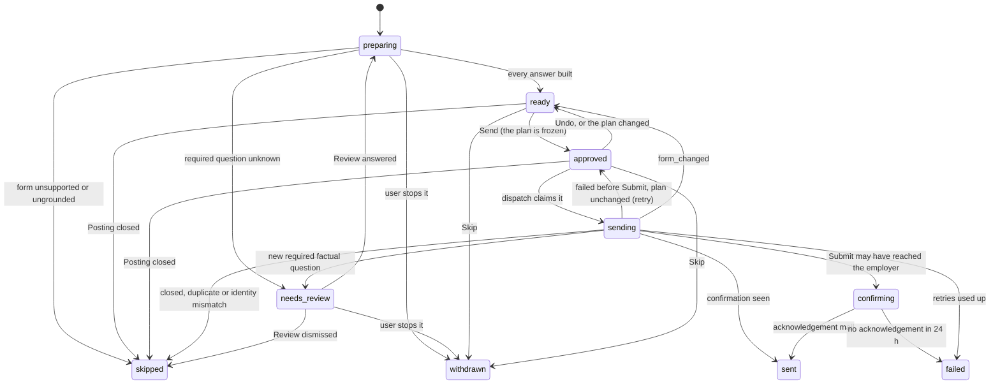

# Overture v2 — specification

Status: **rebuild direction of 2026-11-26**, owner-approved in Epic #678 and written down here by #679. It supersedes
the 2026-11-19 and 2026-11-25 text wherever they differ. Nothing is set in stone. The decisions behind this file are
ADRs in `docs/adr/`; a change to one is a new ADR first, then this file. A worker implements one ticket at a time and
must not need to ask a product question; if a ticket does need one, the gap is a spec bug: raise it on the issue
tracker, do not guess.

Companion files: `GLOSSARY.md` (words), `DESIGN.md` (appearance), `docs/adr/` (why), `docs/SALVAGE.md` (what is
ported from v1), `docs/research/*.md` (evidence). Specs and tickets for implementation live as GitHub issues.

**Words.** The banned words (`Hold` as a stage, runner, lease, provider, dispatch, attempt, ledger, credit, CAPTCHA,
Brain, Hands) never appear in anything a user can read: UI, copy, emails, push, error messages, the landing, the
admin's user-facing exports. Code uses the glossary's words for product concepts (Application, Review, Stage,
Posting) and may use precise engineering names for internals (`ledger`, `attempts`, `dispatch/`, `BrowserProvider`),
because renaming them would hide what they are.

Scale: a small side project being made into a SaaS. Prefer the simplest thing that works; no vendor outreach,
no enterprise process.

---

## 1. Product truth

Overture finds job postings through **freehire** (the only job source, §6), scores them against the user's resume,
prepares every application from the user's own facts, and sends it when you approve, through the employer's real ATS
form in a managed cloud browser (ADR 0029). Users never see a browser or a CAPTCHA.

Promises, in priority order:

1. **Never lie.** Every factual answer comes from a saved fact. The resume PDF is sent byte-for-byte unchanged.
   Cover letters and open-text answers only make claims traceable to the resume.
2. **Never embarrass.** Never apply to the current employer or a skipped company, never twice to the same role, never
   in bursts, never to a job the user did not pick.
3. **Never charge for failure.** An application uses one of "Applications left" only when it is actually sent.
4. **You pick, you approve.** The job list is the product: the user chooses which jobs Overture applies to, and no
   Application is submitted without the user's explicit approval of its exact plan (ADR 0029). Everything else is
   automatic, and the only other thing a user is asked is a factual question Overture cannot answer.
5. **Auditable.** Every sent application keeps an immutable record of the exact answers, letter, resume file and
   consent, plus a screenshot before and after Submit (ADR 0046, §16.5).

Who it is for: one person running a serious job search who will not hand-fill forms, will not let a tool invent an
answer, and wants to pick the jobs and see each application before it goes. Primary persona on the boards: a senior
backend/platform engineer in Canada searching globally. Platform: a web app installable as a PWA, phone-first for
triage (approving an application or answering a Review between meetings), desktop for reviewing proof.

Non-goals: native apps, Telegram/SMS, a user-facing live browser, real-email mode, Workday/iCIMS/Taleo,
teams/workspaces, per-user AI keys, resume generation or restyling, annual plans.

---

## 2. What exists and what is left

The 2026-11-26 rebuild is built end to end. A new account signs in (invite or public sign-up), uploads a resume,
confirms the gaps, picks freehire categories and places, gets one Claude Haiku 5.5 score per job, picks up to its
plan's limit, verifies a card or pays, lands on the Tracker, and approves every application. Each approved
application is prepared from saved facts, sent through the real ATS form by Browser Use, and recorded with
before/after Submit screenshots and a timeline.

| Area | Built |
|---|---|
| Jobs | freehire only: search, offset paging, dedupe across users, place ids, and the changes feed with an API key (§6, ADR 0047) |
| Filters | role (freehire category or title word) and place ids only, plus excluded employers and the company/repost cooldowns (§8.1) |
| AI | Claude Haiku 5.5 for every task, structured output validated by zod, one retry then rejected; Message Batches API wherever the answer is not needed live (§8.6, ADR 0044) |
| Matching | one job per scored call, stored once, band-first order, "Scoring…" until a stored score exists (§8.2, ADR 0045) |
| Onboarding | five resumable steps: sign in, resume, fill the gaps, preferences, matches and plan (Free trial 3, Weekly 50, Monthly 250) (§15) |
| Sending | the user approves each frozen plan; approved sends go at once, 5 minutes apart for one person's paid sends, the trial's three in parallel, daily cap 10 (ADR 0046) |
| Pages | Home · Tracker · Ready · Review · Matches · Inbox · Calendar · Profile · Settings, with the job drawer and workspace search (§15) |
| Mail | one apply alias per account at creation; every message stored in that person's Inbox and copied only to that person's verified login email (§7.3, §11) |
| Plans | Free trial (3, card check only), Weekly $9.99 (50), Monthly $29.99 (250), regular Stripe Billing, grants and the ledger (ADR 0018) |
| Proof | per-application timeline, before/after Submit screenshots kept 30 days, and the admin support lookup (§16.5) |

Two launch gates remain (Epic #678, Wave 5): #710 walks three people through the three plans with `OVERTURE_DRY_SUBMIT`
and stops at Submit, and #708 buys the freehire API plan and turns public sign-up on. This file describes the built
product; where a launch switch is still off, the section says so. The earlier M1–M3 scope lives in ADRs 0019, 0026,
0030 and 0031 as history; it does not describe the product.

---

## 3. System architecture

### 3.1 Deployment

```
 users (browser/PWA) ──HTTPS──▶ Cloudflare (DNS, WAF, CDN, Turnstile, Access)
                                   │ tryoverture.com, admin.tryoverture.com
                                   ▼
                     Fly app `overture-web` (yyz, ONE machine, 1 volume)
                     ┌───────────────────────────────────────────────┐
                     │ litestream replicate -exec "bun run start"    │
                     │  Bun process: Hono API · SPA static · SSE     │
                     │  scheduler · bg_jobs workers · freehire pull  │
                     │  dispatch (playwright-core over CDP)          │
                     │  /data/app.sqlite (WAL, synchronous=FULL)     │
                     │  users · applications · mail · billing        │
                     │  shared jobs · job_places from freehire       │
                     │  catalog.sqlite (legacy, read-only)           │
                     └───────────────────────────────────────────────┘
        │CDP/WSS        │HTTPS            │HTTPS          │OTLP           │S3 API
        ▼               ▼                 ▼               ▼               ▼
  Browser Use Cloud  Anthropic API    Cloudflare      Grafana Cloud      Cloudflare R2
  (Kernel fallback)  (Haiku 5.5)      Email Sending   (LGTM)             backups · files · mail
                                          ▲
  employers ──mail──▶ apply alias ──▶ Email Routing + Worker (tryoverture.com) ──signed raw MIME──▶ overture-web
```

- One Fly app, one machine, one volume. `fly scale count` stays 1. Machine: `shared-cpu-2x`, 2 GB; volume 10 GB.
  No runner app: browsers are remote.
- Same origin for API and SPA. `admin.tryoverture.com` is the same process, routed by host, behind Cloudflare Access.
- Deploys cause ~10–30 s downtime; `kill_signal = "SIGTERM"`, `kill_timeout = 300` (Fly's maximum) and Litestream's
  `-exec` wrapper are the two clocks that matter. Litestream's own `shutdown-timeout` is 280 s: it forwards the signal
  to the Bun server, waits for it to exit, then bounds its final WAL sync to R2. The app's graceful budget
  (`KILL_TIMEOUT_MS`, 240 s) fits inside that, leaving Fly ~60 s for Litestream. On `SIGINT`/`SIGTERM` it stops
  claiming new jobs, stops accepting, ends every open `/api/events` stream, waits for in-flight jobs, requeues what
  is left, flushes OTel, closes both SQLite handles, logs `shutdown: stopped in <ms>` and exits 0, with a SIGKILL
  backstop one second past the budget. An active browser send is drained rather than aborted: its browser stays open
  until the budget runs out, so a 60–180 s submission can finish and commit its ledger state. Only at the end of the
  budget does a last-resort abort close the browser, and the shutdown waits for that handler to record its
  `interrupted` attempt (outcome, credit release and next slot) before it closes the databases. A send waiting for a
  pasted or mailed verification code does not wait for the budget: the shutdown stops the paste route and the claim
  of `mail.ingest`, so that wait ends at once and the send is released as `interrupted` (no attempt used) instead of
  holding the machine for an input that cannot arrive. A send that has not reached `submit_clicked_at` when it stops
  is rescheduled; a send past it waits for its confirmation signal. Anything still open at exit is recovered by
  lease expiry (§9.4).
- After a restart the job worker stays quiet for `JOBS_STARTUP_SETTLE_MS` (5 s): the startup enqueues otherwise wake
  it in the same second the port opens and the new machine's first health checks compete with a full batch of jobs.
  Nothing is dropped; the queued work starts a few seconds later. `JOBS_AUTORUN=false` (test-only; refused in
  production) starts the process without the worker, so an e2e test can drive each job through `/__test__/jobs/*`
  without a live scheduler claiming it first.
- The job worker holds at most 10 jobs at once, with per-class limits: 3 in the browser lane (`application.send`,
  `fixtures.capture`), 3 in the LLM lane (`application.prepare`, `match.score_batch`, `resume.read`), and the rest for
  control, notification, mail, export, freehire-pull and scoring control work. A lane already at its
  limit is left out of the claim, so a stalled browser or model vendor cannot put older slow rows in front of a fast
  control, notification or mail job on the next 15 s tick; a claim also never starts more jobs than the free room.
- The prerendered marketing page (`/`; pricing is its Pricing section and the app redirects `/pricing` there, ADR 0037) is deployed as Workers Static
  Assets (`workers/marketing`, ADR 0033) on an explicit route for that path only, so it stays up through those deploys.
  Every app and API path matches no Worker route and goes straight to `overture-web`; the app's HTML and assets are
  still served by Fly (ADR 0022).
- **Where traffic comes from.** Every request that loads or submits an employer's application form comes from a
  Browser Use browser on a residential IP in the user's country, controlled by `overture-web` over CDP. For job data
  `overture-web` calls only freehire's public API (§6); it also reads the ATSes' public form pages before preparation
  and re-checks a posting's apply link just before sending (§9.3). The developer machine never contacts freehire, an
  ATS, a job site or a Browser Use session; it runs
  code and tests against the local fixture server only. Outside production the app installs an
  outbound guard (ADR 0016): a request to an ATS or paid-service host that is not a local fixture throws instead of
  leaving the machine.
- Litestream replicates `app.sqlite` continuously to R2 `overture-backups`; a nightly snapshot is kept 7 days; a
  restore drill runs in CI weekly against a throwaway machine, checks the restored file read-only and never starts
  the app server or any scheduler, worker or outbound client (issue #412). When Litestream owns the file
  (`LITESTREAM_OWNS_CHECKPOINTS=true`, set by `scripts/docker-entrypoint.sh` only on its `litestream replicate -exec`
  path), `app.sqlite` opens with `PRAGMA wal_autocheckpoint = 0`: the app never checkpoints on a writer's commit, and
  Litestream is the only checkpoint owner (PASSIVE every minute and at ~1000 pages, a blocking TRUNCATE backstop at
  ~121k pages), while the app's `journal_size_limit = 64 MB` caps the WAL file when SQLite resets the log at a
  checkpoint. A failed replica sync also defers Litestream's checkpoint, so an R2 outage grows the WAL until
  replication recovers; the volume alerts (§16.5) surface it. `bun run dev`, `bun run start` and a
  `LITESTREAM_ENABLED=false` image run `main.ts` without a replicator, so they keep SQLite's automatic checkpoint
  (1000 pages) and cannot grow the WAL.
- **Two files during the transition.** The shared freehire `jobs` and `job_places` rows live in `app.sqlite` beside
  the user rows, in the same `drizzle/` migration chain (ADR 0036, ADR 0047). They are public data written only by the
  pull and the scorer's jobs, never owned by a user: user tables keep a Posting's id as a plain logical id with no
  foreign key, and an Application copies the display fields it shows (§5.4). A job row closes; it is not deleted, so
  an Application's stored link keeps resolving. The pull's counters go to `job_pull_runs` and the event log, and the
  `jobs.pull` alert fires after repeated failures without deleting anything (§6.1).
- **`catalog.sqlite` stays as a read-only legacy read model.** The old publication path is gone (no off-box ETL,
  snapshot relay or hot-swap), and nothing writes this file. It is opened locally on boot and still answers readers
  for rows that predate freehire: the stored-match fallback, preparation/review/dispatch for Applications created
  against a catalog Posting, the demo seed and the admin reports (ADR 0036, 2026-11-27 amendment). The public
  `/api/supply` count no longer reads it: it counts the freehire `jobs` rows every new match comes from (§6). Every
  new Application comes from a freehire `jobs` row. Removing those readers, and then the file, is a follow-up once no
  catalog-backed Application remains.

### 3.2 External services and environment

| Service | Purpose | Env / secret | In tests (ADR 0013) |
|---|---|---|---|
| freehire | **the only job source** (§6): search, paging and the changes feed | `FREEHIRE_API_BASE_URL` (defaults to `https://freehire.me/api/v1`; test-only override), `FREEHIRE_API_KEY` (empty on the free plan; the API plan sets it) | recorded freehire responses and a fake `JobSource` adapter; no CI job ever calls freehire |
| Hosted ATS forms (the 28 apply systems in `src/shared/ats.ts`: Greenhouse, Lever, Ashby, Workable, Personio and the batch 1–4 boards) | the plain form read in preparation (§8.3) and the send (§10) | `GREENHOUSE_FEED_BASE_URL`, `LEVER_JOBS_BASE_URL`, `LEVER_EU_JOBS_BASE_URL`, `ASHBY_JOBS_BASE_URL`, `WORKABLE_FORM_BASE_URL`, `PERSONIO_FEED_BASE_URL` (test-only overrides of the real hosts) | local fixture server replaying recorded real pages captured by the fixture capture job and pulled with `scripts/pull-forms.ts`, recorded Lever pages plus the Ashby `ApiJobPosting` and Workable `api/v1/jobs/{shortcode}/form` shapes, and the hosted-form, wave form-reader and `batch4.test.ts` fixtures for each wave board |
| Cloudflare R2 | backups, encrypted files and mail | `R2_ACCOUNT_ID`, `R2_ACCESS_KEY_ID`, `R2_SECRET_ACCESS_KEY`, `R2_BUCKET_FILES`, `R2_BUCKET_BACKUPS`; `R2_DRILL_ACCESS_KEY_ID` and `R2_DRILL_SECRET_ACCESS_KEY` are the read-only backup pair for restore drills; `R2_ENDPOINT` overrides the endpoint for tests | disk object store adapter (real implementation, also used in local dev); the R2 adapter runs against a local S3-compatible server (`test/e2e/s3-server.ts`) |
| Cloudflare Workers Static Assets (`workers/marketing`) | the prerendered `/` page, on an explicit route for that path only (ADR 0033; the rebuild, ADR 0037, removed `/pricing`) | no secret in the app; `wrangler deploy` uses the operator's Cloudflare API token with Workers Scripts and Workers Routes edit on the zone | the real `wrangler.jsonc` route list, the app route table and the built `dist-marketing` against a stand-in origin answering 503 (`test/e2e/marketing-worker.test.ts`); `wrangler deploy --dry-run` in CI |
| Cloudflare Turnstile | bot check on auth forms | `TURNSTILE_SITE_KEY`, `TURNSTILE_SECRET`, `TURNSTILE_HOSTNAMES` (optional, defaults to the `APP_ORIGIN` **and** `ADMIN_ORIGIN` hostnames, deduplicated; production must not list localhost or 127.0.0.1) | Cloudflare's published always-pass test keys; siteverify intercepted with recorded-shape responses (`test/e2e/turnstile-gate.test.ts`) |
| Cloudflare Access | admin host gate | `CF_ACCESS_AUD`, `CF_ACCESS_TEAM_DOMAIN` (both required in production so the token's `iss` is verified), `CF_ACCESS_JWKS_URL` (optional certs-URL override; tests override the certs URL) | real verification against a test signing key |
| Cloudflare Email Routing + Email Worker + Queues | inbound mail (ADR 0028) | `INBOUND_HMAC_SECRET` (shared by the Worker and `overture-web`); the `overture-inbound-mail` and `overture-inbound-mail-dlq` queues, the `INBOUND_QUEUE` producer and `INBOUND_SPILL` R2 binding in `workers/inbound-mail/wrangler.jsonc`, with the queue names and retry policy in `src/shared/inbound-queue.ts` | the Worker's `email` and `queue` handlers run against recorded `.eml` fixtures (`test/e2e/inbound-mail-worker.test.ts`), and the queue consumer against the real app: an outage, a retry, a recovery and a redelivery store the message exactly once (`test/e2e/inbound-mail-queue.test.ts`); signed requests to the real `POST /internal/mail/inbound`; DKIM checked by `mailauth` against recorded keys |
| Cloudflare R2 `overture-inbound-mail-spill` | inbound mail over the 128 KB Queue limit (ADR 0028) | the `INBOUND_SPILL` Worker binding; objects under `spill/{reference}.eml` | a fake R2 binding in the Worker tests (put, get, delete) |
| Browser Use Cloud | primary browser | `BROWSER_USE_API_KEY`, `BROWSER_USE_API_BASE_URL` (test-only override) | `local` provider: real local Chrome filling saved forms from the fixture server (§10.5); control API from recorded responses, through the fail-closed test interceptor in-process or a local recorded fixture server for the app |
| Kernel | fallback browser | `KERNEL_API_KEY`, `KERNEL_API_BASE_URL` (test-only override) | local recorded control-API server with real local Chrome behind it; fixtures only |
| Anthropic | LLM (prod): every AI task is Claude Haiku 5.5, Batch wherever the answer is not needed live (ADR 0044) | `ANTHROPIC_API_KEY` | real adapter; API intercepted by the test interceptor with recorded responses |
| Cloudflare Email Sending | outbound mail (magic links, receipts, batched notifications) | `CLOUDFLARE_EMAIL_API_TOKEN`, `CLOUDFLARE_ACCOUNT_ID` (both or neither); `CLOUDFLARE_EMAIL_API_BASE_URL` (test-only override of the real API host) | real adapter; the send endpoint is intercepted by the test interceptor and the request body asserted (`test/e2e/cloudflare-email.test.ts`) |
| Stripe | Regular Stripe Billing | `STRIPE_SECRET_KEY`, `STRIPE_WEBHOOK_SECRET`, `STRIPE_PRICE_WEEK`, `STRIPE_PRICE_MONTH`; `STRIPE_API_BASE_URL` (test-only override of the real API host) | stripe-mock (Stripe's own local server) + signed webhook fixtures |
| Public sign-up | whether an unknown email may sign up without an invite; on by default | `PUBLIC_SIGNUP_ENABLED` (default `true`; `false` restores the invite-only gate) | public-sign-up e2e with the Turnstile stub; the invite-only suites set it `false` |
| Grafana Cloud | logs/metrics/traces | `OTEL_EXPORTER_OTLP_ENDPOINT`, `OTEL_EXPORTER_OTLP_HEADERS` | local LGTM docker |
| Web Push | notifications | `VAPID_PUBLIC_KEY`, `VAPID_PRIVATE_KEY` | real adapter; push endpoints via the test interceptor |
| Master key | envelope encryption | `MASTER_KEY_V1..V<n>` (each 32 bytes base64) and `MASTER_KEY_CURRENT=n`; the chain is contiguous and rotation re-wraps every user key (ADR 0039, `docs/DEPLOY.md`) | fixed test key |
| Google + LinkedIn (OIDC) | OAuth sign-in providers | `GOOGLE_CLIENT_ID` with `GOOGLE_CLIENT_SECRET`, `LINKEDIN_CLIENT_ID` with `LINKEDIN_CLIENT_SECRET`; each pair optional, both or neither (a half-set pair stops boot); an unset pair leaves that provider unregistered and hidden | local OIDC identity server; discovery URLs overridable via `OAUTH_GOOGLE_DISCOVERY_URL`, `OAUTH_LINKEDIN_DISCOVERY_URL` |
| Auth | better-auth sessions | `BETTER_AUTH_SECRET` (single secret) or `BETTER_AUTH_SECRETS` (`"2:<new>,1:<old>"`, current first) for non-destructive rotation, `AUTH_ALLOWED_HOSTS` | local test secret and loopback hosts |
| App | | `APP_ORIGIN=https://tryoverture.com`, `ADMIN_ORIGIN`, `MAIL_DOMAIN=tryoverture.com`, `ALIAS_EMAIL_DOMAIN` (the apply alias every account gets at creation; defaults to `MAIL_DOMAIN`), `NOTIFY_MAIL_DOMAIN=notify.tryoverture.com` (outbound transactional mail), `OWNER_EMAIL`, `FREEHIRE_API_BASE_URL`, `DATABASE_PATH=/data/app.sqlite`, `CATALOG_DATABASE_PATH=/data/catalog.sqlite` (defaults beside the application file; legacy read-only), `MAIL_FROM`, `SUPPORT_EMAIL`, `TURNSTILE_SITE_KEY`, `TURNSTILE_SECRET`, `TURNSTILE_HOSTNAMES`, `ALERT_NTFY_URL` (optional), `OVERTURE_DRY_SUBMIT` (local acceptance walk only: fills a real form, keeps the pre-Submit screenshot and stops before the click; refused in production) | |

Inbound mail is buffered on the `overture-inbound-mail` Queue (100 retries, 14-day retention) and its dead-letter queue
`overture-inbound-mail-dlq`; spilled messages live in the separate R2 bucket `overture-inbound-mail-spill` under
`spill/`, are deleted after delivery, and a 30-day lifecycle rule removes anything that never delivered. The queue and
the bucket are Worker bindings, not Fly secrets.

The service worker is served at both `/sw` and its build alias `/sw.js` with
`Cache-Control: no-cache, no-store, must-revalidate` and `CDN-Cache-Control: no-store`, so Cloudflare and the browser
always fetch the current worker rather than pinning a stale one.

All secrets are Fly secrets; local dev reads `.env` (chmod 600, never committed).
Overture's own mail (magic links, receipts, batched notifications) goes through the Cloudflare Email Sending adapter
whenever
`CLOUDFLARE_EMAIL_API_TOKEN` and `CLOUDFLARE_ACCOUNT_ID` are both set; otherwise the in-memory sink is used, which is
the test and development adapter. A half-set pair stops the server at boot. The sender is a plain `fetch` to
`POST /accounts/{account_id}/email/sending/send` under `https://api.cloudflare.com/client/v4`, with the token in a
bearer header; the research and the Beta terms are in `docs/research/cloudflare-email-sending.md` and ADR 0028.
`CLOUDFLARE_ZONE_ID` scopes the sending-domain script and guards. `REQUIRE_EMAIL_SENDING` gates the
`mail.sending` guard: unset, the check records `status: "gated"` and does not alert; set, it verifies the sending
domain and alerts while a send to a non-owner recipient would be refused.
Email Sending includes 3,000 emails a month and no Cloudflare limit covers it, so the app counts every send in
`mail_usage` (one row per UTC month and kind) before the request leaves the machine. `mail.monthly_cap` (2,700) is the
base cap and `mail.cap_per_subscriber` (250) adds one Month plan's allowance for every paying subscriber, so the cap
follows paid growth (it counts the ledger's unexpired `period` grants, never admin or trial grants); `mail.sign_in_reserve` (270) keeps the last sends for magic links, verification and resets, so a batched notice cannot starve them; a refused send fails closed like §8.6. The owner is alerted at
`mail.warning_share` (80 %) of the cap, once when notices pause at the reserve, and once when every kind of mail stops at the cap — the reserve
refusal is stamped in `reserve_refused_at` and the cap refusal in `refused_at`, so the first never hides the second.
The admin overview shows the month's count and says which of the two stops is in force. Tests reach Cloudflare only
through the fail-closed test interceptor (ADR 0013, 0016).
Encrypted files stay in Cloudflare R2 (`R2_BUCKET_FILES`) through the R2 object store adapter whenever the bucket and the R2 credentials are set; they are sealed per user. The disk object store on `/data/objects` (`OBJECT_STORE_ROOT`) remains the default for local dev and tests. A half-set R2 files config stops the server at boot. `scripts/move-objects-to-r2.ts` copies the files that were already on the volume and verifies each sha256, and leaves the local files in place for the operator to delete.
Billing is on only when `STRIPE_SECRET_KEY` and `STRIPE_WEBHOOK_SECRET` are both set; a half-set pair stops the server at boot and with neither the app boots with billing off. `POST /webhooks/stripe` verifies the `Stripe-Signature` header (HMAC-SHA256 over the timestamped raw body, five-minute window) before it reads or writes any billing row, and a bad or stale signature is refused with 400. `STRIPE_PRICE_WEEK` and `STRIPE_PRICE_MONTH` name the Stripe prices a Checkout session sells; a missing one answers 503 `billing_not_configured` without a Stripe call, and a second Checkout while the account's subscription has not ended answers 409 `plan_active` (with the stored plan and status) before any Stripe call, so nobody is billed twice. What each plan buys is configuration in `src/server/billing/plans.ts`: Week 50 Applications over 7 days, Month 250 over 30 days (ADR 0018); the price itself lives in Stripe and reaches Overture only as a price id. `invoice.paid` grants its period and clears a `plan_ended` or `payment_failed` pause; `invoice.payment_failed` sets `payment_failed` at once, unless the failed invoice's period is older than the subscription's current period, so a stale out-of-order delivery cannot pause a paid user. Each transition writes one `paused` notification (pushed to the user's devices) and one email naming the fix in Settings (`Choose a plan` and `Update payment` link to `/profile/billing`, and never the word `failed`), and a repeated event writes nothing twice. A grant's period end is the plan end: after the expiry sweep leaves the user with no unexpired grant, sending pauses with `plan_ended`. The demo account is never paused, granted or notified, and its billing mutations answer `403 demo_locked` before any Stripe call; `GET /api/billing` stays open to it so the showcase Billing screen renders.

### 3.3 Domains and DNS

- `tryoverture.com` is registered (Cloudflare Registrar, owner's account).
- `tryoverture.com`: app, marketing, Overture's own mail (`no-reply@` sent through Cloudflare Email Sending from the
  `cf-bounce` sending setup; `hello@` forwarded to the owner by Email Routing), and every account's apply alias
  `<handle>@tryoverture.com` (ADR 0040). MX → Cloudflare Email Routing, whose catch-all goes to the Email Worker.
  Email Sending adds its bounce MX, SPF and DKIM on
  `cf-bounce.tryoverture.com`; Email Routing keeps the apex MX and SPF include, and DMARC stays
  `p=reject; rua=…`.
- `mail.tryoverture.com` is not used (it was the ADR 0005 job-search address domain).
- `admin.tryoverture.com`: Cloudflare Access application (owner identity only).

---

## 4. Tech stack and repository

| Layer | Choice |
|---|---|
| Runtime | Bun 1.4.5 (pinned in `package.json`, CI and the Dockerfile), strict TypeScript (`bun check` for typecheck) |
| HTTP | Hono + `@hono/zod-validator`; Zod on every input, webhook and env var |
| DB | `/data/app.sqlite` (ADR 0036, ADR 0047): user, job-queue and shared freehire job data in `jobs`/`job_places` (WAL, `synchronous=FULL`, Litestream; `wal_autocheckpoint=0` only while the container runs it, so Litestream owns the checkpoints), `foreign_keys=ON` and STRICT; plus `/data/catalog.sqlite`, the read-only legacy read model, with its own `drizzle-catalog/` migrations and SQLite's checkpointing, never replicated. Drizzle ORM + drizzle-kit with `drizzle/` and `drizzle-catalog/`; no SQLite-only SQL outside `server/platform/search` |
| Auth | better-auth (Google, LinkedIn OIDC and magic link; no passwords, ADR 0035; passkey for admin) with Drizzle adapter |
| Web | Vite 8, React 19, React Router 8 (library mode, Zod-typed search params), TanStack Query, `fetch` + Zod response schemas, Tailwind v4, shadcn/ui, 21st.dev, dnd-kit, lucide |
| Browser control | `playwright-core` `chromium.connectOverCDP` |
| PDF | `unpdf` text extraction; Claude Haiku 5.5 reads the key facts (§7.2) |
| Mail | `mailparser`, `mailauth` (SPF/DKIM/DMARC verification), Cloudflare Email Sending over a small `fetch` to its REST endpoint |
| Telemetry | OpenTelemetry SDK (traces, metrics, logs) → OTLP |
| Lint/format | oxlint, every category at error + type-aware (`oxlint-tsgolint`), from Landmines' own configuration, plus `@interfere/landmines`, vendored anti-slop, React / `jsx-a11y` / Vitest plugins and architecture rules (ADR 0023), with the Cloudflare preset rules; `bun lint` runs Oxlint with `--deny-warnings`; `bun fmt` formats |
| Tests | Playwright e2e (sharded), `bun test` for the ADR 0013 invariant files, a fail-closed test interceptor at the network edge (§16.1–16.2) |

```
src/
  shared/            zod schemas, enums, fact catalog, freehire categories and places, copy strings, API types
  server/
    platform/        db, migrations, queue, sse, crypto, telemetry, settings, kill-switches, ports/*
    auth/            better-auth config, invites/allowlist, sessions
    jobs/            the JobSource port, freehire client, pulls, store, reader, language, filter proof
    catalog/         legacy read-only catalog readers and shared question/geo helpers
    places/          canonical place ids, resolvers, autocomplete
    profile/         facts, resume, targets, excluded employers, apply alias
    pipeline/        preparation, reviews, check-ins, applications, stages
    matching/        score prompt and store, code pool, band-first sort, Matches page
    dispatch/        scheduler, limits, browser providers, executor, ats flows, attempts
    billing/         ledger, grants, plans, stripe
    inbox/           ingest, linking, codes, classification, outbound
    notify/          push, batches, in-app notifications
    admin/           admin routes, reveal, audit
    app.ts           Hono app composition (host routing: app vs admin)
    main.ts          process entry: http + workers + scheduler, graceful shutdown
  web/               React app (routes/, features/, components/ui = shadcn)
drizzle/             generated migrations
scripts/             filter-proof.ts, census.ts, eval-match-scoring.ts, eval-resume-facts.ts, pull-forms.ts, restore-drill.ts
test/e2e/           Playwright `*.test.ts` flows, fixture server, interceptor handlers and recordings, `*.test-utils.ts`
                     (the colocated unit tests sit beside their code as `*.test.ts`, per Landmines `colocated-tests`)
tools/oxlint/        vendored anti-slop plugin
```

No comments in source (Landmines `no-comments`; TSDoc on exported port interfaces is the one exception).

### 4.1 Ports (every external dependency)

```ts
interface LlmPort { complete<T>(req: LlmRequest<T>): Promise<LlmResult<T>>; batch<T>(reqs: LlmRequest<T>[]): Promise<BatchHandle> }
interface JobSource { search(q: JobSearchQuery): Promise<JobSearchPage>; changes?(o: { cursor?: string | null; since?: number | null }): Promise<JobChangePage>; getJob?(publicSlug: string): Promise<FreehireJobRecord | null> }
interface BrowserProvider { id: "browser_use" | "kernel" | "local"; open(o: { profileId: string | null; country: string; timeoutMinutes: number; attemptId: string; mode?: "headless" | "stealth" }): Promise<RemoteBrowser>; listOpen(): Promise<{ sessionId: string; attemptId: string | null }[]>; stop(sessionId: string): Promise<void>; sessionUsage(sessionId: string): Promise<{ status: "active" | "stopped"; usage: UsageReport } | null>; ensureProfile(userId: string, country: string): Promise<string>; deleteProfile(profileId: string): Promise<void> }
interface RemoteBrowser { cdpUrl: string; sessionId: string; close(): Promise<UsageReport> }
interface MailSender { sendRaw(m: OutboundMime): Promise<{ providerMessageId: string }> }
interface ObjectStore { put(k: string, b: Uint8Array, meta?): Promise<void>; get(k: string): Promise<Uint8Array | null>; delete(k: string): Promise<void>; list(prefix: string): AsyncIterable<string> }
interface Payments { createCheckoutSession(req: { userId; email; customerId: string | null; plan: "week" | "month"; priceId; successUrl; cancelUrl }): Promise<{ id; url }>; createPortalSession(req: { customerId; returnUrl }): Promise<{ id; url }>; verifyWebhook(payload: string, signature: string | null): Promise<PaymentEvent> }
interface PushSender { send(sub: PushSubscription, payload: PushPayload): Promise<"ok" | "gone"> }
interface Clock { now(): number }
```

Domain code imports ports only (enforced by `no-restricted-imports`). Each port has its production adapter and, where
a real local equivalent exists, a local adapter (`local` browser, disk object store) used in development and tests. No
port has a hand-written fake (ADR 0013). `Clock` reads system time plus an offset that only a test-only route, never
mounted in production, can move; a second test-only route runs every job that is due.

---

## 5. Data model

Conventions: ids are ULID `TEXT`; timestamps are `INTEGER` ms since epoch UTC; booleans `INTEGER 0/1`; money in
minor units `INTEGER`; enums are `TEXT` with `CHECK`; every table `STRICT`; every user-owned row has
`user_id … REFERENCES users(id) ON DELETE CASCADE`. Columns ending `_enc` are AES-256-GCM ciphertext under the user's
data key (§13.2). Drizzle schema in `src/server/**/schema.ts` is the source of truth; this section is its contract.

User data never depends on the shared job rows: `applications`, `matches`, `posting_user_state` and `skip_companies`
keep `posting_id` / `company_id` as plain logical ids with no foreign key into `jobs`, and every Application carries
its own copy of the posting and company display fields (§5.4). Tracker, Ready, Home, Inbox, Calendar, Notifications,
the cost report and the account export therefore never change when a job closes or freehire rewrites it. Preparing a
form, sending an Application, scoring and review attachment read the live `jobs` row, because they act on a Posting
that must still be open; an Application created before the freehire switch reads its retained catalog Posting the same
way. `bun run db:verify` fails if a user table ever grows a foreign key into `jobs`.

### 5.1 Auth (better-auth managed)

`user` (id, name, email UNIQUE, email_verified, image, role CHECK IN ('user','owner'), suspended_at, created_at,
updated_at, mailbox UNIQUE — generated: Gmail dots and `+tag` removed, `googlemail.com` folded to `gmail.com`, every
other address only lowered and trimmed) · `session` · `account` (provider: google, linkedin, credential) · `verification` · `passkey` (owner only)
· `invites` (id, email_hash UNIQUE, email_enc NULL, invited_by, created_at, accepted_at, accepted_user_id NULL, revoked_at NULL, grant_id NULL) — the owner allowlist is `OWNER_EMAIL`; with public sign-up on anyone may join, with it off only invites may (§13.1); an invite still issues its admin grant on first verified sign-in. The invited email is stored hashed and shown to the owner as typed only in the admin, from an encrypted copy sealed under the inviter's data key.

### 5.2 Profile

| Table | Columns |
|---|---|
| `user_keys` | user_id PK, wrapped_dek BLOB, master_key_version INTEGER, created_at. **Deleting this row is crypto-shredding.** |
| `profiles` | user_id PK, running, pause_reason CHECK IN ('user','onboarding','no_resume','plan_ended','payment_failed','suspended','no_mailbox') NULL, timezone (IANA, taken from the browser at sign-up; the first zone saved applies at once; a later change is stored in pending_timezone with pending_timezone_at = now + `limits.timezone_change_days` (7) and the current zone stays in force until then; every read of the zone applies a due pending change first, through one function), pending_timezone, pending_timezone_at, languages TEXT JSON (ISO 639-1), onboarding_step, onboarded_at, use_personal_email DEFAULT 0 (§7.3), digest_enabled DEFAULT 1, push_prompted_at, consent_version, consent_at, created_at, updated_at. `running` and `pause_reason` start at 0 / `onboarding`, so nothing is sent before onboarding ends; finishing onboarding (the plan step, or the no-card finish) sets `running = 1` and clears the reason (ADR 0046). `POST /api/running {running:true}` clears a `user` pause, and setting `running:false` records `user`. The billing lifecycle owns two more reasons: a plan end sets `plan_ended` and a failed payment sets `payment_failed` (both `running=0`), each announced once by push and email with its fix, and a later successful payment clears only one of those two reasons and starts sending again. `consent_version` defaults to the published `1` (migration 0038); `consent_at` is set only when the user accepts the consent at /consent, and the accepted version stays on the profile when a later version is published |
| `facts` | id, user_id, key, scope ('' or an ISO 3166-1 alpha-2 country), value_enc, source CHECK IN ('resume','user','review','import'), confirmed, revision, updated_at; UNIQUE(user_id,key,scope). Keys from the fact catalog (§7.1) or `q:<question_id>` for learned answers. `work_auth` and `sponsorship_required` are country-scoped; every other key has `scope=''` |
| `targets` | user_id PK, roles JSON (freehire category ids, plus optional title words as typed), unresolved_roles JSON (legacy values the boot pass could not map), places JSON (place ids from freehire's place lists, including the `Remote · …` scopes), unresolved_locations JSON (values the picker could not resolve), version INTEGER, updated_at. These are the only two hard filters (ADR 0045, §8.1); excluded employers live in `skip_companies` |
| `skip_companies` | id, user_id, company_id NULL (a plain logical id: no foreign key to `jobs`, so a closed or rewritten job keeps the skip), name, name_norm, domain NULL, reason CHECK IN ('current_employer','user'), created_at; UNIQUE(user_id,name_norm). Matching rules in §8.1 |
| `resumes` | id, user_id, object_key, sha256, bytes, pages, filename_enc, text_enc, parsed_with CHECK IN ('unpdf','llm'), extracted JSON NULL (the AI reader's structured result, §7.2), is_current, uploaded_at; partial UNIQUE(user_id) WHERE is_current=1 |
| `browser_profiles` | user_id, provider, provider_profile_id, country_code, created_at, last_used_at; PK(user_id, provider) |
| `mailboxes` | id, user_id UNIQUE, apply_address (the full `<handle>@ALIAS_EMAIL_DOMAIN`, stored not derived), local_part UNIQUE (the alias handle), status CHECK IN ('active','receive_only','closed'), receive_until NULL, first_message_at NULL (set once by the first message that arrives), created_at. Provisioned in the transaction that creates the account (§7.3, ADR 0040) |
| `retired_addresses` | local_part PK, retired_at — **a local part is never reassigned** |
| `account_erasures` | user_id PK (**no foreign key**: it outlives the `users` row), vendor_profiles JSON (`[{provider, providerProfileId}]`, shrinks as each is deleted), object_prefixes JSON, notice_name NULL, notice_to NULL, user_deleted_at, vendor_cleaned_at, objects_cleaned_at, notice_queued_at, last_error NULL, created_at, updated_at. The durable plan for one erasure: written in the transaction that deletes the account, so the vendor ids and prefixes survive the `browser_profiles` cascade; `notice_name`/`notice_to` are wiped as soon as the confirmation notice is queued |

### 5.3 Jobs

Every row in `jobs` is one **freehire job record** (§6): the table, its columns, its categories and its places follow
freehire's shape, not the retired feed shape, and every new job is read from here (ADR 0047). Jobs are public data,
shared by every user, and written only by the freehire pull and the scorer. `job_places` holds the
canonical place ids both a saved target and a job speak (§6.4, ADR 0048). `questions` and `question_variants` stay
shared across users and are never tied to one job.

| Table | Columns |
|---|---|
| `jobs` | id (the freehire `public_slug`), source (one of the 28 apply systems in `src/shared/ats.ts`), freehire_source, external_id, board_token, ats_job_id, url NULL, apply_url, apply_via CHECK IN ('direct','go'), title, title_norm, company, company_norm, company_slug NULL, location_raw NULL, countries JSON, regions JSON NULL, metros JSON NULL, cities JSON NULL, work_mode CHECK IN ('remote','hybrid','onsite') NULL (null when freehire is blank: **never guessed**), category NULL (freehire category id), language NULL (ISO 639-1, detected from the description, null when too short or ambiguous), seniority NULL, employment_type NULL, experience_years_min NULL, skills JSON NULL, salary_min NULL, salary_max NULL, salary_currency NULL, salary_period CHECK IN ('year','month','day','hour') NULL, description NULL, description_hash NULL, posted_at, source_created_at, source_updated_at, first_seen_at, last_seen_at, closed_at NULL, status CHECK IN ('open','closed') DEFAULT 'open', fake_freshness INTEGER DEFAULT 0 (freehire's re-post flag), repost_count NULL, age_days NULL, dedupe_key, created_at, updated_at; UNIQUE(source, external_id); INDEX(dedupe_key); INDEX(status, posted_at); INDEX(category, status) |
| `job_places` | job_id, place_id (a canonical freehire place id: `country:`, `region:`, `metro:` or `city:`, plus `remote:country:`, `remote:continent:` and `remote:worldwide`), kind CHECK IN ('country','region','metro','city','remote_country','remote_continent','remote_worldwide'); PK(job_id,place_id); INDEX(place_id,job_id). Both sides of a location match read the same ids (§6.4, #683) |
| `job_pull_state` | user_id PK, last_full_pull_at NULL, last_fresh_pull_at NULL, last_query_key NULL (the roles and places the last search used), updated_at. A changed query key makes the next pull a full one (§6.2) |
| `job_pull_runs` | id, group_key, mode, user_count, fetched, kept, dropped_closed, dropped_duplicate, dropped_no_link, dropped_unsupported, error NULL, started_at, finished_at NULL; INDEX(group_key, started_at). One grouped pull's counters (§6.1) |
| `questions` | id, text_display, text_norm_hash UNIQUE, field_type CHECK IN ('text','textarea','select','multiselect','radio','checkbox','file','date','number','email','phone','url'), options_hash NULL, fact_key NULL (a fact key, or a derivation key for `target`/`derived`), answer_kind CHECK IN ('fact','target','derived','open_text','consent','skip','unknown'), mapped_by CHECK IN ('rules','llm','owner'), seen_count, created_at |
| `question_variants` | variant_hash PK, question_id |

**Legacy catalog (read-only).** `catalog.sqlite` keeps the pre-freehire tables read-only: `companies`,
`company_boards`, `postings`, `posting_questions`, `posting_tags`, `posting_locations`, `supply_facets` and `geo_places`.
No new row is written there. They answer the stored-match fallback for old Applications, preparation and review for an
Application created against a catalog Posting, the demo seed and the admin reports; `supply_facets` is the retired
`/api/supply` rollup, which nothing rebuilds or reads now that the public count follows freehire `jobs` (#742). The
retired role taxonomy survives only as the one-time boot migration of saved targets and the legacy catalog label
bridge; no matching path reads it for new jobs. Removing these readers and the file is a follow-up once no
catalog-backed Application remains (ADR 0036, 2026-11-27 amendment).

A Posting carries no role label, no tag source and no tag import: freehire supplies its category, seniority, work mode,
places, skills and salary, and Overture never invents the ones freehire leaves blank. A job row closes on a change
feed or a liveness read; it is **never deleted**, so an Application's stored link keeps resolving (ADR 0047). A
description change rewrites the description and its hash and queues one rescore; nothing else about the row changes
under a user.

### 5.4 Pipeline

| Table | Columns |
|---|---|
| `matches` | user_id, posting_id, code_rank, score NULL, reason NULL, scorer_version, resume_id, targets_version, role_fit, skills, level, logistics, blockers JSON, reasons JSON, posted_at, exact_role, company_key, description_hash, scored_at; PK(user_id,posting_id). A score is computed once per (posting, resume, targets, scorer version), stored, and never re-rolled on page load (ADR 0045); `score` is NULL until a real score exists, and the sub-scores, blockers and reasons are what the drawer and the Matches page show. `posting_id` is a plain logical id: no foreign key to `jobs` |
| `posting_user_state` | user_id, posting_id, state CHECK IN ('saved','hidden'), updated_at; PK(user_id,posting_id). `posting_id` is a plain logical id: no foreign key to `jobs` |
| `catalog_posting_flags` | posting_id PK, flag_reason CHECK IN ('unsupported_login_required','employer_form_failed'), fail_count, updated_at. Runtime state so a freehire rewrite never records a failure: a login wall flags the Posting on the first failure, a changed or broken employer form on the second, and a flagged Posting is skipped by candidate matching |
| `onboarding_batches` | id, user_id UNIQUE, plan_kind CHECK IN ('free_trial','week','month') NULL, status, failure_reason NULL, created_at, updated_at. One durable onboarding batch per account, written before the Stripe card check; a refresh, second tab or repeated return reuses it (#687) |
| `onboarding_picks` | id, user_id, posting_id, application_id NULL (set when preparation creates its one Application), status, status_reason NULL, company_id, company_name, company_name_norm, company_domain NULL, posting_title, posting_url, apply_url NULL, ats NULL, location_raw NULL, salary_currency NULL, salary_min_minor NULL, salary_max_minor NULL, salary_period NULL, created_at, updated_at; UNIQUE(user_id,posting_id). The employer, title and link snapshot keep a pick meaningful when its job closes during Checkout (#687) |
| `applications` | id, user_id, posting_id, company_id, ats NULL (one of the 28 `ATS_VALUES` registry keys, or NULL for an unknown board), company_name, company_name_norm, company_domain NULL, posting_title, posting_url, apply_url NULL, location_raw NULL, salary_currency NULL, salary_min_minor NULL, salary_max_minor NULL, salary_period CHECK IN ('year','month','hour') NULL, origin CHECK IN ('pick','manual'), status CHECK IN ('preparing','needs_review','ready','approved','sending','confirming','sent','failed','skipped','withdrawn'), status_reason NULL (§11), stage CHECK IN ('queued','ready','applied','screening','interviewing','offer','closed') NULL, stage_locked INTEGER DEFAULT 0, board_position REAL, score_at_queue, scheduled_for NULL, attempts INTEGER DEFAULT 0, ready_at NULL, approved_at NULL, approved_plan_sha256 NULL, approved_plan_enc NULL (the frozen send plan, sealed; §8.7), changes JSON NULL (what changed since the last approval, shown on the card), sent_at NULL, closed_reason CHECK IN ('rejected','no_response','withdrawn','offer_declined','offer_accepted','other') NULL, created_at, updated_at; UNIQUE(user_id,posting_id); partial UNIQUE(user_id) WHERE status='sending'. **Self-contained**: `posting_id` and `company_id` are logical ids (no foreign key to `jobs`), and the display fields (`ats` … `salary_period`) are an immutable copy taken from the Posting when the Application is created, so a job closing or being rewritten never changes what the Tracker, Ready, Home, Inbox, Calendar, the cost report or the account export show. Migration `0056_snapshot_decouple` backfills them for existing rows and uses "Unknown company" / "Unknown role" when the job row is already gone. Where the copy is empty (an Application whose Posting is no longer stored), `ats` is NULL and readers show "unknown". `withdrawn` applies only before `sent` (the user stops a queued application, or presses Skip on a Ready card); a sent application cannot be un-sent, so the user moves it to Closed with `closed_reason='withdrawn'` |
| `application_snapshots` | application_id PK, user_id, posting_url, posting_title, description_hash, answers_enc (JSON array `{question_id, label, answer, fact_key, fact_revision, kind, resume_line_ids, by_user}`), cover_letter_enc NULL (JSON `[{sentence, resume_line_ids, by_user}]`), resume_id, resume_sha256, consent_version, approved_at, approved_plan_sha256, provider, provider_session_id, submitted_at, confirmed_by CHECK IN ('page','email'), cost_micros. **Immutable**: a `BEFORE UPDATE` trigger always raises; a `BEFORE DELETE` trigger raises `WHEN EXISTS (SELECT 1 FROM user WHERE id = OLD.user_id)`, so rows go only when the user row is gone (account deletion cascade). Flow 29 proves both |
| `application_answers` | id, application_id, question_id, user_id, kind CHECK IN ('open_text','cover_letter','fact'), sentences_enc (JSON `[{sentence, resumeLineIds, byUser?}]`, sealed; a `fact` row holds the person's plain answer as one sentence), word_count, created_at, updated_at; UNIQUE(application_id,question_id). The generated, grounded open text and letter kept from preparation until the Snapshot takes them, and a Review answer the person chose not to reuse; `byUser: true` marks text the user edited on the card, which preparation keeps |
| `application_events` | id, application_id, user_id, at, kind CHECK IN ('status','stage','email','checkin','note'), from_value, to_value, source CHECK IN ('system','user','email','checkin','admin'), detail JSON; the card timeline and stage history |
| `application_receipts` | application_id PK, message_id, confirmed_at; UNIQUE(message_id). The one authenticated message that confirmed the Application; one message is the receipt for at most one Application, so it can never commit a second credit |
| `attempts` | id, application_id, user_id, n, provider, provider_session_id, started_at, lease_until, ended_at NULL, submit_clicked_at NULL, submit_response_status INTEGER NULL, outcome CHECK IN ('sent','unconfirmed','captcha_blocked','code_timeout','posting_closed','form_changed','blocked','upload_failed','duplicate','needs_review','provider_error','timeout','crash','interrupted') NULL, browser_ms, proxy_bytes, captcha_seen, code_used, cost_micros, error_code NULL |
| `attempt_screenshots` | id, attempt_id, user_id, application_id, phase CHECK IN ('before_submit','after_submit'), object_key, bytes, taken_at, expires_at. Sealed per user, deleted 30 days after `taken_at` by `maintenance.retention`, and removed with the account's objects on erasure (§16.5) |
| `reviews` | id, user_id, question_id, fact_key NULL, scope ('' or an ISO 3166-1 alpha-2 country), prompt, field_type, options JSON, reason CHECK IN ('unknown_required','option_missing'), attempt_id NULL (the attempt whose live-form check opened it), status CHECK IN ('open','answered','dismissed'), created_at, resolved_at; UNIQUE(user_id,question_id,scope) WHERE status='open' |
| `review_applications` | review_id, application_id; PK(review_id,application_id) |
| `review_audit_events` | id, user_id, at, kind CHECK IN ('review_opened','review_resolved','auto_answer','snapshot_sent'), application_id NULL, review_id NULL, question_id NULL, ats NULL (an `ATS_VALUES` registry key), source NULL CHECK IN ('fact','target','derived','consent','file','open_text'), fact_key NULL, fact_revision NULL, scope, detail JSON; INDEX(user_id,at), INDEX(kind,at). Append-only by code: every Review opened and resolved, every automatic answer with its source, and every Snapshot sent. The owner's Review-rate and false-answer reports read it (§8.4) |
| `checkins` | id, application_id UNIQUE, user_id, due_at, status CHECK IN ('open','answered','expired'), answer CHECK IN ('rejected','interviewing','still_waiting') NULL, created_at |
| `interview_events` | id, user_id, application_id, message_id, uid, sequence DEFAULT 0, starts_at, ends_at NULL, tz NULL, source CHECK IN ('ics'), created_at; UNIQUE(user_id,uid), INDEX(user_id,starts_at), INDEX(message_id). The interview date parsed from a `text/calendar` attachment on forwarded ATS mail (ADR 0034); `tz` is the IANA `TZID` when `DTSTART` carried one, and a higher `sequence` replaces the row for the same `uid`, while `METHOD:CANCEL`/`STATUS:CANCELLED` deletes it. Mail body text is never parsed |
| `calendar_feed_tokens` | id, user_id UNIQUE, token_hash UNIQUE (SHA-256 hex of the URL token; the token itself is never stored), created_at, rotated_at. One row per user with the feed on; turning it off deletes the row (ADR 0034) |
| `calendar_custom_events` | id, user_id, day_key (`YYYY-MM-DD`, a local day), kind CHECK IN ('interview','followup','reminder'), title, company DEFAULT '', time (`HH:MM`, NULL for all-day), created_at, updated_at; INDEX(user_id, day_key). The interviews, follow-ups and reminders a person adds to their own Calendar (H6): server-backed so they never leak across accounts on one browser, and read into the `.ics` feed, the export and account erasure |
| `support_tickets` | id, user_id, reference_id UNIQUE, category CHECK IN ('account','billing','bug','other'), subject, message_enc (sealed with the person's key), status CHECK IN ('open','in_progress','resolved','closed') DEFAULT 'open', admin_notes NULL, created_at, updated_at, resolved_at NULL; INDEX(user_id, created_at), INDEX(status, created_at). One row per support request for the Admin Portal Support Queue (ADM-2, M5); the sender's address is read from `users`, never stored twice |
| `plan_cache` | id, ats, form_signature, plan JSON (`{readPath, questions}`; each question carries its shared `question_id`, label, field name, type, options, required and position), hits, failures, updated_at; UNIQUE(ats,form_signature). `hits` counts preparations served from the cache; `failures` counts a cached plan that no longer matched the live form or whose questions no longer exist. It never holds answers: they are rebuilt per user from Facts and Targets |
| `consent_versions` | version PK (a whole number as text), text, published_at — the exact consent wording each `consent_version` refers to. Rows are never edited: publishing a version appends the next number with its text and date (`scripts/publish-consent-version.ts`), so an accepted version and every Snapshot keep the wording and version they were made under. Version 1 is seeded by migration 0038; version 2 (billing) by migration `0048_consent_v2` |

### 5.5 Inbox

| Table | Columns |
|---|---|
| `mail_threads` | id, user_id, application_id NULL, subject_enc, employer_started, last_message_at |
| `messages` | id, thread_id, user_id, mailbox_id, direction CHECK IN ('in','out'), rfc_message_id, in_reply_to NULL, sender_domain, auth CHECK IN ('pass','fail','none'), from_enc, to_enc, subject_enc, text_enc, html_object_key NULL, snippet_enc, classification CHECK IN ('ack','code','rejection','screening','interview','offer','other') NULL, code_consumed_at NULL, read_at NULL, out_status CHECK IN ('queued','sent','bounced','failed') NULL, provider_message_id NULL, created_at; UNIQUE(mailbox_id, rfc_message_id) |
| `message_attachments` | id, message_id, filename_enc, mime, bytes, object_key |
| `code_waits` | id, user_id, mailbox_id, attempt_id NULL (no foreign key until the attempts slice links it), started_at, expires_at, resolved_at NULL, resolved_by CHECK IN ('mail','paste') NULL, resolved_message_id NULL, code_enc NULL |
| `mail_suppressions` | address_hash PK, reason CHECK IN ('bounce','complaint'), created_at |

### 5.6 Billing

| Table | Columns |
|---|---|
| `customers` | user_id PK, stripe_customer_id UNIQUE, created_at, updated_at |
| `subscriptions` | id, user_id, stripe_subscription_id UNIQUE, plan CHECK IN ('week','month'), status, current_period_start, current_period_end, cancel_at_period_end, updated_at |
| `grants` | id, user_id, source CHECK IN ('trial','period','admin'), quantity, starts_at, expires_at, stripe_invoice_id UNIQUE NULL, created_at |
| `ledger` | id, user_id, kind CHECK IN ('grant','reserve','commit','release','expire','refund','adjust'), debit_account, credit_account, amount CHECK (amount > 0), grant_id, application_id NULL, idempotency_key UNIQUE, created_at. **Each row is one balanced transfer**, so the ledger is zero-sum by construction. No UPDATE/DELETE (triggers). |
| `stripe_events` | id PK (Stripe event id), type, received_at, processed_at NULL |
| `billing_reconciliations` | day PK (UTC date), status CHECK IN ('clean','mismatch'), checked_at, window_start, window_end, stripe_invoices, stripe_refunds, ledger_grants, ledger_refunds, mismatches, detail JSON |
| `card_fingerprints` | hmac PK (HMAC-SHA256 of the Stripe card fingerprint, keyed by `CARD_FINGERPRINT_SECRET`), trial_used_at, created_at — **no foreign key**; survives account deletion |

Accounts: `issued`, `available`, `reserved`, `used`, `expired`. The same no-UPDATE rule and the same user-gone `BEFORE DELETE` condition as snapshots apply. Transfers: grant `issued→available`; reserve
`available→reserved`; commit `reserved→used`; release `reserved→available`; expire `available→expired`. Balances are
per `(user_id, grant_id, account)`. Reserve draws from the grant expiring soonest. "Applications left" =
Σ available over unexpired grants. A reservation is not a charge: an application is spent only when a send is
confirmed sent (`commit`), and any attempt that is not a confirmed send releases its reservation, so a failed
application never consumes one (§9.4). Daily usage = reservations made in the user's current local day that are still
reserved or committed (a release counts against the day its reservation was made, never against today). No separate
counters table. A grant that has carried a reserve, commit or release counts as started even when a restarted
process's clock reads before its `starts_at`, and a release is paired with its reservation by insertion order, not
`created_at`, so a hard kill cannot un-start the grant the crashed attempt was spending from or leave that
reservation open. Expiry: `expire` moves only `available`; a reservation held on a grant that expires is released
and expired in the same transaction (`release` then `expire`), so it never returns to spendable. The one
exception is a send already in flight (`sending` or `confirming`): its reservation stays across the period end,
so a confirmed send commits and is charged for what was sent, and a failed or unconfirmed one releases and is
expired by the next sweep. When the last unexpired grant ends, sending pauses with `plan_ended`.
`stripe_events` holds each signed Stripe event id once: the row is inserted, its effect applied and `processed_at`
set in one transaction, so a replay finds the row and does nothing; a bad signature never reaches the table. The
pause notice, its push and email jobs, and the planner/prep jobs a resume queues are written in that same
transaction, so a crash cannot commit the event without them and a redelivery cannot skip them. A signed
`checkout.session.completed` links `customers.stripe_customer_id` to the user named by `client_reference_id` (or
`metadata.user_id`), and `customer.created`/`customer.updated` link the same way from `metadata.user_id`.
`invoice.paid` issues the period grant: `source='period'`, the plan's quantity, `starts_at` at the invoice line's
period start and `expires_at` at its end (or at receipt and the plan's own period from receipt when the invoice names
none), and `stripe_invoice_id` the invoice id, which is also the grant's ledger idempotency key, so a replay grants
once and a renewal's new invoice issues the next period's grant starting where the old one ends. The plan comes from
the price the invoice line names, so a Week/Month switch Stripe applies at the renewal grants the new plan's quota
even while the subscription metadata still names the old one; a price Overture does not sell grants nothing instead
of borrowing that metadata, and only an event that names no price at all falls back to it. A paid period is never cut short: an upgrade from the trial grants the paid plan's Applications at once
beside the trial's, and cancelling at the period end only sets the flag below. A demo account never receives a period
grant. A signed `customer.subscription.created`, `customer.subscription.updated` or `customer.subscription.deleted`
stores the subscription in `subscriptions`: its `user_id` from the event metadata, the stored row or the event's Stripe
customer; its `plan` from the price item (a price Overture does not sell records no new plan, and only an event with no
price falls back to the metadata); its `status` verbatim; the period the event names;
and `cancel_at_period_end`. `invoice.paid` refreshes that row's plan and period too, so the state follows the invoice
when the subscription update lags. An hourly `billing.grant-expiry` pass releases a reservation still held on a grant past its period end
and then expires its available balance, so it never returns to spendable (ADR 0008); until that pass runs,
"Applications left" already ignores the ended grant.

A daily `billing.reconcile` pass, ten minutes after UTC midnight and only when billing is on, compares one UTC day
of Stripe's side with Overture's: every paid invoice Stripe reports for the day must have its period grant (matched on
`stripe_invoice_id`) and every period grant created that day must be an invoice Stripe reports; every refund Stripe
reports must be a refund Overture audited (its `admin_audit` detail carries the Stripe refund id) with its ledger
`refund` row, and every audited refund must still be at Stripe. The provider is read with six hours of slack on each
edge, so an invoice paid just before midnight and granted just after it always matches, while the day's counts stay
inside the window. The result is one `billing_reconciliations` row per day (a re-run replaces it), carrying the four
counts and the first fifty mismatches; the first run that finds a mismatch raises the `billing.mismatch` alert with
the day, the count and the kinds (a retry of the same day does not alert twice), and a clean day writes its row and
alerts nobody. The admin billing page shows the last result.

### 5.7 Platform

| Table | Columns |
|---|---|
| `bg_jobs` | id, kind, payload JSON, run_at, priority, status CHECK IN ('queued','running','done','failed','dead'), attempts, max_attempts, locked_until NULL, last_error NULL, dedupe_key UNIQUE among queued rows NULL, created_at, updated_at |
| `events` | seq INTEGER PK AUTOINCREMENT, user_id NULL, topic, payload JSON, created_at — SSE outbox, purged after 24 h |
| `notifications` | id, user_id, kind, title, body, url, created_at, read_at, pushed_at, emailed_at |
| `push_subscriptions` | id, user_id, endpoint UNIQUE, p256dh, auth, created_at, last_ok_at |
| `settings` | key PK, value JSON, updated_at, updated_by — admin-tunable limits (§12) |
| `kill_switches` | scope CHECK IN ('global','ats','employer','provider'), key, enabled, reason, set_by CHECK IN ('auto','owner'), set_at; PK(scope,key) |
| `llm_usage` | id, user_id NULL, purpose, model, input_tokens, cached_tokens, output_tokens, cost_micros, created_at |
| `llm_batches` | id, input_revision_hash UNIQUE (sha256 of the model and the request set), model, batch_id NULL, status CHECK IN ('creating','in_progress','applied','failed'), results JSON NULL, result_applied_at NULL, expires_at NULL, last_polled_at NULL, last_error NULL, created_at, updated_at |
| `fx_rates` | date, currency, per_usd REAL; PK(date,currency) |
| `admin_audit` | id, at, actor_id, action, target_user_id NULL, reason, detail JSON — also shipped to Loki (off-box, append-only) |

The `bg_jobs` claim query reads only queued and running rows through the partial index `bg_jobs_claim_due` on
`(status, run_at)` where `status IN ('queued','running')`, so a long lifetime history of done and dead rows is never
scanned on a tick.

Retention: `events` 24 h; `bg_jobs` done 7 days, dead 30 days; `attempts` 180 days; `llm_batches` applied or
failed 30 days; `llm_usage` 400 days;
`notifications` 90 days; messages for account lifetime; `review_audit_events` and Snapshots for account lifetime (the
audit is only useful across a search). Job rows close and are never deleted (ADR 0047).

---

## 6. Jobs: the freehire job source

### 6.1 One source

**freehire is the only job source** (#700). Overture reads jobs from freehire's search API and nowhere else: it does
not discover boards or poll an ATS job feed, and the old catalog publication path (off-box ETL, snapshot relay,
hot-swap) is gone. `catalog.sqlite` remains only as the read-only legacy read model for rows that predate freehire
(§3.1, §5.3); no new job comes from it. The ATS list in `src/shared/ats.ts`
is kept for one thing only: the 28 job systems Overture can actually fill, and per-system apply adapters (§10).

| Concern | Rule |
|---|---|
| Endpoint | `https://freehire.me/api/v1/jobs/search` behind the `JobSource` port (§4.1); comma-separated multi-values, `sort=created_at&order=desc`, `limit=100` with offset paging (offset + limit ≤ 10,000) |
| Auth | keyless while only the owner tests; the API plan ($29/month) sets `FREEHIRE_API_KEY` at launch (#708) |
| Pace | at most 2 requests a second; retry with backoff on 429 and 5xx |
| Sources kept | only the 28 systems with an apply adapter (`zohorecruit` → `zoho_recruit`, `join` → `join_com`, `isolvedhire` → `isolved_hire`, …); a job in any other system is dropped |
| Apply link | saved once per system: Lever `https://jobs.lever.co/<board>/<id>/apply`, Greenhouse `https://job-boards.greenhouse.io/<board>/jobs/<id>`, Ashby `https://jobs.ashbyhq.com/<board>/<id>`; everything else the target of `/api/v1/go/<public_slug>` followed once without redirecting and with `utm_*` stripped. A blank or missing `apply_url` falls back to the go link |
| Board token | the part of `external_id` before `:`, so an adapter reaches the real board |
| Stored | freehire's job record: `public_slug`, source, `external_id`, title, description, category, seniority, work mode, countries, regions, metros, cities, skills, salary and `reality.fake_freshness`. Work mode is **null** when freehire leaves it blank and is never inferred; the drawer says "Work mode not stated" |
| Dedupe | shared across all users, by `public_slug` first, then employer + title + places |
| Changed or closed | with an API key, `/jobs/changes` drops jobs that closed; without one, a posting is re-checked against its apply link just before preparation and again before sending (§9.3) |

A failed pull changes nothing: the user keeps their last good matches, and the alert in §16.5 fires when pulls keep
failing. Every pull writes its counters (fetched, kept, dropped per reason) to the event log. Nothing is deleted
because a pull failed. No test, CI job or scheduled job calls freehire (ADR 0013); tests replay recorded responses and
use a fake `JobSource`.

### 6.2 When pulls run (#700, #686)

| Trigger | Who | What |
|---|---|---|
| Onboarding finishes | everyone, free trial included | one full search for the user's roles and places, in code-rank order |
| Preferences change | everyone | a fresh search for the changed roles or places; jobs that no longer fit drop out |
| Every 3 hours | Weekly and Monthly only | a fresh-jobs pull for jobs opened since the last pull, scored by Batch. The interval is one setting, so it can drop to hourly on the API plan. Free-trial users get no repeating pull |
| Before preparation and before sending | everyone | a liveness check of that one posting (its apply link, §9.3) |

Pulls are grouped across users who share the same roles and places, so one freehire request serves many users. The
pull and its scoring never run for a user with no Applications left while the spend gate is on (§13.1).

### 6.3 Scoring after a pull

New jobs go to the matcher (§8.2, ADR 0045): the code pool filter first, then the Haiku 5.5 score, one job per call,
up to the plan's scoring budget. A score is stored once and reused; a posting whose description changed is rescored.

### 6.4 Categories and places (#683, #684)

- **Roles** are freehire's job categories (about 55), plus optional title words the user types ("backend",
  "kindergarten"). A job matches when its category is picked **or** its title contains a picked word.
- **Places** are freehire's own lists as freehire returns them: country, region, metro and city, plus the remote scopes
  `Remote · <country>`, `Remote · <continent>` and `Remote · Worldwide`. A saved place is stored as a place id and a
  job's places are place ids from the same source, so a location match is exact.
- **Remote handling.** A job matches `Remote · Canada` only when freehire marks it remote and lists Canada. A job with
  no work mode matches by its listed city or country only. A job with no country matches only a `Remote · Worldwide`
  user when freehire marks it remote; otherwise it is left out.
- **No AI location or role tagging.** Places and categories come from freehire. There is no AI location schema, no
  Batch tagging job and no hand-written role rules.

### 6.5 Filter proof and census

`bun run scripts/filter-proof.ts` replays a recorded freehire pull (`src/server/jobs/fixtures/filter-proof/`) through
the production store and matching pool and writes `docs/research/685-filter-proof.md`. It is offline: no freehire,
Anthropic or browser call in tests, CI or a scheduled job. The proof covers the 12 graded fields, King Kong's real
targets and the three 26 November walk users.

#685 proves the role + location filter on freehire data before it ships: the 300-string hand-checked location set
(including "Frisco, Texas", same-name cities, "Remote US", "Remote - Europe" and German/Swedish spellings) reads at
least 98 % exact, a remote-Canada user never sees a "Remote US only" job from the code filter, a detected language
outside the user's languages is dropped, and non-jobs (talent pools, open applications, tests) never enter a pool or
a public count.

---

## 7. Profile, facts and resume

### 7.1 Fact catalog (`src/shared/facts.ts`)

| Tier | Keys | When |
|---|---|---|
| 1 (required to start) | legal_name, email (the user's real email, prefilled from the resume and confirmed; the apply alias §7.3 is what forms get by default), phone, current_city, current_country, linkedin_url, current_job_title, work_auth (per target country), sponsorship_required (per target country), notice_period, earliest_start, salary_expectation (per currency), willing_relocate, years_total, degree_highest, employment_history, education_history, current_employer, how_did_you_hear (optional), languages | prefilled from the resume; edited on Profile → Saved answers |
| 2 (encouraged) | preferred_name, github_url, website_url, skills, certifications, security_clearance, drivers_license, spoken_languages_levels, voice_sample, cover_letter_template, eeo_gender, eeo_race_ethnicity, eeo_hispanic_latino, eeo_veteran, eeo_disability (EEO opt-in only) | Profile → "Strengthen your profile", each shows "unlocks N queued jobs" and is answered inline; saving it resolves the open Reviews it answers and prepares their Applications again |
| 3 (learned) | `q:<question_id>` | created by answering a Review; reused for every later application asking that question |

Each fact has `revision`; snapshots record the revision used, and a revision changes only when the value does, so
saving an unchanged Fact never invalidates an approval that used it (§8.7). `work_auth` and `sponsorship_required` are stored per
country, with `scope` set to the ISO country code. A question that names a country is answered only from that
country's Fact; with none it opens a Review for that country. A question that names no country is answered from the
unscoped Fact; with none, from the country-scoped Facts only when they all agree, otherwise it opens a Review that
picks none. A question naming several countries is answered only from the unscoped Fact.

`salary_expectation` is stored once per currency, with `scope` set to the ISO 4217 code (the currency the form asks
in). A salary question that names a currency is answered only from that currency's Fact; with none it opens a Review
that picks none, and a question that names no currency is answered only from an unscoped Fact (an answer saved on the
Review screen), never by choosing one currency's figure for another.

**Derived answers.** Some answers are deterministic code over a saved Fact or a Target, not a model output: the
country or countries a question asks about (`target_countries`, the Posting's country when it is a target, else the
target countries the form offers), remote/hybrid/onsite willingness (`target_workplace`), relocation
(`target_relocation`, from `current_city` and `willing_relocate`), "have you ever been employed by X?"
(`employed_by_company`, from `current_employer` and a confirmed `employment_history`), a US-state list
(`us_state_residence`, from `current_city`/`current_country` and the states named in the question), and a combined
city/region or city/region/country answer (`city_region`, `city_region_country`). A derivation that cannot be made
from the user's values is a Review for a required question and blank for an optional one; it never guesses. The
answers snapshot records the derivation key next to the value.

### 7.2 Resume: read, then fill the gaps (#701, #702)

- Upload PDF ≤ 10 MB, stored encrypted in R2 `files/{user_id}/resume/{id}.pdf.enc`; sha256 recorded.
- `unpdf` extracts the text and column boxes. One live **Claude Haiku 5.5 resume reader** then reads the key details
  from that text and returns structured output (the same zod schema validates it): legal name, email, phone, city,
  region, country, citizenship or work permit, current employer, current title, years of experience, highest degree,
  languages with level, LinkedIn URL, GitHub or portfolio URLs. Every field may be null, the prompt forbids guessing,
  and code drops any value that is not literally in the resume text except a normalised country code. The signup name
  and email fill identity when the resume lacks them. The result is stored as `source='resume'`, unconfirmed, in
  `facts` and on the resume row; the call's cost is recorded in `llm_usage`. This replaces the line-pattern matcher.
- **Fill the gaps** is one screen right after the resume in onboarding, and the same fields in the same order under
  Profile → Saved answers. Values found on the resume are pre-filled; the user confirms or edits them and fills only
  the empty ones: first and last name, email, phone, city and country, legally allowed to work in the country, needs
  sponsorship, LinkedIn (optional), current employer, salary expectation, notice period or earliest start, willing to
  relocate, languages and level. Saved values become confirmed facts, so they answer form questions on every later
  application. A one-line explanation says why: "We use these on every application so you aren't asked again."
- A replacement becomes current for new applications only; snapshots keep the old file.
- `current_employer` prefilled from the most recent role in the old-style `employment_history` or the reader's current
  employer → `skip_companies`.

### 7.3 Apply alias and the per-user inbox (ADR 0028, ADR 0040, #693)

- Every account gets one readable apply address, `<handle>@ALIAS_EMAIL_DOMAIN` (default: `MAIL_DOMAIN`, i.e.
  `tryoverture.com`), **in the transaction that creates the account**. `handle` is `first.last` from the display name,
  or the sign-in email's local part when the name has no usable words, with a short suffix (`alex.chen.4k`) when
  someone already has that handle. The full address is stored in `mailboxes.apply_address`, so pointing
  `ALIAS_EMAIL_DOMAIN` at a stealth domain changes only new assignments: an existing alias keeps exactly the address it
  was given, with no migration, rewrite or backfill. Existing accounts keep the alias they have.
- The reserved system local parts (`support`, `hello`, `security`, `privacy`, `admin`, `no-reply`, `noreply`,
  `postmaster`, `abuse`, `billing`, `help`, `info`, `legal`, `notify`, `alerts`, `jobs`, `careers`, `apply`,
  `webmaster`, `hostmaster`, `root`, `mailer-daemon`) are never a handle and never its first dot-label, so a person's
  alias cannot shadow an Overture system address. Handles are unique across domains: the index compares the local
  part, so a domain change can never give the same handle to a second person.
- New applications answer every "email" question with the alias while `profiles.use_personal_email` is false, the
  default. The stored Tier 1 `email` fact remains the person's own, editable address. Profile → Account has the switch
  **"Use my personal email instead"**: new applications then put the sign-in email on the form, and because that code
  goes to the person's own inbox Overture cannot read it, so the paste ask comes at once (§11.1). Applications already
  approved or sent keep the address and snapshot they went out with.
- **One catch-all, one recipient.** The apex catch-all in the inbound Email Worker resolves the envelope recipient to
  an active alias; a reserved or retired alias never delivers. Every accepted message (an ATS receipt, a recruiter, a
  code, an attachment) is stored in that person's Inbox and copied to **that person's current verified login email**
  from the Overture sending domain. There is no shared mailbox, no owner fallback and no ATS-sender filter: user A's
  mail never reaches user B or the owner (#693).
- The alias is the only address an employer sees and the only inbound path; there is no second address or mailbox
  filter for a user to maintain. A message that arrives is recorded
  against its mailbox in the same transaction as receipt, deduplicated per mailbox on RFC Message-ID (and on a
  content hash when there is none), retried safely, with a bounce and loop path and oversize attachments linked
  instead of copied. Inbox shows the alias and "Copies sent to: <login email>" (§15).
- The alias is retired with the mailbox: a delete trigger records its local part in `retired_addresses` and a trigger
  refuses to assign it again. On account deletion the local part moves there and is never reused. After cancel,
  `status='receive_only'`, `receive_until = now + 12 months`; after that `closed`, and mail to it is discarded at
  ingest.

### 8.1 Candidates (code, free)

The pool is code work, and **role and location are the only hard filters** (#684, ADR 0045). A posting is a candidate
for a user when all hold: open (`status='open'` and `closed_at IS NULL`, and every stored job is from one of the 28
systems with a deterministic apply adapter), its freehire **category** is one of the user's picked categories or its
title contains one of the user's title words, its **place ids** overlap the user's place ids (a `Remote · X` pick
matches only a remote posting whose remote scope includes X; a job with no work mode matches by its listed city or
country only), its posting language is in the user's `languages` or undetected, the company is not excluded (below),
and: no other application by this user to this company in status preparing, needs_review, ready, approved, sending or
confirming and none sent to it in the last 30 days (failed, skipped and withdrawn do not count); no sent application
to the same `dedupe_key` in the last 60 days; crowd limits not reached (§12); not `hidden`; not flagged by a runtime
form failure (`catalog_posting_flags`, §5.4); no kill switch on its ATS or employer.

Work mode, seniority, salary, employment type and job type are **not** filters. They are not stored as preferences
and the matching code never reads them; the drawer shows "Work mode not stated" when freehire left it blank (#684).
Level is read by the scorer from the resume and the description, not by a code gate.

**Code rank** only decides **which jobs get scored first**; it never decides the order the user sees (that is the
band-first sort in §8.2): an exact target category or title word beats a category-only match, then the newest
posting, then the posting id.

**Live Targets count.** `POST /api/profile/targets/match-count` counts open jobs that pass the filters above that
depend on the job table: category or title word, place ids and the profile's posting language. A repeated count, or
the second request of a burst, is answered from a cache keyed on the normalized filters and the job-table revision
(`PRAGMA data_version` plus `total_changes()`), so any job write invalidates the whole bounded store.

**Skip matching** (the current employer and excluded employers): a posting's company is skipped when any of these
match a `skip_companies` row: same `company_id`; same registrable domain; same name after normalisation (lowercase,
diacritics folded, punctuation dropped, legal suffixes `inc`, `ltd`, `llc`, `corp`, `co`, `gmbh`, `sa`, `plc`,
`limited`, `corporation` removed). A near match (token similarity ≥ 0.85 but not equal) also skips and is logged for
the owner: when unsure, Overture does not apply.

### 8.2 Scoring, the match list and picks (ADR 0045, #686)

The match list is the product. A score is computed once, stored, and never re-rolled when a page loads, so the order a
user sees is stable.

1. **Pool**: the code filter above.
2. **Score**: Claude Haiku 5.5, **one job per call**, structured output (the same zod schema validates the reply):
   `role_fit` (0/15/30/40), `skills` (0/10/20/30), `level` (0/4/12/20), `logistics` (0/5/10), `blockers` (from a
   fixed list: `license_required`, `language_required`, `level_far_off`, `wrong_field`, `location_incompatible`,
   `not_a_job`) and two or three `reasons` of at most 110 characters each. The resume and the rubric sit first in the
   prompt so implicit caching covers them; the version lives in `src/server/matching/prompts/score-v1.ts` and is part
   of the cache key. A missing skill is never a blocker; it lowers `skills`.
3. **Store once** on `matches` with `scorer_version`, `resume_id` and `targets_version`; a score is reused while those
   match the user's current ones (§5.4).
4. **Sort, in code**: `score = role_fit + skills + level + logistics` (0–100); **hidden** if any blocker or score < 50;
   **band** Strong 85–100, Good 70–84, Possible 50–69; order band first, then exact target category or title word
   before category-only, then score, then newest posting, then posting id. Banding first means a ±5–7 point wobble
   between equally good jobs stays inside a band and cannot push a weak job above a strong one.
5. **Never show ranking points as a match score.** Until a stored AI score exists the card says "Scoring…", not a
   number derived from code rank (the 26 Nov run showed "85" for every unscored pick).
6. **Onboarding picks**: walk the ordered list and take the first job from each new employer, up to the plan's pick
   limit (3 on the free trial, 10 on Weekly or Monthly) (#687, #709).

**When scoring runs:**

- **Preferences saved** (onboarding or Profile): score the pool in code-rank order, up to 1,000 jobs, with live calls;
  one onboarding matching budget of $0.50 (§8.6).
- **Paid users**: new jobs from each 3-hourly pull, up to 50 new jobs per user per day (top by code rank), through the
  Message Batches API. Free-trial users get no repeating scoring.
- **A filter change** (a role or place added): score only the newly included jobs; removed jobs drop out.
- **A resume or scorer change**: rescore, the top 100 by the previous order live and the rest in Batch.
- **A changed description**: rescore that one job.

**Picks.** The Matches page lists the ordered jobs. The user picks jobs to apply to, at most **3 on the free trial and
10 on Weekly/Monthly** — 10 is the daily cap. Each pick creates or reuses one `application` (`origin='pick'`), saved
before any Stripe step, and preparation (§8.3) starts for it. A pick keeps its employer and title even if the posting
closes during Checkout (#687). The account never prepares or sends a job nobody picked.

**Cost.** About $0.00027 per job scored live and $0.00014 with Batch; 500 jobs at onboarding is about $0.14–0.20 and
50 a day about $0.007. Every call's cost is recorded in `llm_usage`.

### 8.3 Preparation

Job `application.prepare`:

1. Load questions: Greenhouse pre-flight via the questions endpoint. A form on any other apply-supported board is read
   with a plain HTTP request from `overture-web` first — Lever's server-rendered apply page, Ashby's public
   `ApiJobPosting` GraphQL operation, Workable's public `GET /api/v1/jobs/{shortcode}/form`, Personio's
   server-rendered `/job/{id}/apply` page, and each wave board's own apply page through its reader — and only when
   that read cannot see the form does preparation fall back to the read-only `fixtures.capture` browser path (no
   fill, no Submit). The read records the form's signature and its questions in `plan_cache` together with the path
   that ran (`lever_html`, `ashby_graphql`, `workable_form`, `personio_html`, `breezy_json`, one `<ats>_html` path per
   hosted board such as `smartrecruiters_html`, `teamtailor_html` or `bamboohr_html`, `batch4_html` for the eight Batch
   4 boards, or `browser`); later postings with the same form signature reuse the cached questions and their stored
   mappings. The development machine never makes these reads (ADR 0016). An Application never reaches `ready` with
   questions still unknown, because the user approves every answer (ADR 0029).
   **Login-wall pre-flight:** every plain form read, and the browser fallback, runs the deterministic
   `detectLoginWall` check before anything is mapped or answered (`src/server/pipeline/login-wall.ts`). It reads the
   URL the fetch settled on — a redirect to a sign-in, registration or SSO path, an identity-provider host, or an
   added login query — and the page itself — a credentialed sign-in form or mandatory sign-in copy with no guest
   application form. A wall marks the Application `skipped` with `status_reason='unsupported_login_required'` before
   any model call, browser form-wait, retry or credit reservation, so nothing is charged and Home shows it as
   Couldn't apply with nothing sent; the runtime flag (`catalog_posting_flags`, §5.4) keeps it out of matching after
   the first wall. The check is deliberately
   conservative: a page with an active guest form is never a wall, even when it also offers "Sign in to autofill" or
   "Apply with LinkedIn", and an optional sign-in prompt alone is never a wall.
2. Map each question to the shared question catalog: normalise text (lowercase, strip punctuation/numbers/company names) → hash →
   `question_variants`; unknown → rules (regex set for common facts) → else Haiku mapping call returning
   `{fact_key | 'open_text' | 'consent' | 'skip' | 'unknown'}` from the fixed fact list. Rules alone may also map a
   question to `target` or `derived` with a derivation key; the model never returns either. Result stored on
   `questions`. Posting text passes the posting guard (`docs/SALVAGE.md`) first and never decides a factual answer.
3. Answer every field into a plan entry, with a built value or a typed block. `fact` → saved Fact value formatted
   to the field type/options; select options matched by normalised text, then the explicit synonym tables for
   work-authorisation types, countries, degrees, notice periods and salary periods, else an `option_missing` Review;
   never a fuzzy or model pick. The formatted value is re-validated against the field type (email, phone, url,
   number, date, option list); a value that does not pass is a typed block, never a guess. Salary, notice-period and
   date Facts keep currency and period: a text field keeps the whole Fact, a number field carries the
   currency/period alongside the amount and is used only when the question asks for that unit, a salary range never
   collapses into one number, and a date is parsed without a timezone shift. A `work_auth` or
   `sponsorship_required` answer is country-scoped (§7.1): the question's country decides which Fact may answer it,
   and another country's Fact never does.
   `target` and `derived` → the deterministic derivation in §7.1, from Targets and the Posting for the former and
   from saved Facts for the latter; a value that cannot be derived never becomes a model guess (required → Review,
   optional → blank). The question's stored `fact_key` is the derivation key.
   `open_text` → Haiku from resume text + guarded posting (≤ 120 words unless the field states a limit), returned as
   `[{sentence, resume_line_ids}]` with the same rule as cover letters: a sentence that makes a factual claim
   without a resume line is removed; a choice field (`select`, `radio`, multi-select, checkbox) never takes generated
   prose, so an open-text mapping there stays factual and becomes a Review when unknown. `consent` → only an
   allowlisted Overture-standard acknowledgement (privacy notice, data-processing acknowledgement or accuracy
   confirmation) that has a positive option to select; never a marketing opt-in and never a refusal option.
   `skip` → blank. A file field maps to a named file Fact (resume or cover letter), never to "any file".
4. Cover letter only if the form has a cover-letter field: ≤ 200 words, in the posting's language, generated from
   resume + posting + the user's cover-letter template (its fixed text kept verbatim, its blanks filled) or, without a
   template, the voice sample; every sentence with a factual claim must map to a resume line (the model returns
   `[{sentence, resume_line_ids}]`); sentences without a mapping are removed. A sentence with no factual claim (a
   greeting or sign-off) may stand without a line.
   **Grounding check in code**, for open text and letters: every number, date, employer and technology named in a
   sentence must appear in the resume lines it cites, and so must every seniority claim (led, owned, managed,
   architected, mentored, expert, senior, staff, principal) or inflated title, else the sentence is removed. A claim
   is checked against the cited lines only; a cited line is not proof of entailment. (Anthropic Citations cannot be
   combined with structured outputs, so the check is ours.)
5. `ready` only when every required field has a built value that passed type and option validation. Unknown
   **required** factual question, or a required derivation the user's values cannot answer → status `needs_review`,
   create/attach a Review. Unknown **optional** → left blank, never blocking. A required open-text answer or cover
   letter whose surviving sentences are empty (no resume, or nothing the resume grounds) is never a Review: the
   Application is `skipped` with `status_reason='open_text_ungrounded'`. A required non-standard consent, a required
   marketing opt-in, a required `skip`, and a required file field that is neither the resume nor the cover-letter slot
   never become a Review: the Application is `skipped` with `status_reason='form_unsupported'`. The same applies to a
   required cover-letter slot while no cover-letter file exists. A required resume slot resolves only when a current
   resume exists. Optional marketing opt-ins stay unchecked.
6. All answered → status `ready`, `ready_at` = now: prepared and waiting for the user's approval (§8.7). Nothing is
   scheduled until it is approved.

### 8.4 Reviews

- **Review is grouped by application** (#704). The page lists applications that need answers, each with a count
  ("Kaseya · Senior Software Engineer · 4 questions"), not a flat list of loose questions. Opening one shows all of
  its questions in one form with one "Save and continue", and the application moves to Ready when the last required
  answer is saved.
- **A shared question is answered once.** A question asked by several waiting applications is answered once and
  fills all of them; the card says "Also used for 2 other applications". One open Review per (user, question, country
  scope), so a country-scoped Review saves its answer to that country's Fact and answering "authorised to work in
  Canada" never answers a question about the UK. It records why it opened: `unknown_required` when the Fact is
  missing and `option_missing` when a Fact value has no exact or tabulated option in the field's list.
- Answering has a **"Save to my saved answers for future applications"** switch, on by default for reusable questions
  and off for company-specific open text. On: the answer becomes a Fact (Tier 3 `q:<id>` or the mapped fact key), so
  every later form asking it is answered; off: the answer is kept only for the applications that asked
  (`application_answers`, kind `fact`), no Fact and no shared mapping is written, and another Application asking the
  same thing opens its own Review. Either way, every attached application is prepared again and the Review closes.
  Dismiss → attached applications `skipped` (`review_dismissed`).
- **Notifications about Reviews come in batches** with every other notice (§15.1), never one per question.
- A posting that closes while waiting detaches; a Review with no attachments auto-dismisses.
- **Measured.** Every Review opened and resolved, every automatic answer with its source (a saved Fact, a
  derivation, or the consent allowlist; a named file and generated open text are recorded too) and every Snapshot
  sent appends a row to `review_audit_events` (§5.4). A Review opened for a question and country scope the user
  already answered is recorded as a repeat. The owner's report is
  `scripts/review-report.ts --db <path> [--since <ISO date or epoch ms>] [--sample <n>] [--seed <text>] [--out <path>]`:
  JSON with the Review rate per 100 prepared Applications (Applications created in `preparing`), per ATS (the ATS
  whose preparation or live-form check opened the Review) and per normalised question hash, the repeat rate,
  coverage (sent ÷ prepared), the automatic answers by source and the answered/dismissed split with the median time
  to answer. With `--out` it also writes a seeded, reproducible random sample of sent Snapshots (default 20) with
  each factual answer's question, value, Fact key and revision to a mode-600 file; stdout carries the keys and
  sources only. No admin screen is built (ADR 0021).
- **Targets.** Zero false factual answers in the sampled Snapshot audit, zero wrong-company sends, and fewer than 1
  Review per 10 sent Applications after the second week of a user's search (research §5.6). The repeat rate target
  is 0. The Review rate alone proves nothing: a low rate bought by guessing fails the audit, so both are read
  together.

### 8.5 Stages and check-ins

- `stage` is `queued` while status ∈ {preparing, needs_review}; `ready` while status ∈ {ready, approved, sending,
  confirming}; becomes `applied` on `sent`; `NULL` for failed/skipped/withdrawn. A card in `confirming` shows "Checking with the employer".
- The **Tracker draws three columns**: **Queue** (Queued and Ready, with a badge for Preparing · Needs your answer ·
  Ready to send · Queued · sends at <time> · Sending · Confirming), **Applied**, and **Interviews** (Screening,
  Interviewing and Offer). Closed, Cancelled and Not sent sit behind a filter, not in a column (#688). The lane names
  follow ADR 0020.
- Users drag between Applied and Interviews freely; a manual drag sets `stage_locked=1`.
- Email classification (§11.3) may move a card **forward only** (applied→screening→interviewing→offer, or →closed
  on rejection) when `stage_locked=0`; each auto move creates an event and an "Undo" notification.
- Every stage change writes an `application_events` row (stage, time, reason, attempt id) and a wait records why, so
  the application timeline is the record of what happened (#695, §16.5).
- Check-in: an application in `applied` for `checkin.after_days` (21) with no authenticated employer mail linked to
  it gets a `checkins` row shown on Home (Rejected · Interviewing · Still waiting). Rejected and Interviewing move the
  card on the tap; Still waiting restarts the wait, so the next Check-in falls due 21 days after the answer and the
  45-day close moves with it. At `checkin.close_after_days` (45) with neither mail nor an answer → `closed`,
  `closed_reason='no_response'`, with a notification and the Tracker's Undo; an Undo restarts the wait too. A message
  bound to the Application stops the Check-in and the close, and a message that arrives while a Check-in is open
  takes the Check-in off Home.

### 8.6 LLM usage (ADR 0044)

**Claude Haiku 5.5 (`claude-haiku-5-5`) is the model for every AI task**, through `LlmPort`; the Anthropic adapter is
the only one, and tests intercept its API with the test interceptor. No other model is used.
The **Message Batches API** carries every task whose answer is not needed live. Every call returns **structured
output** (`output_config.format`) that the same zod schema validates before anything is stored: an invalid reply gets
**one retry** and is then **rejected** — it is never stored as free text. Thinking is disabled with `effort: "low"`
except cover letters (`effort: "medium"`); prompt caching covers the system prompt and the resume digest; no PII in
telemetry.

| Purpose | Live or Batch | Input | Output | Est. cost |
|---|---|---|---|---|
| score | live at onboarding and on a filter change; Batch for the 3-hourly new jobs | resume digest (cached) + job title, place, pay, category and seniority + first 220 words of its description + the user's roles, places and excluded employers | sub-scores, blockers, reasons (§8.2) | ~$0.00027 live / ~$0.00014 Batch |
| open_text | live | resume + posting + question | text grounded in resume lines | ~$0.0002 |
| cover_letter | live | resume + posting + voice sample | sentences with resume-line ids | ~$0.0005 |
| resume_reader | live (the user is waiting) | resume text | the structured key facts (§7.2) | ~$0.003 once |
| question_mapping | live | question + options + fact list | mapping | ~$0.0001 once per question globally |
| email_classify (fallback) | Batch | subject + first 1,000 chars | classification | ~$0.0001 |

Budgets (settings): the onboarding matching budget is **$0.50 once**; a user's daily AI budget is **$0.10**; the
global base is **$50 a day**, plus `llm.cap_per_subscriber_day_usd` (`$0.30`) for every paying subscriber, so the
ceiling grows with paid growth instead of halting it. The owner is alerted at `llm.spend_alert_ratio` (80 %) of a
budget. A call over a budget fails closed: scoring pauses until the next UTC day, preparation waits. Everything the
app spends is Haiku 5.5 spend; there is no tagging budget because there is no AI tagging.

An Anthropic batch is recorded in `llm_batches` before its id exists and keyed by the sha256 of the model and its
request set, so the id, its status and the moment its results were stored survive a deploy or a crash. A producer
that restarts finds the record and polls the same provider batch instead of submitting a second one, so the same
requests are never billed twice: a single conditional update claims the stored results, and every later call returns
them. A `llm.batch_poll` job, queued when the batch is submitted, checks the provider every
`ANTHROPIC_BATCH_POLL_INTERVAL_MS` (10 s) and requeues itself without holding a worker, so polling continues when the
producer is gone; it stops once the provider's `expires_at` has passed and records the reason in `last_error`. The
producing call
still waits for the results because `LlmPort` returns them, bounded by `ANTHROPIC_BATCH_WAIT_MS` (1 h), and a wait
that gives up leaves the record resumable. The submission carries `Idempotency-Key: <input_revision_hash>`, and a
record still in `creating` after two minutes is submitted again with the same key, so a crash between the POST and
the write is billed once wherever Anthropic honours the key. The results url is fetched with the api key only when it
points at the configured api origin, so a provider response that names another host cannot take the key with it.

> `email_classify` is the one Batch LLM use besides new-job scoring; it runs only when the rules in §11.3 are not
> confident.

### 8.7 Approval and Ready (ADR 0029)

No Application is submitted without the user's explicit approval. The user approves the plan, not a filled browser
form: one browser session per Application, opened only after approval.



- **Ready.** An Application in `ready` is prepared and waiting for approval (UI "Ready"). It waits until its Posting
  closes (→ `skipped`, `status_reason='posting_closed'`, found by a pull or a liveness check) or the user skips it;
  it never expires on a timer. An Application only exists because the user picked its job (§8.2).
- **The approval workspace** uses a top status metric strip (`Pending approval`, `Scheduled`, and `Daily limit`) paired with a structured approval table (`Application`, `Match`, `Prepared` status/answer count, and direct `Inspect` / `Approve` / `Skip` actions) plus a slide-over inspection drawer. Inside the drawer, the header shows job title, employer, location, and Match score, followed by any drafted/cover letter prose under **"Written for this role"** and all **"Prepared answers"** (factual answers plus exact resume file) visible directly by default with a bottom-right **"Show more"** control when answers exceed the compact view. Each answer names its source ("Drafted from your resume", "Saved answer", "Your answer"). When the Application came back from an approval, `changes` says what changed ("A new required question", "The options for Country changed", "Your resume changed").
- **Send** (`POST /api/applications/:id/approve` `{planSha256, dwellMs?}`) is allowed only in `ready`. The request carries the hash of the plan the card showed; if the plan changed since the page loaded, it is refused with 409 `plan_changed` and the card reloads. `dwellMs` is an optional bounded reading time (at most `86_400_000`) used only for the `ready.approve` log line, never as a metric label. In one transaction: the send plan the executor will fill (posting identity, resume id and sha256, every field with its value, Fact key and revision, the letter, the consent version) is serialised canonically, its SHA-256 stored in `approved_plan_sha256` and the plan sealed in `approved_plan_enc`; `approved_at` = now; status `approved`; `changes` cleared; a `status` event with `source='user'`. Pressing Approve opens a confirmation dialog whose confirm action records per-application consent. The planner then gives it a slot (§9.2).
- **Send all** (`POST /api/ready/send-all`) approves every ready card whose answers are all the user's, in the order
  shown, and is the path the **onboarding picks** use (#687): the free trial's three go **at once**, and Weekly or
  Monthly picks are sent **5 minutes apart** (ADR 0046). A card that carries newly drafted prose is held for
  individual review instead of being approved by the batch. It returns the approved,
  held (`needsReview`) and refused lists: a card that carries newly drafted prose is held for individual review
  unless the user has opened it and approved it one at a time through its row **Approve** action or the slide-over
  inspection drawer (`A`, `E`, `S` approve, edit, and skip, and arrow keys step Prev/Next across rows), while the rest
  proceed. Cards
  beyond today's remaining sends wait for the next free slot (5 minutes apart for a paid user, the daily cap of 10).
- **Undo** (`POST /api/applications/:id/unapprove`) returns an `approved` Application to `ready` at the API level, clearing the approval and its slot, and is refused once `sending` has started (a conditional update on `status='approved'`). In the Ready UI, approvals require confirmation in a modal and enter **Scheduled to send** without an Undo button.
- **Skip** is the existing withdraw (`POST /api/applications/:id/withdraw`), allowed in `ready` and `approved`:
  status `withdrawn`. It never adds the company to the excluded-employer list.
- **Edit an answer** (`PUT /api/applications/:id/answers/:questionId`). Only a `ready` Application can be edited; an
  approved one shows Undo, not Edit. A factual answer is a Fact (ADR 0007), so editing it saves the Fact (a new
  revision, `source='user'`) as Profile would, and every unsent Application whose plan uses that Fact key and scope
  is prepared again; any that were `approved` go back to `ready` with `changes` set. The value is validated against
  the field type and options like any planned value. Editing open text or the cover letter changes that Application
  only: the user's text replaces the generated sentences, marked `byUser: true` in `sentences_enc` and `by_user` in
  the Snapshot, checked against the field type and length but not against the resume (they are the user's own
  words). Preparation keeps a `byUser` answer and never regenerates it.
- **Anything that changes the plan clears the approval**: a Fact or resume change the plan used, an answered
  Review, a form difference found at send. Overture never re-plans an approved Application silently; the user sees
  `changes` and approves again. Saving a profile Fact or uploading a resume checks every approval the same way the
  dispatcher does (§9.3), so the Application is back in `ready` before a browser ever opens.
- **At send** the executor fills only the approved plan and the preflight compares the live form with it (§9.4,
  §10.3).
- **Notifications come in batches** (#705, §15.1). A new Ready card, an open Review, an employer reply, an
  interview or a code is collected and sent as one notice on a short interval instead of one message per event; it
  comes from `no-reply@tryoverture.com` through Cloudflare Email Sending (§11.2) to the user's verified email and
  carries one link to the page that shows the work. Opening a link only shows the page, because mail scanners open
  links; nothing is ever approved or sent by a GET. There is no per-application email.

> Considered for later, out of scope: an opt-in "send without asking" switch per user, off by default and
> admin-gated (ADR 0029). Nothing is built for it.

---

## 9. Dispatch: scheduling and limits

### 9.1 Send queue

Applications in `approved` with `scheduled_for ≤ now`, ordered by user round-robin, then `approved_at` ascending:
approved Applications are sent in approval order (ADR 0029). A `ready` Application is never in this queue: only an
Approval schedules a send. Home and the Tracker show each approved Application's queue position and when it sends.

### 9.2 Planner (pacing, ADR 0046)

An approved Application is eligible the moment it is approved; the planner never books a send hours out (the 26 Nov
run booked one 133 minutes later). Job `planner.assign` runs whenever an Application is
approved, its approval is undone, or a slot frees, and assigns `scheduled_for` in approval order under one rule per
user:

- **5 minutes between one user's paid sends.** A paid (Weekly or Monthly) send is at least `limits.send_spacing_minutes`
  (5) after that user's previous *paid* send; another user's spacing never delays anyone.
- **The free trial's three are exempt** and may go at once, in parallel (three browser sessions, one per pick).
- **Daily cap 10** counts sends, not approvals, and resets at the user's local midnight.
- Approval never bypasses the company cooldown, the crowd limits or the caps.
- A retry's earliest time (§9.4) is a lower bound: the planner gives it the first free slot at or after that time.

Browser concurrency is **uncapped** (`browser.max_concurrent_sessions = 0`): the provider and the box bound it, and a
429 from Browser Use is retried with backoff without spending an attempt (§10.1).

### 9.3 Dispatcher

Job `dispatch.tick` every 15 s claims at most `free_slots` Applications in `approved` (never `ready`) that pass
every gate below, in order. `free_slots` is the smaller of `session_cap − active_sends` and the sessions free right
now in the process-wide browser semaphore: `session_cap` is `browser.max_concurrent_sessions` when it holds a
positive integer, while the default `0` means no cap and the provider and the box bound concurrency instead. A
capture or fixture read holding a slot leaves one fewer send free when a cap is set, so no Application is claimed
to wait in `sending`. `active_sends` is the number of distinct Applications with send work in flight: those
in `sending`, plus those with an `application.send` job still `queued` or `running` (a job waiting in the session-slot
queue is `running` while its Application is still `approved`). An Application becomes `sending` only after it holds
one of those slots, so a send that is queued or waiting for a browser already counts against the cap and `sending`
never counts an Application that is still waiting for a browser:

1. Global and provider kill switches off; ATS and employer kill switches off.
2. User `running=1`, not suspended, has a current resume and an active mailbox.
3. User has no other application in `sending` (enforced by the partial unique index) and no `application.send` job
   `queued` or `running`; an Application with a live send job is never queued again, so a waiting or retrying send
   cannot be duplicated, bypass its retry time or count twice.
4. Applications left ≥ 1 and today's used + reserved < daily cap (10).
5. Per-ATS global hourly cap not exceeded; crowd limits (20 Overture applicants per posting, 50 per employer per
   7 days) not exceeded.
6. **Liveness re-check**: read the posting's apply link (and freehire's `/jobs/changes` when the API key is set);
   closed → `skipped/posting_closed`.
7. **The approval still holds**: the approved plan's resume is the current resume and every Fact revision it used is
   current, so a change made since approval is found before a browser opens; otherwise the Application is prepared
   again and goes back to `ready` with `changes` set (§8.7). Nothing has been reserved yet.

Then, in one transaction: ledger `reserve` (idempotency key `reserve:<application_id>:<attempt n>`), status
`approved` → `sending` (a conditional update, so it and an undo of the approval can never both win), create `attempts` row with `lease_until = now + 12 min`, enqueue `submit.run`.

### 9.4 Outcomes

Each ATS flow names its application request. The executor clicks the final Submit and watches that request
(ADR 0025): a 4xx answer (Greenhouse's 428 `captcha-failed` asking for an emailed code and a second Submit) means
nothing was submitted; a 2xx, a 5xx, a timeout or a lost connection sets `attempts.submit_clicked_at`, and the status
is kept in `submit_response_status`. A flow that cannot observe its request sets `submit_clicked_at` at the click.
That timestamp splits every failure in two: before it, nothing reached the employer and a retry is safe; after it,
the employer may have the application, and a retry could send it twice.

| Attempt outcome | Ledger | Application | Retry |
|---|---|---|---|
| `sent` (confirmation page seen) | commit | `sent`, stage `applied`, snapshot written (`confirmed_by='page'`) | — |
| `unconfirmed` (any failure **after** `submit_clicked_at`: no confirmation signal, timeout, crash, browser lost) | stays reserved | `confirming` | **never** |
| `needs_review` (unknown required question found on the form) | release | `needs_review`, approval cleared; the Review records the attempt id; answering it prepares the Application again and returns it to `ready` | after Review and a new approval; does not count toward `limits.max_attempts` |
| `ats_flagged` (Ashby "flagged as possible spam") | release | `failed`, `status_reason='ats_flagged'`; the repost guard still applies | no |
| `posting_closed`, `duplicate`, `identity_mismatch` | release | `skipped`; a mismatch sets `status_reason` to `posting_identity:<field>` | no |
| `interrupted` (deploy or shutdown **before** `submit_clicked_at`) | release | back to `approved` (the plan did not change, so the approval stands), next free slot; does not count toward `limits.max_attempts` | yes |
| `form_changed` (the live form differs from the approved plan, **before** `submit_clicked_at`) | release | prepared again, back to `ready` with `changes` set and the approval cleared, if `attempts < 2`, else `failed` | only after the user approves again |
| `captcha_blocked`, `code_timeout`, `blocked`, `upload_failed`, `provider_error`, `timeout`, `crash` (all **before** `submit_clicked_at`) | release | back to `approved` (the approval stands), earliest retry ≥ 6 h later (§9.2), if `attempts < 2`, else `failed` | once, fresh browser session |

**Live-form check (the preflight).** After filling and uploading, and before the final Submit, every flow runs the shared forms engine's preflight: it reads the live DOM and compares it with the **approved** plan (§8.7), the one the user saw, never a plan rebuilt at send time. Any difference stops before Submit; Overture never sends on a difference. Every planned answer must be set, every planned option present and selected, every checkbox (including consent) in the planned state, every required field covered, and the uploaded file input's name and byte size must equal the planned resume. A missing field, value, option or required field means **no submit request is made**. An unexpected required field the plan never covered is mapped from its label and type: a durable factual field with no Fact stops the attempt as `needs_review` (release, status `needs_review`, one Review per question with `reviews.attempt_id` recorded, no `max_attempts` charge, no retry); a one-off essay, non-standard consent, file that is not the resume, a changed option list, a removed field or any other structural difference ends `form_changed` (release, back to `ready` with what changed, per the table above). A preflight failure records its kinds and field names on `attempts.error_code` (for example `preflight:option_missing:country`). The check is shared so Greenhouse, Lever, Ashby and Workable all use the same rule.

**Ashby.** The sanitised Ashby recording strips the SPA bundle, so the submit request cannot be observed offline.
Until the first real Ashby send confirms it from its attempt log, the flow treats a POST to
`jobs.ashbyhq.com/api/non-user-graphql` whose `op` names Submit as the application request. A 2xx alone is never
success on Ashby: `sent` requires the success page state (the application form gone and a thank-you message),
"flagged as possible spam" fails the Application without a retry, and inline required-field errors stay before
Submit. Ashby's Yes/No answers are `<button>`s around a hidden checkbox: the flow presses the option button inside
that question's own group (never a button looked up by name, so Submit can never be pressed as an answer), and the
preflight reads the group's pressed option as the answer.

**Workable.** A Workable Posting is addressed by its shortcode alone (`/j/{shortcode}`), so identity checks the host
(`apply.workable.com` or the fixture host) and the shortcode, not the employer's account slug and not the page
title. The form is read before any browser session from `GET /api/v1/jobs/{shortcode}/form`; the plan's field names
are the endpoint's field ids (`firstname`, `email`, `QA_…`), its choice text is each option's `value` (Workable names
the submitted identifier `name`, the reverse of the other ATSes), and a `boolean` question is offered as Yes/No. A
`group` control (education, experience) is skipped rather than flattened into its children, because a group is a
repeatable compound and not one answerable control; a required group the plan cannot cover stops the attempt before
Submit — a Review when the group's fields are durable facts, otherwise a form change. The send watches the apply host's POST
(the submit request), and `sent` requires the confirmation page: a 2xx alone stays `confirming`. A 4xx that is a
CAPTCHA answer is `captcha_blocked`, any other 4xx `blocked`, and a page that says the application was flagged as
spam ends `failed` with reason `ats_flagged`. Workable has no per-posting liveness request: the daily snapshot is
its closure signal, and a form that 404s at send ends as a form change rather than a submission. Workable's kill
switch stays engaged until its 20-form probe passes
(#235); preparation skips a Workable Application as `ats_not_enabled` while it is engaged.

**Personio.** The apply page is server-rendered: the whole form is in its HTML, and preparation reads it over plain
HTTP (`personio_html`). Every control is named by its id: the profile fields (`first_name`, `last_name`, `email`,
`phone`, `available_from`, `salary_expectations`, `gender`, `birthday`), the employer's own questions
(`custom_attribute_<n>`) and documents (`documents.cv`, `documents.cover-letter`, …). A field's label is its
`label[for]`, else its group's label; a star on either marks it required. The flow fills text, email, date and select
controls (a select's option text is the answer), attaches the resume to its document category and waits for the file
name to show as a pill, then runs the shared preflight. Submitting waits for the submit control to enable (a
Cloudflare Turnstile box can hold it; still disabled → `captcha_blocked`), clicks it, and waits for the confirmation
page before `sent`; a bare 2xx answer to `POST /api/v1/jobs/{id}/application` without a confirmation state is
`unconfirmed` (never retried, §9.4), a 4xx is `blocked`. Personio's kill switch stays engaged until its 20-form probe
passes; preparation skips a Personio Application as `ats_not_enabled` while it is engaged.

**The wave adapters (Batches 1–4).** The other 23 boards run one shared hosted-form engine with a per-board label
dictionary and selectors: preparation reads the board's apply page over plain HTTP (its own `<ats>_html` path, or
`batch4_html` for the eight Batch 4 boards; Breezy reads `breezy_json`), and the read-only browser capture is used only
when that read cannot see the form. Send checks the board host and job id, fills only the approved plan, runs the same
preflight (§9.4) and counts `sent` only on the board's visible confirmation page. A Wave 1B Posting whose employer
gates the form behind an account is `unsupported_login_required` before any spend, and the Posting is skipped by
matching (§8.3). Each board has a recorded fixture, a login-gate case where its employer can gate, and the
form-change, confirming and identity-mismatch cases (`batch4.test.ts`, the hosted-form and wave form-reader tests).

**Confirming.** An application in `confirming` waits up to `limits.confirm_wait_hours` (24) for an acknowledgement:
mail to the user's apply alias with `auth='pass'`, from the company's or the ATS's sender domains, naming the company
or the posting title, received after `submit_clicked_at`. The match must be unambiguous: when more than one Application is
`confirming` at the same employer, both the employer and the role must appear; a message that still matches more than one
Confirming Application is left unresolved, and a message is the receipt for at most one Application
(`application_receipts.message_id` UNIQUE), so a replayed message never confirms a second Application or commits a second
credit. Ingest checks each authenticated message as it arrives, and the
recovery sweep rechecks stored mail, so a message that arrives while the process is down still counts. Found → commit, `sent`, snapshot (`confirmed_by='email'`).
Not found → release, `failed` with reason `unconfirmed`, never retried, and the posting's `dedupe_key` is treated as
sent for the 60-day guard so Overture cannot apply to it again. Shown as `Couldn't apply` with the reason "Overture
couldn't confirm this one reached the employer, so it won't send it again." and the line "Nothing was sent · 0
applications charged", plus a safe external "Apply on company site" link when the Application has an `https` apply or
posting URL. `confirming` does not occupy the one-in-flight slot (the partial unique index covers `sending` only) and
counts toward the company rule (§8.1).

**Recovery sweep** (every minute, and once on boot): an attempt whose `lease_until` has passed with no outcome is
closed as `unconfirmed` if `submit_clicked_at` is set, else as `crash`, and the table above applies. A `confirming`
application past `limits.confirm_wait_hours` without an acknowledgement is released and failed as above. The same sweep
lists the provider's open sessions and stops any whose attempt is closed or unknown (a crashed process never runs
`finally`). It also backfills metering for attempts that ended in the last day with `cost_micros = 0` and a provider
session id: a session that the provider now reports as stopped has its `browser_ms`, `proxy_bytes` and `cost_micros`
read from the provider and written to the attempt.

### 9.5 Automatic kill switches

Evaluated every 10 minutes over the last 50 attempts per scope: ATS success rate < 60 % → ATS switch on; employer
with ≥ 3 consecutive `blocked`/`captcha_blocked` → employer switch on; provider success < 50 % over 20 attempts →
provider switch on and traffic moves to the fallback provider. Every switch alerts the owner; only the owner turns
switches off. A provider that answers 402 or 403 sets its own switch immediately, outside this window (§10.1).
An ATS switch also excludes that ATS's Postings from matching; Personio's ships engaged
until #232 releases it after the 20-form probe, and Workable's until #235 does the same.

---

## 10. Browser execution

### 10.1 Providers

- **Browser Use Cloud** (default): `POST /api/v4/browsers` with `profileId` (one per user, created on first use),
  `proxyCountryCode` = user's `current_country` (fallback: nearest supported country from a static map),
  `solveCaptchas: true`, `timeout: 15` (minutes; the default is 60) and the attempt id as metadata; connect with `chromium.connectOverCDP(cdpUrl)`; **always** stop the browser through the
  API in `finally` (closing CDP does not stop billing). The recovery sweep stops any session left open (§9.4). Browser Use stays the default provider; the owner accepts its standard terms (ADR 0028). Every attempt records `browser_ms`, `proxy_bytes` and `cost_micros`, and admin Overview shows proxy MB and cost per completed application against the $0.03 gate.
- **Stop and settle.** A `PATCH .../stop` that answers 404 (the session already ended by timeout) still yields the
  session's usage: the adapter falls back to `GET /api/v4/browsers/{id}`. When metering has not settled within 30 s, the
  attempt keeps `cost_micros = 0` and the recovery sweep backfills it later (§9.4). `BROWSER_USE_USAGE_SETTLE_MS` is a
  test-only override of the 30 s wait, like `SEND_HARD_TIMEOUT_MS`.
- **429, 402 and 403.** A 429 honours `Retry-After` (seconds or an HTTP date): a short wait is retried in place, a long
  one (Browser Use sends 300 s) requeues the job for exactly that delay without spending an attempt. A 402 (no credit)
  or 403 (forbidden) is never retried: it is a provider error, the `provider` kill switch for `browser_use` is set and
  the owner is alerted, so dispatch pauses until the owner turns the switch off.
- **Kernel** (emergency fallback): headless browser (1 GiB) by default, stealth on only after a bot block, ISP proxy,
  per-user profile. Its control API reports uptime and estimated cost but no proxy volume, so its attempts keep
  `proxy_bytes` NULL (unknown) rather than a misleading 0, and the admin report totals only the bytes providers
  actually measured. Every session is deleted through `deleteBrowser` in a `finally` block even when its usage read
  fails; a delete that fails is swallowed and logged, leaving the recovery sweep (§9.4) to stop the lingering session,
  so a cleanup failure is visible and does not block the attempt's usage record. Its acceptable-use policy bans
  "bulk unsolicited form submission" (ADR 0003), so it is exercised only against fixtures, never
  sent real applications by default; the owner switches real traffic to it only if Browser Use's provider kill switch
  trips and the owner chooses to.
- **Local** (tests/dev): local headed Chrome against the fixture server; no network to ATSes.
- Provider choice per attempt: admin setting `browser.provider` (`browser_use` | `kernel`), recorded on the attempt.

### 10.2 Executor (ported)

Ported from the v1 form-filling engine and per-ATS flows (`docs/SALVAGE.md`), with everything about local Chrome,
Xvfb, the laptop, wireproxy, Rehearsal and Shadow removed. The executor reads the page's ARIA tree,
matches fields to prepared answers by label, fills, uploads, and verifies before submit.

### 10.3 Attempt steps (`submit.run`)

1. Open provider browser (15-minute vendor timeout, attempt id as metadata); `page.route` aborts fonts, images (except a host in `CAPTCHA_HOSTS`), media (audio and video) and known analytics/tracker hosts, and the project's network policy blocks the same tracker hosts at the Browser Use proxy (`POST /api/v4/network-policies` with `networkPolicyId` on create) so service-worker, prefetch, iframe and CSS loads never cross the proxy either. A policy that cannot be created or updated raises `browser.network_policy` and falls back to the Playwright trim. Scripts, XHR and CAPTCHA hosts (hCaptcha, reCAPTCHA, Turnstile) are never blocked: at $5/GB proxy is 59 % of Browser Use's bill at the one recorded session usage (2.71 MB, 9 min 16 s) and reaches 80–90 % only on a form of about 10 MB or more, so scripts, XHR and challenge assets cost money but they are what the form needs (`docs/research/cost-m1.md`).
2. Navigate to the apply link: for Greenhouse the embed form `https://job-boards.greenhouse.io/embed/job_app?for={board_token}&token={ats_job_id}` (`job-boards.eu.greenhouse.io` when the board's `region` is `eu`), never the employer's `absolute_url` and never the plain `/{board_token}/jobs/{id}` board page, which redirects to the employer's own site on boards with a custom careers domain; otherwise `apply_url`. The identity check reads `for` and `token` from that path. If the page says the job is closed → `posting_closed`. Check that the live page's
   host, board token, job id and company name match the Posting; a redirect or any other mismatch → `identity_mismatch`
   (release, `skipped` with `status_reason` `posting_identity:<field>`, never submit).
3. Decrypt the approved plan and check it against `approved_plan_sha256` (a mismatch ends the attempt as `crash`
   before anything is filled); compute the form signature and record it. A plan is never built at send time.
4. Fill the approved answers; upload the resume with `setInputFiles({name, mimeType, buffer})` from the decrypted file. Read the
   file input back and check its name and byte size against the planned resume.
5. Run the live-form preflight (§9.4): compare every planned answer, option, consent and required field with the DOM.
   An unexpected required field the plan does not cover is mapped (§8.3 step 2); if it is factual and durable → stop,
   outcome `needs_review` with the attempt id on the Review (nothing submitted); a one-off or unsupported field, a
   removed field or a missing/mismatched option → `form_changed` (nothing submitted).
6. Submit. If a verification-code prompt appears (on Greenhouse, a `#verification_code` step after a 428 answer to the
   application request, an 8-character code), open a `code_waits` row for the attempt and its mailbox (§11.1) and wait
   for it to resolve: mail with `auth='pass'` from an ATS sender domain received after `started_at` resolves it, woken
   by ingest and checked every 5 s as a backstop. The ask is immediate when the mailbox has never forwarded mail
   (the code went to the user's own inbox, because they chose their personal email) and waits at most a few seconds
   for the alias copy to land before it asks. Either way it creates the "paste it" notification and the same ask on
   Home (a card with the countdown to expiry), and the paste endpoint (§14) resumes the same wait and the same browser
   session until the row's ten-minute expiry. Type the code, mark
   `code_consumed_at` and `attempts.code_used`, and Submit again. No code by the expiry → `code_timeout`. Whether a
   timeout is `code_timeout` or `unconfirmed` depends only on whether
   `submit_clicked_at` was set (§9.4), never on where the prompt appeared.
7. If a CAPTCHA is visible: stop interacting, wait 10 s, re-inspect, up to 3 times (vendor solver works meanwhile).
   Still visible → `captcha_blocked`.
8. **Screenshot before and after Submit** (#695): one JPEG of the filled form immediately before the click and one of
   the confirmation state immediately after it, stored sealed in the user's account (`attempt_screenshots`, 30 days).
   A screenshot that fails never blocks the send.
9. Click the final Submit; set `submit_clicked_at` per §9.4 from the application request's answer. With
   `OVERTURE_DRY_SUBMIT=1` (never in production) the flow stops just before the click: the pre-Submit screenshot is
   kept, the attempt is `dry_submit`, no `submit_clicked_at` is written, the credit is released and the Application
   returns to `ready`. Confirm success by the ATS confirmation signal
   (URL/heading/text per ATS). No signal within 30 s → `unconfirmed` (§9.4). A missing or changed field found
   **before** the click → `form_changed`.
10. Close the browser; record `browser_ms`, `proxy_bytes`, `cost_micros` from the provider usage report. A session whose stop fails is read back with `GET`; usage that is still unsettled after 30 s is backfilled by the recovery sweep (§9.4).
11. Hard timeout 15 min (the browser session and the attempt lease) → `timeout` before the click, `unconfirmed` after it. The limit is fixed in production; `SEND_HARD_TIMEOUT_MS` exists only so the e2e suite can reach the deadline without a fifteen-minute wait.

### 10.4 Evidence of a send

Three records prove what happened to an application, taken from the real send rather than a separate exercise:

- **Before and after Submit screenshots** on every attempt, stored in the user's account with 30-day retention
  (§16.5), so a person and support can see exactly what was sent.
- The **per-application timeline** (§8.5, §16.5): every stage change, wait and attempt with its reason.
- The **attempt record** (`attempts`): outcome, duration, proxy bytes and cost per attempt, summed by the admin
  Overview against the $0.03 gate; completion and cost count **distinct attempted Applications**, never attempts, so a
  failure-then-success retry is one attempted and one completed Application, and an email-confirmed send counts as
  completed even though its attempt keeps the `unconfirmed` outcome.

Kernel stays the fallback browser. The owner's real applications, each approved, are the only live exercise.

### 10.5 Fixtures

Fixture capture is an admin-started job (`fixtures.capture`, `POST /admin/api/fixtures/capture` `{ats, apply_urls}`)
that runs on `overture-web` and drives a Browser Use session, the same path as a real application, and never clicks
Submit. It saves sanitised HTML + assets (names, emails, tokens and employer tracking stripped) to R2
`fixtures/{ats}/{form_signature}/`. A developer pulls them into `test/e2e/fixtures/forms/` with
`scripts/pull-forms.ts` (R2 read only, no ATS traffic); the local fixture server replays them, including fake
confirmation pages, a fake code prompt and a fake visible challenge. The capture job opens at most ten URLs per run,
with no user profile attached, and writes `fixtures/{ats}/{form_signature}/form.html`, its assets and `meta.json`. The ATS apps render the form after load, so the job waits up to 20 s for a form field and otherwise fails with `no_form_rendered`, saving nothing.
Preparation reads a Lever, Ashby or Personio form over plain HTTP from `overture-web` first (§8.3) and falls back to
this capture path only when the plain read cannot see the form; the path that ran is kept in `plan_cache`. Personio's
form is complete in the server-rendered HTML, so its fill proof needs no browser read at all; `fixtures.capture`
accepts `personio` for the capture job.
Every browser session, whether a capture or a dispatch send, takes a slot from one
process-wide semaphore sized by `browser.max_concurrent_sessions` (default `0`, no cap; a positive integer sets an
optional cap). That one setting is both the semaphore and the dispatcher's in-flight send cap (§9.3); with no cap the
semaphore grants every caller a slot and the dispatcher's free-send count is bounded only by the Applications due. A
send takes its slot before it marks the Application `sending`, and a send that is queued or still waiting for its slot
counts against that cap. A capture that cannot get a slot waits without failing or spending an attempt. A 429 from the provider's create-session call is retried with backoff or the
`Retry-After` delay and does not spend an attempt, and a `goto` that times out is retried once.
On production the same job is queued from the machine with
`bun run scripts/capture-forms.ts --ats <ats> --url <apply_url> [--url <apply_url> …]`; the running worker picks it
up and the files land under the `fixtures/{ats}/` prefix in R2. The developer machine never drives a browser against
a real form; the e2e suite replays fixtures only (§16.4).

---

## 11. Inbox

### 11.1 Inbound

1. Email Routing on `tryoverture.com` sends the catch-all to the Email Worker (ADR 0028, #693); literal rules such
   as `hello@` keep forwarding to the owner. The Worker resolves the envelope recipient to one **active apply alias**
   (`<handle>@<ALIAS_EMAIL_DOMAIN>`), rejecting reserved and retired local parts and every other address, and enqueues
   **every** message for it: an ATS receipt, a recruiter, a code, an attachment, a thread. There is no ATS-sender
   filter and **no shared or owner fallback**: the copy goes to that person's current verified login email only, through
   the `send_email` binding from `notify@notify.tryoverture.com` with `Reply-To` set to the original sender and only
   allow-listed headers (`In-Reply-To`, `References`, `Thread-Index`, `Thread-Topic` and `X-*`, at most 20 named
   headers and 16 KB in total). A copy over 4 MiB leaves its attachments in encrypted R2 under `mail-attachments/` and
   links to the Inbox instead. `message.forward()` is never used, because Cloudflare caps it at 200 verified
   destinations per account. The Worker enqueues the raw MIME with the envelope on the `overture-inbound-mail` Queue
   (`INBOUND_QUEUE`). A message
   whose queue body would exceed the 128 KB Queue limit — every message over 128 KB, and any message whose base64 body
   plus envelope does not fit — is written to R2 `overture-inbound-mail-spill` under `spill/{reference}.eml` first, and
   the queue carries that pointer instead of the body. Email Workers accept messages up to 25 MiB.
2. A queue consumer in the same Worker signs the raw MIME with HMAC-SHA256 under `INBOUND_HMAC_SECRET` over a
   timestamp and the body (5-minute replay window) and POSTs it with the envelope to `POST /internal/mail/inbound`.
   A 2xx acks the message and deletes its spilled R2 object; a network error, `5xx`, `408`, `425` or `429` retries it
   after 5 minutes; any other refusal is dead-lettered at once. The queue keeps messages 14 days and retries a message
   up to 100 times; what is still undelivered goes to the `overture-inbound-mail-dlq` queue, whose consumer posts a
   signed `POST /internal/mail/dead-letter` and raises the owner's `mail.dead_letter` alert with the reason
   (`refused`, `spill_missing`, `malformed` or `retries_exhausted`), the attempt count and the spill key when there is
   one. Message content is never logged. Nothing else sweeps.
3. The endpoint verifies the signature and timestamp, resolves the alias to its mailbox, stores the raw message
   encrypted and enqueues `mail.ingest`. A redelivered message — queue delivery is at least once — is posted again and
   deduplicated per mailbox by RFC Message-ID (and by a content hash when there is none) when `mail.ingest` runs, so
   every message is stored exactly once and a missing Message-ID cannot double-deliver.
4. Job `mail.ingest`: unknown or `closed` local part → delete the raw object, store nothing. Otherwise parse
   (`mailparser`) and verify with `mailauth`: `auth='pass'` when DKIM passes aligned with the original From domain
   (delivery breaks SPF but keeps the DKIM signature), `fail` on a failing signature, `none` when unsigned; encrypt subject, text, from, to, snippet; HTML and attachments → R2 encrypted;
   delete the stored raw message. **Nothing for a live address is dropped**: failed auth is stored and labelled "Couldn't
   verify sender". Ingest wakes any attempt waiting for a code from that mailbox.
5. Threading by `In-Reply-To`/`References`, else new thread; `employer_started=1` when the first message is inbound.
6. Link to an application: sender domain ∈ company domain or ATS mail domains (Greenhouse, Lever, Ashby,
   Workable and Personio sender lists in `src/shared/ats-mail-domains.ts`) **and** company
   name or posting title found in subject/body, choosing the most recent sent application to that company.
7. Automation (codes, stage moves) only when `auth='pass'`.
8. Code waits: while a verification prompt is open, an attempt records a `code_waits` row with `started_at` and
   `expires_at = started_at + 10 min`. Ingest resolves the oldest open, unexpired wait for that mailbox when an
   `auth='pass'` message classified as a code arrives at or after its start, storing the code encrypted and publishing
   `code.wait_resolved`; the copy is already on its way to the person's login email, and the paste ask follows only if
   the Inbox could not resolve it. Overture then creates a `notifications` row and publishes the `notification`
   topic; Home shows the same ask as a card with the countdown to expiry. If the user holds no push
   subscription (rows are pruned when a push service answers 404/410), the same alert also sends one transactional
   email with the `?codeWait=<id>` deep link that opens the paste sheet, marked on the notification's `emailed_at` so
   a wait is emailed once. The wait stays open to its expiry. The person may instead paste the code
   through `POST /api/mail/code-waits/:id` while the wait is unexpired; an expired or already-resolved wait is refused
   with a message saying so. `GET /api/mail/code-waits` lists the signed-in user's open waits with the Application
   they belong to and the server's `now` for the countdown and its `askAt` (the moment the card appears); `GET /internal/mail/code-waits` lists the open waits for
   a mailbox, authenticated with the same HMAC-SHA256 headers as inbound mail. A code that arrives first resolves the
   wait and Home stops asking.

### 11.2 Outbound

**Replies to employers are not built.** The apply alias (§7.3, ADR 0040) is the address employers reply to, and
the apex catch-all Worker (issue #561) delivers that mail into the Inbox, but composing and sending a reply from
Overture is not built: a user's direct replies from their personal email belong in their own mailbox. The Inbox is
read-only: threads, messages and attachments of captured mail. The reply composer, `limits.reply_per_day`, the 10 MB
reply attachment limit, the suppression list and delivery-event webhooks of the old design are not built; a later
decision reopens them.

Overture's own mail (magic links, verification, the code-wait fallback, batched notifications, receipts) leaves `no-reply@tryoverture.com` through
Cloudflare Email Sending (ADR 0028, `docs/research/cloudflare-email-sending.md`). The inbound Worker sends its
copies and the code-wait fallback to the login email from `notify@notify.tryoverture.com` through the same service.
`NOTIFY_MAIL_DOMAIN` (`notify.tryoverture.com`) names that isolated outbound sending domain. Sending to anyone but the
owner needs Workers Paid ($5 a month)
and `tryoverture.com` and `notify.tryoverture.com` onboarded as sending domains. The idempotent operator script
`scripts/onboard-email-sending.ts` does the onboarding and checks the bounce MX, SPF, DKIM and DMARC records;
`--dry-run` calls nothing that writes, `--check` is the read-only form, `--notify` selects `NOTIFY_MAIL_DOMAIN` and
`--all` does the apex and the notify domain. A deploy guard runs `--check` before deploying and the same check runs hourly as a mail-health guard
(`mail.sending`); both are gated by `REQUIRE_EMAIL_SENDING`, so they warn while the switch is off and
refuse the deploy or alert the owner once the owner turns it on. The switch is one command once the plan is paid
(docs/DEPLOY.md).

### 11.3 Classification

Rules first, per ATS template and language: acknowledgement ("thank you for applying", "we received your
application") → `ack`; code patterns → `code`; rejection phrases ("unfortunately", "not moving forward", "other
candidates") → `rejection`; scheduling links (Calendly, GoodTime, Greenhouse scheduling, `.ics`) → `interview`;
"phone screen", "recruiter call" → `screening`; offer phrases → `offer`. Not confident → `email_classify` (§8.6).
Stage effect: rejection → closed (`rejected`); screening → screening; interview → interviewing; offer → offer.

A `text/calendar` attachment (or a file named `.ics`) is also read on its own, whatever the message's classification:
its `VEVENT` `UID`, `SEQUENCE`, `DTSTART`/`DTEND` and `TZID` become one `interview_events` row on the Calendar for the
Application the thread is linked to (ADR 0034). The mail body is never parsed for a date, so "Tuesday at 3pm" shows no
interview rather than a guessed one.

### 11.4 Mail health (admin)

`GET /admin/api/mail-health?days=7|30` (default 30) groups mail sent to apply aliases by employer and counts only:
Applications sent in the window, messages in, their authentication verdicts and bounces. It reads no subject,
body, sender or attachment, so the admin never sees message content.

- **Reply rate** = messages in ÷ Applications sent in the window. An employer with at least 10 sends and a rate
  under 5% shows "Reply alert"; one with at least one bounce and a rate at or above 5% shows "Watch, N bounces";
  fewer than 10 sends and no replies shows "Too few sends" (a low volume with a reply is judged on its rate);
  otherwise "Healthy".
- The alert is **alert-only**: it raises `mail.reply_rate` for the worst employer in the window and
  `mail.domain_reply_rate` when every employer together has at least 20 sends and a rate under 5%, and notifies
  the owner. Sends continue until the owner pauses the employer from the card, which sets the employer kill switch
  (`kill_switches` scope `employer`, key the company id) and writes the admin audit.
- **Bounces** are messages with `direction='out'` and `out_status='bounced'`. No path sends mail to an employer
  (ADR 0028), so the column reads 0 until one does; the alert does not depend on it.
- "Open employer" expands the employer's row with its ATS, its Application count in the window, its inbound
  authentication counts and its kill-switch state. Authentication totals for the window are shown under the table;
  a message that failed DKIM or was unsigned is counted and never acted on (§11.1).

---

## 12. Limits and settings (admin-tunable defaults)

| Key | Default | ADR |
|---|---|---|
| `limits.daily_cap` | 10, resetting at the user's local midnight | 0010 |
| `limits.send_spacing_minutes` | 5 (the minimum gap between one user's **paid** sends; the trial's three are exempt and go at once) | 0046 |
| `limits.company_cooldown_days` | 30 | 0010, 0028 |
| `limits.repost_guard_days` | 60 | 0010 |
| `limits.crowd_per_posting` | 20 | 0010 |
| `limits.crowd_per_employer_week` | 50 | 0010 |
| `limits.ats_hourly.{ats}` | 120 | 0010 |
| `limits.max_attempts` | 2 (pre-submit failures only) | 0009 |
| `limits.confirm_wait_hours` | 24 | 0009 |
| `invite.grant_quantity` / `invite.grant_days` | 300 / 30 (the admin grant an accepted invite gets) | 0028 |
| `limits.timezone_change_days` | 7 | — |
| `match.hidden_below` | 50 (a score under it, or any blocker, hides the job; bands are fixed at Strong 85, Good 70, Possible 50) | 0045 |
| `match.batch_new_jobs_per_user_day` | 50 (new jobs scored per paid user per day after a fresh-jobs pull) | 0045 |
| `llm.cap_onboarding_usd` / `llm.cap_user_day_usd` / `llm.cap_global_day_usd` / `llm.cap_per_subscriber_day_usd` | 0.50 once / 0.10 / 50 / 0.30 (AI budgets; the subscriber share is added for every unexpired `period` grant) | 0044 |
| `llm.spend_alert_ratio` | 0.8 (the share of an AI budget at which the owner is alerted) | 0044 |
| `mail.monthly_cap` / `mail.cap_per_subscriber` / `mail.warning_share` / `mail.sign_in_reserve` | 2700 base plus 250 per paying subscriber, 80 % warning, 270 kept for sign-in mail (sends a UTC month) | 0033 |
| `browser.provider` | `browser_use` | 0003 |
| `browser.max_concurrent_sessions` | 0, no cap: concurrency is uncapped and the provider and the box bound it | 0003, 0046 |
| `checkin.after_days` / `checkin.close_after_days` | 21 / 45 | 0012 |
| `jobs.poll_interval_ms` / `jobs.batch_size` | 15000 / 10 (how often the job worker looks, and how many due jobs it claims) | — |
| `freehire.refresh_hours` | 3 (a paid user's fresh-jobs pull interval; drops to 1 on the API plan) | 0046 |
| `backups.replica_read_interval_ms` | 30000 (how often the background reader refreshes the replica lag `/api/health` serves from cache) | — |
| Plans | trial 3 one-time; weekly $9.99 → 50 / 7 days; monthly $29.99 → 250 / 30 days; renewals; no rollover | 0018 |

---
## 13. Security and privacy

### 13.1 Auth

- better-auth: Google, LinkedIn (OIDC; name/email/photo only; each optional until its client ID and secret are both set, and only configured providers are registered and shown), and magic link (15 min, single use). **No passwords are stored or accepted** (ADR 0035): there is no email + password sign-in, sign-up, verification resend, forgot-password or reset, and `/sign-in/email`, `/sign-up/email`, `/send-verification-email`, `/request-password-reset` and `/reset-password` do not exist. A magic link or a verified provider sign-in proves the mailbox, so every session belongs to a verified email; preparation and the planner still skip an unverified user. A refused sign-in shows the same invite copy for every method.
- Account linking only between methods with the **same verified email**; an OAuth provider is never linked to a local account whose email is still unverified. A verified provider sign-in to an address that only has an unproven credential row left over from before ADR 0035 first discards that row, so an old pre-registration cannot keep the address after the owner proves the mailbox. Existing `credential` rows and `accounts.password` values are inert and are removed by a later migration.
- **One mailbox, one account** (#182): `users.mailbox` folds a Gmail address's dots, `+tag` and `googlemail.com` to one spelling and carries a unique index, so a dot or plus alias cannot open a second account, and a suspension is a property of the mailbox rather than one spelling of it. However an address is admitted (public sign-up, invite or the owner allowlist), it gets at most one account per mailbox, and an existing verified account only lets that mailbox sign in again. An unverified row proves nothing: when the mailbox is proved (magic link or verified provider) any unverified row on it — including one registered under another spelling — is discarded before the account is created, and a suspended mailbox is never erased that way.
- Turnstile + rate limits: magic link 3/15 min, demo sign-in 3/15 min, social sign-in 10/15 min (IP), and the delete-account sign-in link 3 per window.
- Turnstile gate (our own, in front of `/api/auth/sign-in/social`, `/api/auth/sign-in/magic-link` and `/api/auth/demo/sign-in`, before any auth logic): the token comes from `x-captcha-response` and must be a non-empty string of at most 2048 characters. The surface's action comes from `x-turnstile-action` and must be allowed for that endpoint: `signin` for social, `magiclink` for the emailed link and the demo sign-in. Each sign-in widget renders with its surface's action and resets after each submit. The server calls siteverify once per token (form-encoded `secret`, `response`, `remoteip`; 10 s timeout). Any missing or over-long token, non-OK response, error, `success: false`, `action` other than the surface's, or `hostname` outside `TURNSTILE_HOSTNAMES` gets a 403 `captcha_failed`. `TURNSTILE_HOSTNAMES` (comma-separated) defaults to the `APP_ORIGIN` and `ADMIN_ORIGIN` hostnames, deduplicated, or to localhost and 127.0.0.1 when `APP_ORIGIN` is unset outside production; boot fails in production if the list includes localhost or 127.0.0.1, or if neither `APP_ORIGIN` nor `TURNSTILE_HOSTNAMES` is set.
- Cookies httpOnly, Secure, SameSite=Lax; CSRF by Origin check on state-changing routes; sessions 30 days rolling;
  "Sign out" (this device only) and "Sign out all devices" (every other session) on Profile → Account. "Sign out" ends the current session and returns to `/signin`; it is also the only sign-out inside the signed-in app, and the demo account may use it.
- **Who may join.** With `PUBLIC_SIGNUP_ENABLED=true` (the default) any unknown email may sign up by magic link or
  provider and reaches onboarding with no invite; an invite that exists is still accepted on the first verified
  sign-in and issues its one admin grant of 300 applications over 30 days. Setting `PUBLIC_SIGNUP_ENABLED=false`
  restores the invite-only gate: a sign-in with any other email is refused with the same copy for every method. An invite can be revoked until accepted; a suspended user cannot sign in.
  A new account lands in onboarding after sign-in until its steps are finished; the owner and legacy accounts go
  straight to Home.
- **Paid work is gated** whenever billing is configured or public sign-up is on (so a missing Stripe pair fails closed, not
  open): no LLM call, cloud browser session, preparation or send starts for a user with no Applications left. That covers
  preparation, Match score (daily and on open), manual Apply, resume text extraction, email classification and dispatch;
  each skips or stays rules-only until a verified trial card or a paid plan (or an admin grant) issues Applications. The
  per-user and global LLM budgets (`checkLlmCaps`, a base plus a share per paying subscriber, §8.6) refuse the call and
  raise the `llm.cap` alert, and the `llm.spend` soft alert fires at the configured share of a budget;
  `invite.grant_quantity`/`invite.grant_days` still govern an admin grant. In
  invite-only mode with billing off, nothing changes.
- **Demo account** (`DEMO_LOGIN_ENABLED=true`, off by default): entering `test@email.com` on the sign-in page signs in
  as the demo user with one click and sends no mail; with the flag off the same email is refused like any other. The
  demo is seeded idempotently (`bun run db:seed-demo`, or on its first sign-in) with fictional facts, a resume,
  targets, ~4 months of Applications across every status and Stage, Ready cards, Reviews, Inbox mail, notifications,
  Check-ins and an admin grant with its ledger. Role `demo` never sends: the dispatcher, the executor, preparation,
  push, every outbound mail and the Check-in sweep skip it, no ATS or Browser Use call is made for it, it reads only
  its own rows, and it is left out of admin counts. Its sessions expire after 24 h, and up
  to 20 visitors may hold one at once (the oldest is evicted). The demo is read-only: every non-GET `/api` call except
  sign-in and sign-out returns a 403 that points at a real account, so shared demo data cannot be changed, and the
  cost-bearing posting read is refused the same way; better-auth account mutations (email, linked accounts,
  session revocation and deletion) are refused too. In production a startup check logs the enablement and the
  guarantees, and refuses to start if `test@email.com` belongs to a non-demo role; the seed runs once at boot and only
  completes on sign-in when it is missing. Turnstile still applies to its sign-in endpoint.

### 13.2 Encryption and deletion

- Envelope encryption: per-user 256-bit DEK, wrapped with AES-256-GCM under `MASTER_KEY_v{n}`; ported from v1
  (`docs/SALVAGE.md`). Ciphertext format `v1:{key_version}:{iv}:{tag}:{data}`; associated data for sealed database
  columns = `table:column:row_id`, and every new sealed R2 object (raw and HTML mail bodies, attachments, resume
  PDFs) binds its person = `table:column:user_id:row_id`. A read tries the user-bound AAD first and falls back once
  to the legacy `table:column:row_id` for objects written before #578, incrementing
  `overture.crypto.aad_legacy_fallback_reads` and logging `crypto.aad.legacy_fallback`; another person's user id
  cannot open a user-bound ciphertext.
- **Master-key rotation** (ADR 0039, issue #541): `MASTER_KEY_CURRENT=n` requires a contiguous `MASTER_KEY_V<k>`
  chain from the lowest configured version to `n`; a missing version, or a `user_keys` row still wrapped under an
  unconfigured key, stops boot with the key name and row count. The `maintenance.master-key-rotation` admin job
  re-wraps each `user_keys.wrapped_dek` under the current key (the DEK itself never changes, so sealed values stay
  readable) in bounded batches of 250 rows, one `{ behavior: "immediate" }` transaction and `retryWhenBusy` per
  batch, recording `master_key_version` and writing `master_key.rotate` per batch plus one
  `master_key.rotate.summary` to `admin_audit`; a crash resumes at the rows still below the current version, and
  `--dry-run` only counts. Reads try the row's version, `MASTER_KEY_CURRENT`, then every older configured key.
  A pending deleted-account notice, sealed directly under the master key, is re-sealed under the current key in
  the same run. The operator order — deploy the release that accepts the chain, set `MASTER_KEY_V2` with
  `MASTER_KEY_CURRENT=2`, dry run, run the job, verify, then remove `MASTER_KEY_V1` — is in `docs/DEPLOY.md`.
  A configured key with no `user_keys` rows logs a retirement warning: its value stays archived offline for at
  least `MASTER_KEY_RETENTION_HOURS` (720h, matching `litestream.yml` `snapshot.retention`) and leaves the live
  secrets only after the zero-row check and a post-rotation Litestream snapshot plus restore drill.
- Encrypted: all `_enc` columns, resume files, mail HTML and attachments, exports.
- **Delete account** (Profile → Account → Delete account, re-auth): a signed-in session must have been created by a fresh sign-in (an
  emailed link, or Google or LinkedIn) in the last 15 minutes. The page offers "Email me a sign-in link"; there is no password check (ADR 0035).
  The request suspends the account, closes the mailbox, drops its sessions and queues one `account.erase` job.
  In one transaction the job writes the durable `account_erasures` plan (every Browser Use/Kernel vendor profile id,
  the R2 prefixes `files/{user_id}/`, `mail/{user_id}/` and `exports/{user_id}/`, and the name and address the
  confirmation needs), deletes `user_keys` first (crypto-shredding), retires the mailbox local part into
  `retired_addresses`, and cascade-deletes the user row (all remaining personal rows and the session). It then
  deletes each vendor profile through the provider API and every object under the three prefixes, recording each
  success on the plan; a profile the vendor already reports gone (404) counts as clean. It re-lists every prefix to
  confirm nothing is left. If either external delete fails, the job is requeued without consuming an attempt every
  minute (`RetryLaterError`), so a vendor outage or a restart keeps retrying until both are clean rather than losing
  the profile ids with the cascade. Only after both are confirmed is the single `account.deleted.notice` job queued
  (deduplicated per user) and the plan's name and address wiped, so a completed plan keeps only the opaque user id and
  timestamps and a repeated erase is a no-op. It keeps only unlinked card fingerprints and admin audit rows. It
  completes within 24 h when the vendors are reachable, and sends one confirmation email.
- **Backups and replay window**: the erased account's ciphertext rows can remain in Litestream replicas and R2
  backups until the normal rotation: the `overture-backups` bucket applies a 35-day lifecycle rule to the
  `app.sqlite/` prefix and keeps nightly snapshots for 30 days (`retention: 720h`). Point-in-time replay or a restore
  therefore brings back only keyless rows, because the wrapped key was destroyed first; a replay of a backup older
  than the erasure cannot make them readable again. Object store deletes are not part of a database replay, so the
  files, mail and exports stay deleted. The `account_erasures` row is not personal data after the notice is queued
  and is not restored into anything readable.
- **Export**: JSON (profile, facts, applications, snapshots, messages metadata + text) + resume + attachments, zipped,
  encrypted under a random per-export key that the server generates and wraps under the user's data key. The key is
  never stored in plaintext or logged; it reaches the page only with the download link (in its fragment), and the page
  decrypts the archive in the browser. The link is valid 24 h; then the archive is deleted, and a new request replaces a
  ready one. Built in the background one page of rows at a time, so its memory does not grow with the mailbox, and
  each page is its own short read statement — no transaction stays open across a page boundary, so the export never
  pins a WAL snapshot while the app keeps writing.
- Logs/traces never contain names, emails, phone numbers, answers, letters or mail content; a redaction processor in
  the OTel pipeline drops attributes outside an allowlist and strips a URL's query string and fragment.

### 13.3 Admin

- Host `admin.tryoverture.com`: Cloudflare Access (owner identity) **and** better-auth session with `role='owner'`
  **and** a passkey assertion within the last 12 h.
- `admin.tryoverture.com` is served by the same process; the Host header picks the admin surface. `GET /` on the admin
  host redirects `302` to `/admin`, keeping the query string; the app host keeps its landing page. A signed-in
  non-owner who opens an admin page gets a plain HTML page naming the owner account instead of the SPA shell, and the
  one-click demo sign-in endpoint is refused on the admin host. Sign-in on the admin host uses that host as the
  better-auth base URL, with the app host as the allowed fallback and no trusted proxy headers, so a magic link is
  verified and its session cookie is set on `admin.tryoverture.com`; social sign-in buttons are hidden there because
  the OAuth clients register the app host's callback only.
- A request to the
  admin API (`/admin/api/*`) that fails a gate is refused with a stable code: `access_required` (no Access JWT in
  `Cf-Access-Jwt-Assertion` or the `CF_Authorization` cookie, or one that fails verification against the team JWKS
  with audience `CF_ACCESS_AUD`), `sign_in_required` (no session), `owner_required` (the session's role is not
  `owner`) or `passkey_required` (no passkey assertion within 12 h, recorded in `passkey_assertions` when the
  better-auth passkey plugin verifies one). A Reveal-gated act-as request that fails its own gate is refused with
  `reveal_required` (no active Reveal for that user) or `read_only` (the act-as surface refuses every write).
- **Reveal**: passkey re-assertion within 5 minutes + typed reason → 15-minute grant scoped to one user; every
  reveal open/view/expire and admin action writes `admin_audit` and ships to Loki (`LOKI_URL`, unset keeps it on the
  machine only) as who, action, target and typed reason with `detail` keys only, never its values. Users see their
  entries on Profile → Account → "Support access" through `GET /api/support-access`.
- Every admin action on `admin_audit`: `at`, `actor_id`, `action`, `target_user_id` (null), `reason`, `detail`
  JSON; an OTel span carries the action.
- `/admin/api/catalog` returns `{ discoveredAt: null, ats }`, where `ats` holds one entry per apply system (the 28
  keys in `src/shared/ats.ts`) with `hourlyLimit` (from `limits.ats_hourly.<ats>`) and `killSwitchEnabled` (null until
  a kill switch for that ATS is set). The page also runs the manual Personio form probe. It never counts
  favorites or jobs.
- `GET /admin/api/applications/:id` is the **support lookup** (#695): selection, picks, queue slot, attempts, any deploy
  interruption, confirmation and balance/mail state for one application, with no message content and no answer values.

- `GET /admin/api/storage-report` attributes what consumes disk and R2 space without any personal content:
  `app.sqlite` with its `-wal`/`-shm` sidecars and `catalog.sqlite` when that file exists, the volume's total and
  free bytes, job counts by ATS with open and closed, object counts and bytes grouped by `files/`, `mail/`,
  `exports/` and the rest, and Litestream backup totals when `R2_BUCKET_BACKUPS` is configured. It returns sizes,
  counts and source/table/prefix names only: never an email, name, user id, answer, resume, message or job URL.
  `?dbstat=1` adds a table and index byte breakdown read from an isolated `VACUUM INTO` snapshot opened read-only, so
  it never blocks live WAL writes; without it the route copies nothing. A missing `catalog.sqlite` or an unconfigured R2 bucket is reported as absent,
  never as an error. `bun run scripts/storage-report.ts --db <path>
  [--objects-root <dir>] [--tables]` prints the same report as JSON and opens the database read-only.
- `GET /admin/api/jobs?status=queued|running|failed|dead|completed|all&kind=…&limit=1…200` (default 50)
  powers the Background jobs page (`/admin/jobs`): it returns the counts by status, the count per kind and status,
  the known kinds, and the recent `bg_jobs` rows ordered by `updatedAt` descending. A row carries its id, kind,
  status, priority, attempts, `maxAttempts`, run and lock times, `lastError`, dedupe key, created and updated times,
  and a redacted payload summary that names the top-level fields and their shapes only, never an address, token,
  answer or message. `POST /admin/api/jobs/:id/retry` puts a `dead` or `failed` job back in the queue with zero
  attempts, a fresh run time and no error, and `POST /admin/api/jobs/:id/cancel` takes a `queued` or `dead` job out
  of the queue as `failed`; both act in one transaction, refuse a `running` or `done` job (and a retry whose dedupe
  key now has a queued row) with `409`, and write `admin_audit` as `job.retry` or `job.cancel`. The Overview's
  Background jobs card links to `/admin/jobs?status=dead` when the dead count is above zero.
- `PUT /admin/api/settings/:key` and `PUT /admin/api/kill-switches/:scope/:key` are the admin's write
  surfaces. `GET /admin/api/llm-usage` returns the recorded LLM usage and cost, filterable by `purpose`.
- Never shown per person: EEO answers (aggregate counts only), card data (Stripe), stored passwords (none exist, ADR 0035).
- Act-as is **read-only** and requires an active Reveal: `GET /admin/api/act-as/:userId` returns the user's
  profile, Facts (EEO answers withheld), targets and board, and every other method answers `read_only`.

### 13.4 Legal minimum before launch

Terms of Service (`/terms`) and Privacy Policy (`/privacy`) as public pages for signed-out visitors, linked from
sign-in, the consent card and Profile → Account, and the per-application consent text versioned in `consent_version`. The
consent card (`/consent`) shows the current `consent_versions` row and records the accepted version on the profile;
earlier rows and every Snapshot keep their version and wording. The business name is "Overture"; the contact is
`admin@tryoverture.com` (it exists); the postal address is the literal placeholder `[POSTAL ADDRESS]` until the owner
supplies one, and the pages say so plainly in the build, never invented.
Sub-processors listed: Fly, Cloudflare (DNS, Email Routing and Sending, R2, Workers), Browser Use, Kernel (fallback),
Anthropic, Grafana, Stripe (payments; Overture is the seller and Stripe the payment processor and tax calculator). AWS is not used. Vendors' standard
published DPAs are accepted as-is; no vendor outreach. Drafts for owner review, not legal advice, and the pages say
so in their footer.
Billing (#252): the Terms cover the Week ($9.99, 50 applications over 7 days) and Month ($29.99, 250 over 30 days)
plans, automatic renewal, cancellation at period end through the Stripe customer portal, refunds (none by default;
a failed application is never charged and never uses an allowance) and the free trial (3 applications, one card gets
one trial through a keyed fingerprint that survives account deletion). The Privacy Policy lists Stripe, explains that
card details go straight to Stripe, and names the billing records kept and their deletion. Publishing the billing
consent text is version 2: the migration appends the row, and version 1, every accepted profile and every Snapshot
stay as they were (migration `0048_consent_v2`).

---

## 14. API surface

All routes validate their JSON body or query string with Zod and answer in one error envelope: `{ "error": "<code>" }`,
with the Zod `issues` beside a `400 invalid_request`. Response schemas are shared where they exist and parsed by the
hand-written typed clients under `src/web/lib/`; there is no Hono RPC client. A signed-out request is
`401 sign_in_required`, a missing row is `404 not_found`, and a route-specific refusal keeps its own code (for example
`409 plan_changed` or `409 not_ready`). An unhandled failure is `500 internal_error`. Auth routes are better-auth's
(`/api/auth/*`).

| Area | Routes |
|---|---|
| Session | `GET /api/me` (the signed-in user, the Turnstile values and the enabled social providers; `adminOrigin` is present only for `role = "owner"` and is `null` for anonymous visitors, regular users and the demo account, so the admin host is never advertised to anyone who cannot use it; on the admin host itself `adminOwnerEmail` names the owner account and `socialProviders` is empty, and neither is exposed on the app host) |
| Health | `GET /api/health` (public, no session: `select 1` plus the cached Litestream replica reading from `backups.status()`, so Fly's check and the sentinel Worker probe answer in milliseconds and never run Litestream) |
| Supply preview | `GET /api/supply?role&location&remote` (public, no session, read-only: the count of open, apply-supported freehire `jobs` in `app.sqlite` (§5.2, ADR 0047), grouped by system, optionally filtered by one freehire category id or retired category/granular role label, one canonical place id with an optional city radius and `remote=true`; the non-job exclusion is the reader's, and the count never reads the legacy catalog; cached per filter for 30 s and answered `Cache-Control: public, max-age=60, stale-while-revalidate=300`; at most 120 requests a minute per client IP → `429 rate_limited`; never returns a Company, title or any per-row field) |
| Shell | `GET /api/nav` (the counts behind the nav badges: Applications in Ready, open Reviews, unread employer mail; a zero hides its badge) |
| Events | `GET /api/events` (SSE; signed-in only, per user: a stream carries just that user's rows and never a row with no owner; `Last-Event-ID` replay is capped to the newest 200 rows, so a reconnect from `0` cannot dump the whole log; heartbeat 25 s) |
| Home | `GET /api/home` (running and pause reason, applications left, today's sent/remaining, ready-to-send count, queued count + next send time, `nextPrepAt`, sent/replies/interviews and a per-day or per-week series for 7D/30D/90D, open Reviews grouped by jobs unlocked, recent authenticated Inbox items, activity, check-ins, and recent "Couldn't apply" rows with their plain-English reason and a safe `applyUrl`) · `POST /api/running` `{running}` |
| Applications (Tracker and Calendar) | `GET /api/board` (every card and its Stage for the Tracker's three columns; the Calendar view reads `GET /api/calendar`) · `PATCH /api/applications/:id/stage` `{stage, position}` · `POST /api/applications/:id/undo-stage` · `POST /api/applications/:id/withdraw` (before `sending`: Queued, or Skip on a Ready card) |
| Ready | `GET /api/ready` (Ready and approved cards with their two-layer plans, `hasGeneratedProse`, `planSha256`, `changes`, queue position and ETA) · `POST /api/applications/:id/approve` `{planSha256, dwellMs?}` · `POST /api/applications/:id/unapprove` · `POST /api/ready/send-all` (Send all; a card with newly drafted prose is held for individual review) · `PUT /api/applications/:id/answers/:questionId` (§8.7) |
| Application | `GET /api/applications/:id` (card + timeline + snapshot "proof": answers with sources, letter with mapped lines, resume hash, the posting's safe `applyUrl`, the receipt and Submit screenshot metadata, and the derived `dossier`: sent-directly details, saved-answer trace, and only the "did not happen" lines the stored data proves) · `GET /api/applications/:id/screenshots/:phase` (one owner-checked image, `private, no-store`) |
| Matches | `GET /api/matches?page&pageSize` (the ordered match list for the Matches page: band, score, reasons and blockers from the stored score, server-paged with the posting id as the final tie-break so pages never repeat or skip; a card with no stored score reads "Scoring…", never a code rank) · `GET /api/postings/:id` (one job with its score, reasons and the drawer fields; scores it once if nobody has) · `POST /api/postings/:id/apply` (the Apply action: creates or reuses one `application`, saved before any Stripe step, and refuses past the plan's pick limit — 3 trial, 10 paid) · `PUT /api/postings/:id/state` `{saved|hidden|null}` |
| Jobs search | `GET /api/search?q&filters` (signed-in only, at most 60 requests a minute per user → `429 rate_limited`; FTS ≤ 50 ms; filters: `role` = freehire category id or title word, `location` = place id). `/search` and `/board` and `/applications` redirect to the Tracker; a job opens in the job drawer (`?application=<id>` or the Matches page) |
| Review | `GET /api/reviews` (grouped by Application) · `POST /api/reviews/answers` (one application's whole form, `saveForFuture` per question) · `POST /api/reviews/:id/answer` `{value, saveForFuture?}` · `POST /api/reviews/:id/dismiss` |
| Check-ins | `POST /api/checkins/:id` `{answer}` |
| Inbox | `GET /api/threads` · `GET /api/threads/:id` · `GET /api/attachments/:id` · `POST /api/messages/:id/read` · `GET /api/mail/code-waits` · `POST /api/mail/code-waits/:id` (paste a code) |
| Calendar | `GET /api/calendar?from&to&timezone` (signed in only, `Cache-Control: no-store`; at most 42 days, counted in the `timezone` the browser draws the grid in, which defaults to the user's saved timezone: every Sent Application, Stage move, Check-in and interview date with its job, employer and Stage, ordered by time; the response carries the user's `timeZone` so the client buckets days the same way; no mail body and no answers) · `GET /api/calendar/events?from&to` (signed in: the user's own interviews, follow-ups and reminders; `from`/`to` are inclusive `YYYY-MM-DD` days and arrive together) · `POST /api/calendar/events` `{dayKey, kind, title, company?, time?}` (201; `invalid_request` for an impossible day or a loose time) · `DELETE /api/calendar/events/:id` (404 when the entry is missing or belongs to another user) |
| Workspace search | `GET /api/workspace/search?q&limit` (signed in only, `Cache-Control: no-store`; `q` trimmed and at most 120 characters, an empty `q` returns four empty lists, `limit` is 1–20 and defaults to 8 per category; case-insensitive substring over the user's own Applications (company, title, location, Stage, status), open Reviews (prompt or category), authenticated inbound mail (sender, company, subject, snippet; `code` mail excluded) and interviews (summary, company, title, location); reads at most the newest 500 messages, 200 Reviews and 200 interviews, and no other user's row, count or decrypted value can enter the response; ADR 0037) |
| Calendar feed | `GET /calendar/<token>.ics` (no session: the token in the path is the credential; `text/calendar; charset=utf-8`, `Cache-Control: private, no-store`; 404 for any unknown, rotated or turned-off token, with no other difference; the user's custom calendar events (`calendar_custom_events`) are written beside the Application items) · `GET /api/calendar/feed` (signed in: `{enabled, createdAt, rotatedAt}`, never the token) · `POST /api/calendar/feed/token` (signed in: turns the feed on or rotates it; returns `{path}` once, and the previous token stops working at once) · `DELETE /api/calendar/feed` (signed in: turns it off) |
| Profile | `GET/PUT /api/profile/facts` · `POST /api/profile/resume` · `GET /api/profile/resume` (the current resume and its history) · `GET /api/profile/resume/:id/file` (streams the resume PDF) · `GET/PUT /api/profile/targets` (roles = freehire categories plus title words, places = place ids, and excluded employers; returns the live matching count) · `POST /api/profile/targets/match-count` (draft count) · `GET /api/profile/places?q` (place autocomplete from freehire's lists, keyboard-accessible, stale requests cancelled) · `GET/PUT /api/profile/skip-companies` · `GET/PUT /api/profile/languages` · `GET/PUT /api/profile/settings` (timezone and languages) · `GET /api/profile/mailbox` (the apply alias read-only and `copiesTo`, the current verified login email) · `GET/PUT /api/profile/strengthen` (the Tier 2 Facts that would unlock queued Applications, each with its count; answering saves the Fact and resolves the Reviews it answers) |
| Consent | `GET /api/consent` (public current version and text; the signed-in user's accepted version and date) · `GET /api/consent/versions` (every published version, newest first) · `POST /api/consent/accept` `{version}` (refuses `version_changed` when a newer version is published) |
| Onboarding | `GET /api/onboarding` (the step, `onboarded_at`, pause reason, current resume, current employer, skip list and whether an invited user must onboard) · `POST /api/onboarding/:step` (records finished steps 1–4 and returns the state; the resume step refuses a non-PDF, the gaps step requires a resume, the preferences step refuses without at least one role and one place; step 5 answers 409 `start_required` and finishes through `settle` or `start`) · `GET/PUT /api/onboarding/gaps` (the fill-the-gaps fields, pre-filled from the resume reader and saved as confirmed facts, §7.2) · `GET/PUT /api/onboarding/matches` (the ordered match preview, `planKind`, `trialAvailable` and `pickLimit`, and the saved picks; a PUT with an unknown or closed posting is 404 and a pick past the plan's limit is 409 `pick_limit`) · `POST /api/onboarding/prepare` `{postingIds}` (requires the current consent and Applications left; saves the picks, then starts preparation for them; 402 `trial_required` with none) · `POST /api/onboarding/settle` (verifies a card or paid Checkout once, prepares the saved picks, switches the account on and returns one outcome per pick; a refresh, second tab or repeated webhook reuses the same Application) · `POST /api/onboarding/current-employer` `{name}` (the blocked current employer) · `GET/PUT /api/onboarding/targets` (the preferences step: the saved roles, title words and places, the choices that have open Postings, and the live count) · `PUT /api/onboarding/timezone` (the browser's zone through the seven-day rule) · `PUT /api/onboarding/plan` `{planKind: free_trial|week|month}` (stores the choice on the durable batch; the trial refuses a second trial with 409 `trial_used`, and a plan that allows fewer picks than are saved is 409 `pick_limit`) · `POST /api/onboarding/checkout` `{plan: week|month}` (Checkout in subscription mode, returning to `/tracker?billing=success&plan=…`; a subscription that has not ended is 409 `plan_active`; the picks are already saved, so a cancel returns to this step with them kept) · `POST /api/onboarding/start` (finishes onboarding with no card: requires the current consent, sets `running = 1`, clears the `onboarding` pause reason, and queues the onboarding search; used by tests and the no-card path) · `GET/PUT /api/onboarding/facts` (the old Tier 1 form, still mounted for tests; it is no longer a wizard step) |

| Notifications | `GET /api/notifications` (the newest 100 rows in reading order, with `unread` and the server's `now`) · `POST /api/notifications/read` `{id}` · `POST /api/notifications/read-all` · `GET/PUT /api/notifications/preferences` · `GET /api/push` (the VAPID public key, or null when push is off) · `POST /api/push/subscribe` · `POST /api/push/unsubscribe` `{endpoint}` |
| Settings (ADR 0037) | `GET/PUT /api/profile/settings` (timezone, languages, notification switches) · `GET /api/account/export` · `POST /api/account/export` · `GET /api/account/export/:id/download` · `GET /api/account/deletion` (email, re-authenticated) · `POST /api/account/reauth/link` (a fresh sign-in link) · `POST /api/account/delete` `{confirm: true}` · `GET /api/support-access` |
| Support (Profile → Support) | `POST /api/support` `{category, subject, message}` (signed in, never the demo account; sealed into `support_tickets` for the Support Queue, mailed to `SUPPORT_EMAIL` with the sender as `Reply-To`; 201 `{ok, referenceId}`, 429 `rate_limited` past ten an hour, 502 `mail_send_failed` when the mail fails while the ticket stays recorded) |
| Billing | `GET /api/billing` (`enabled`, `customer`, the subscription's `plan`, `status`, `currentPeriodEnd`, `cancelAtPeriodEnd`, `applicationsLeft` and `planApplications`; the demo account reads it too, so its Billing screen renders) · `POST /api/billing/checkout` `{plan}` (Checkout returns to `/profile/billing?billing=success|cancelled`; a subscription that has not ended answers 409 `plan_active` with its `plan` and `status`, before any Stripe call) · `POST /api/billing/portal` (returns to `/profile/billing`; plan switches, cancel at period end, payment method and invoices happen there, in Stripe) |
| Webhooks and internal | `POST /webhooks/stripe` · `POST /internal/mail/inbound` · `POST /internal/mail/dead-letter` · `GET /internal/mail/code-waits` |
| Admin | `/admin/api/session`, `/overview`, `/users` (filtered list), `/users/:id`, `/users/:id/reveal` (POST open, GET current, DELETE close), `/users/:id/suspend`, `/users/:id/reinstate`, `/act-as/:userId`, `/attempts`, `/attempts/:id/replay`, `/applications/:id` (support lookup, §13.3), `/fixtures/capture`, `/kill-switches` (`PUT /kill-switches/:scope/:key`), `/settings` (`PUT /settings/:key`), `/grants`, `/billing/users`, `/billing/users/:id`, `/billing/refunds`, `/billing/reconciliation`, `/margin`, `/catalog`, `/jobs` (`POST /jobs/:id/retry`, `POST /jobs/:id/cancel`), `/llm-usage`, `/invites` (`POST /invites/:id/revoke`), `/mail-health`, `/storage-report`, `/audit`, `/alerts` (the owner's readiness report and unread alerts), `/alerts/ack` `{id?}` (POST: acknowledges one alert, or every unread one when `id` is absent), `/system` (the runtime, volume, database and integration snapshot), `/system/checkpoint` (POST: truncates the catalog database WAL only; Litestream owns `app.sqlite`), `/support` (the Support Queue: `GET /support?status=open|in_progress|resolved|closed|all&limit` lists newest-first with the author's address and the opened message, `total` counts the filtered tickets, `openCount` counts the tickets still `open`, and a message that cannot be opened is marked unreadable rather than failing the list; `PATCH /support/:id` moves the status, saves the internal note, sets `resolvedAt` and records `support.update`; `POST /support/:id/reply` mails the author quoting `[Ref: referenceId]` and records `support.reply`; `/overview` carries `openSupportTickets`) |

SSE topics: `application.updated`, `board.moved`, `review.created`, `review.resolved`, `message.received`,
`home.updated`, `notification`, `calendar.updated`, `billing.updated`, `mailbox.updated`, `profile.updated`.
TanStack Query invalidates by topic. The Calendar invalidates on
`application.updated` and `board.moved`, and `calendar.updated` is published only when an interview row is written or
removed from a forwarded `.ics` attachment (#296, ADR 0034).

---

## 15. Surfaces

Visual design: Ember v0.2 palette, typography, and component primitives governed by `DESIGN.md`, ADR 0037, and ADR 0038 (superseding retired pre-Ember PNG pixel diffs in favor of lint-enforced tokens, `layout-guards-*`, `interactive-*`, `axe`, and seeded screen checks). The signed-in app lives under `/home` and the other destination paths, and `/` is the public landing page for everyone.

**Sidebar order (2026-11-26, #688): Home · Tracker · Ready · Review · Matches · Inbox · Calendar · Profile · Settings.** Tracker sits above Ready and Review because it is the main page. Ready and Review **stay as pages** (they are not retired), alongside Home, Notifications, Support, workspace search (⌘K, `GET /api/workspace/search`), the Account menu and Applications left. The phone tab bar keeps Home, Tracker, Ready, Review, Inbox. `/board`, `/applications` and `/search` redirect to Tracker (`/tracker`); `/tracker?view=calendar` redirects to Calendar (`/calendar`); `/settings` resolves to the Settings page. Nav badges show live counts for Tracker work, Ready, open Reviews and unread Inbox mail (hidden at zero, and the link's accessible name carries the count). The sidebar's plan and balance card names the active plan (Free trial, Weekly or Monthly), shows `N applications left · X of 10 today`, and carries Upgrade (or Manage plan once subscribed) (#691). Profile has five pages: Resume & Cover Letter, Saved answers, Preferences, Billing and Account; Settings holds timezone, languages, notification switches and the Calendar feed.

| Surface | Content | Key states |
|---|---|---|
| Home | Leads with what needs the person first (#692): the pause and billing banners (including the trial-used "Your 3 free applications are sent" banner and the out-of-applications state), then the "needs a code" card when a verification-code wait opens (countdown to expiry, Paste the code, No code yet), then **Needs your answer → Ready to send → In progress → Recruiter replies → New matches**, then the day-so-far chart (sent, replies and interviews for 7D/30D/90D), recent "Couldn't apply" cards with the plain-English reason and "Nothing was sent · 0 applications charged", due check-ins, and the profile completion prompt. Every count control and row deep-links to the exact place: a Review question, Ready, the Tracker drawer, the Inbox thread or Matches. A section only shows when it has work; Home links to Matches for new jobs and never lists the shortlist | paused (each reason has its own copy and fix), nothing matching, waiting for Review, out of applications, a code wait to paste, a failed application to retry on the employer's site |
| Ready | Heading "Approval Queue". Summary metric strip (`MetricStrip`) shows Pending approval count, Scheduled count, and Daily limit progress. Applications sit in a full-width approval table (`ReadyTable` + `ReadyTableRow`) showing role/company, Ember match badge, prepared status/answer count, and `Inspect` / `Approve` / `Skip` controls; inspecting a row opens the right slide-over drawer (`ReadyInspectDrawer`) displaying always-visible prepared answers with Prev/Next stepping (`Approve` opens a single-application confirmation modal, `Edit`, `Skip`; A/E/S and arrow shortcuts); confirmed applications move into `"Scheduled to send"` below without UI Undo (`PostApprovalCard` removed). Never sends from a link | none ready, all approved, a card that came back with changes, new prose waiting for individual review |
| Tracker | Heading "Application Tracker" with **three columns, Queue · Applied · Interviews**, fit to width with no horizontal scroll at 390–2560 (#688). **Queue** holds Queued and Ready with a badge (Preparing · Needs your answer · Ready to send · Queued · sends at 3:42 PM or "next in line" · Sending · Confirming); **Applied** holds applied cards; **Interviews** groups Screening, Interviewing and Offer. Closed, Cancelled and Not sent sit behind a "Show closed (N)" filter, never a fourth column; lane names follow ADR 0020. A card opens the job drawer (§15, #689) and the URL becomes `?application=<id>`; back closes it, and a shared link opens it. ⌘K searches jobs and applications and opens the chosen one with its drawer open. Cards show company, role title, place ("Work mode not stated" when freehire is blank), band and status; the drawer has Timeline, Answers, Cover letter & resume and Emails, with the Move menu for every Stage and Archive. A card moves only when the server moved it: a refused move snaps back with its reason, and Archive on a Ready or Approved card is Skip. The terminal shows each pick's real outcome (prepared, needs your answer, closed, failed with reason), "Nothing was sent · 0 applications charged" and "Apply on company site" when a safe URL exists.
| Review | Heading "Review Queue", **grouped by application** (#704): each card names the application ("Kaseya · Senior Software Engineer · 4 questions") and its count; opening one shows all of its questions in one form with a single "Save and continue" and the application moves to Ready when the last required answer is saved. A shared question says "Also used for 2 other applications" and is answered once. Choice questions render their options, free text renders a text box, and no question renders without an input. The "Save to my saved answers for future applications" switch is on by default for reusable questions and off for company-specific open text | none open |
| Matches | Heading "Matches". The ordered match list over the whole width, server-paged: each row shows company, role, place, band (Strong · Good · Possible), the stored score only when a score exists ("Scoring…" before that), two or three short reasons, posted date and the Apply action. Filters are the user's roles and places only; there is no seniority, salary, work-mode or job-type chip. Apply adds the job to the Tracker (up to 3 on trial, 10 on paid) and the pick counter says which plan applies. Opening a row opens the job drawer (`?application=<id>`); the drawer shows the description, freehire's category, places, "Work mode not stated" when blank, the reasons, and Apply / Skip | nothing scored yet → "Scoring…", no jobs → the limiting role or place with a real revised count |
| Inbox | The header names the mailbox: "Your application email: <alias> · Copies sent to: <login email>" (#693). Threads list (linked job/card), message view, attachments, "Couldn't verify sender" label; read-only (no reply, §11.2); the code-paste prompt | empty, address explainer, a message whose copy bounced |
| Calendar (`/calendar`) | Heading "Calendar". A Monday-first month grid (six weeks, `Intl`, no date library) with per-day chips for Sent, Stage move, Offer, Closed, Check-in and Interview; the selected day opens in a side panel (a bottom sheet on the phone, where an agenda list sits under a compact grid). Arrow keys move by day and week, Home and End by row, Page Up and Page Down by month, Enter selects; the month is the `?month=YYYY-MM` query. Read-only for derived events plus custom milestone creation, refreshing on `application.updated` and `board.moved` | nothing this month, nothing on this day, request failed |
| Profile | A hub at `/profile` with five pages. Resume & Cover Letter: the resume and the cover-letter template. Saved answers: the same fields as the fill-the-gaps step, in the same order, with "Strengthen your profile". Preferences: roles (freehire categories plus optional title words) and places with a live job count, and employers to exclude; there is no "Your targets" summary card and no salary, work-mode, seniority or job-type field (#684). Billing: the plan, Applications left, renewal, Choose a plan for a user with no subscription, and Manage in Stripe for one with a subscription (a subscribed user never starts a second Checkout). Account: the apply alias and the "Use my personal email instead" switch, export, the fixed limits, the support access log, sign out (this device), sign out all devices and delete. Settings: timezone, languages, notification switches and the Calendar feed | missing saved answers, no matches → the limiting field with a real revised count |
| Support | A form (category, subject, message) sent to `SUPPORT_EMAIL`, ten an hour per user; the reference id is shown after sending | sent, rate limited, failed |
| Onboarding | Five resumable steps (#687, #702, #709): 1 Sign in (an invite or public sign-up, recorded automatically) · 2 Resume (one PDF) · 3 Fill the gaps (one screen, pre-filled from the Haiku 5.5 resume reader; only the missing fields are asked) · 4 Preferences (roles = freehire categories plus optional title words, places = freehire place ids, employers to exclude, the current employer; a live count and browser timezone saved without asking) · 5 Matches and plan (the ordered match list with "Scoring…" until a score exists; up to 3 picks on Free trial or 10 on Weekly/Monthly; the plan choice side by side: Free trial — 3 applications, card check only; Weekly — $9.99, 50 a week; Monthly — $29.99, 250 a month; then "Start my 3 free applications" / "Start Weekly and apply to N jobs" / "Start Monthly and apply to N jobs"). Picks are saved **before** Stripe, and the Stripe return lands on the **Tracker** with each pick's status. Cancelled or failed Checkout returns to the plan step with the picks kept. A card that already used the trial is told so, with Weekly and Monthly offered. No forwarding step; the apply alias is created at sign-up and shown in the Inbox and Profile | resume unreadable → manual entry, no matches → adjust preferences, card declined → another card or a plan, trial already used → Weekly or Monthly |
| Admin | Same design system: Overview (success per platform, cost per sent application, queue, spend, and an alert linking to the Support queue while tickets are open), Support (tickets newest-first, status filter tabs, the author with a link to their user page, the opened message, an internal note, status transitions and a reply by email), **the application support lookup** (`/admin/applications/:id`, §13.3), Users, Applications/Attempts (attempt record and the before/after Submit screenshots), Reviews, Kill switches & Settings, Hiring systems (per-ATS limits, kill switches and the Personio probe), System health (database, WAL, storage, backups, alerts), Jobs (retry/cancel), LLM spend, Mail health, Fixture capture, Grants/Refunds, Audit | |
| Public | Landing (prerendered static HTML on the marketing Worker), sign-in, sign-up, privacy, terms; prices are shown on the landing and on Profile → Billing, and there is no `/pricing` page (ADR 0037; `/pricing` redirects to the landing's Pricing section); the landing says Overture prepares every application and sends it when you approve, names the hiring systems it applies through (Greenhouse, Lever, Ashby, SmartRecruiters, Personio, Workable, Recruitee and BambooHR), and every number and employer it shows is real or plainly an example. The landing's live supply preview asks the public `GET /api/supply` for the count of open roles and filters it by role, location and remote; with JavaScript off, on the static Worker with the app unreachable, or when the API fails or is slow, the card shows a sentence in the same reserved space and never a broken number, a console error or a layout shift (#567) | |

User-facing copy never uses the banned words (see the Words rule at the top; ADR 0020).

### 15.0 Calendar feed

Settings has a Calendar feed card, after the notification switches. It turns the feed on, rotates the link and turns it off. The link is shown once, when it is made or rotated, because only its hash is stored; the card says so and offers Copy link. Rotate makes a new link and the old one stops working at once; Turn off deletes the feed's only row. The feed holds the same minimal items the Calendar shows (kind, job title, employer and Stage, as `SUMMARY`), never mail text, answers or notes. Its window is 180 days back to 365 days ahead. Interviews are timed events; the rest are all-day events on the date in the user's timezone. Anyone with the link can read those titles, so the card says to keep it private. Overture does not log the token, but the request path is seen by the hosting edge, as with any URL. Decisions are in ADR 0034.

### 15.1 Notifications (batched, #705)

**Notifications come in batches.** Nothing interrupts a person for each event: new Ready cards, open Reviews, employer
replies, detected interviews or offers, auto-moved cards, a code to paste and "Couldn't apply" outcomes are collected
for a short interval and sent as one notice, by push (PWA, Web Push with VAPID) where the person has a subscription
and by one email from `no-reply@tryoverture.com` to their verified login email otherwise or as well. The batch names
each item with one link to the page that holds the work.

- **Nothing is approved by a push or a link.** A link opens the app; the user approves there.
- The in-app Notifications list mirrors the pushes: unread rows carry a dot and Mark all as read clears them.
- A push endpoint the service says is gone (404 or 410) is deleted at once; when a person holds no push subscription
  left, the same alert falls back to the batched email with the paste-sheet deep link (#565). A malformed push payload
  still shows an "Overture update" notification, so a silent push never costs the user their subscription.
- Each kind's switch is stored per user and read again when a push is dispatched and when a row is written, so
  turning a kind off stops both. Settings holds the switches.
- **A code wait is the one thing that goes at once**, because a code expires in ten minutes; everything else batches.
- There is no per-application email.

An authenticated employer message that says none of the stages (a human reply, not a receipt and not a code) raises
the reply notice; mail that moves the card raises the interview or offer notice instead, and a move that is not one of
those raises the auto-move notice with its Undo link. These enter the next batch.

---

## 16. Quality: testing, CI, observability

### 16.1 End-to-end flows (Playwright, real code, network edge via the test interceptor; ADR 0013)

1. Passwords are gone (the old endpoints and screens are refused) · 2. magic link · 3. Google (local OIDC server) · 4. LinkedIn (local OIDC server)
· 5. account linking refused for unverified email · 6. v1 importer loads resume, answer bank, learned answers ·
7. resume upload + the Haiku resume reader + the fill-the-gaps step from a mock PDF · 8. preferences (roles, title
words, places, excluded employers) with a live count and the zero-match path back to the limiting field ·
9. a freehire pull stores deduped jobs, drops unsendable sources and keeps work mode null · 10. the role + place
code filter (skip list incl. near-match names and domains, one open application per company, cooldown, repost guard,
language, `Remote · X` scoping) · 11. scoring: one job per call, stored once, "Scoring…" before a score exists,
band-first order, blockers hidden · 12. picking a job creates one application, is idempotent, and refuses past the
plan's pick limit · 13. preparation with factual, open-text, optional blank · 14. Review grouped by application, a
shared question answered once, both applications moving to Ready · 15. approval: Send freezes the plan, a stale
`planSha256` is refused, Undo before `sending`, Skip withdraws, Send all approves the picks, a mixed batch is 422
a held card left for individual review while the rest proceed, Approve & Next with A/E/S, Edit an answer clears the approvals that used the Fact, a link
never sends · 16. dispatch timing: an approved send is eligible at once, a second paid one for the same user waits
5 minutes, the trial's three go at once, another user is never delayed, the daily cap of 10 · 17. dispatcher gates
(cap, applications left, kill switch, one-in-flight, only `approved`, approval still current) · 18. submit success on the
original five ATS fixtures and each wave batch's hosted form, with a before and an after Submit screenshot · 19. verification
code read from the mailbox · 20. challenge blocked before Submit → release + retry once → failed · 21. crash or missing
confirmation after Submit → `confirming`, never retried; acknowledgement mail → sent; none in 24 h → failed, not
charged, repost guard set · 22. the three-column Tracker with no horizontal scroll at 390–2560, the drawer in
`?application=<id>`, ⌘K → job → drawer, keyboard DnD, the Show closed filter and the Calendar view · 23. email moves
the card forward + undo · 24. check-in at 21 days, close at 45 · 25. inbound mail with failed auth stored, not
automated; user A's mail never reaches B or the owner · 26. invite accepted by each sign-in method, refused for any
other email, revoked, suspended · 27. the five-step onboarding, resumable, for each plan: trial (3 picks → card
check → Tracker with 3), Weekly (10 picks → Checkout → Tracker with 10, balance 50) and Monthly (10 picks → Checkout
→ Tracker with 10, balance 250), with a cancelled Checkout keeping the picks · 28. push + batched notifications + the
in-app list · 29. export + delete crypto-shred · 30. admin Reveal + audit + support access log · 31. Stripe
checkout, renewal, expiry, payment-failure pause with push and email, automatic resume on payment · 32. admin fixture
capture job writes sanitised forms to R2 and never submits · 33. a live form that differs from the approved plan stops
before Submit and returns the Application to Ready with what changed · 34. Terms and Privacy render for a signed-out
visitor (axe clean, reachable from sign-in), the consent card records the accepted version, and publishing version 2
leaves version 1 and an already sent Snapshot on version 1 · 35. a failed application on Home and in the Tracker
detail shows its plain-English reason, "Nothing was sent · 0 applications charged" and an external "Apply on company
site" link, at 390 and 1280 in both themes · 36. a Posting behind a login wall is skipped before any spend · 37. the
admin support lookup shows one application's timeline, attempts and screenshots, and a screenshot older than 30 days is
gone

Plus: route reachability for every page, interactive/layout guards (`interactive-*`, `layout-guards-*`), WCAG AA `axe` checks on every route, and seeded per-screen E2E checks across 390 / 1280 px light and dark (ADR 0038). The landing's live supply preview is walked end to end with seeded freehire `jobs`: the count follows a role, location and remote change, the fallback paragraph replaces it when the API answers 503, and the page stays axe clean at 390 and 1280 in both themes (#567, #742).

### 16.2 Unit tests (`bun:test`, beside their code)

| File | Invariant |
|---|---|
| `scripts/database-sync-guard.test.ts` | every `new DatabaseSync` in `src/` or `test/` configures `PRAGMA busy_timeout` or is a documented opt-out |
| `scripts/lint-config-guard.test.ts` | the `no-unlisted-unit-test` allowlist names every unit test file and no path that does not exist |
| `scripts/vacuum-app-db.test.ts` | a fragmented `app.sqlite` is compacted to a zero freelist with `integrity_check` ok, a dry run changes nothing, and the script refuses without `--confirm` or while another writer holds the lock (#506) |
| `scripts/vacuum-fly.test.ts` | the compaction driver parses the dry run's printed sizes and skips a file whose freelist is below the 50 MB threshold unless an operator forces the run (#514) |
| `scripts/setup-stripe.test.ts` | an existing lookup-key price and the nine-event webhook are reused on a second run, `--rotate-webhook` replaces the endpoint with a fresh secret, and the out-env file (mode `0600`) is the only place a key or signing secret appears |
| `scripts/workflow-config-guard.test.ts` | every `oven-sh/setup-bun` step pins the version `package.json` requires, so a runner release cannot break a scheduled job |
| `src/server/account/erase.test.ts` | the erasure plan is written before the user row goes, the confirmation is queued only after both external deletes confirm clean, and a restart resumes the cleanup from the plan (#415) |
| `src/server/auth/client-ip.test.ts` | only the header Fly's proxy stamps is believed; a forged `x-forwarded-for` never sets Turnstile's `remoteip` or the auth limiter's key |
| `src/server/billing/admin-view.test.ts` | the owner's billing list filters and pages in SQL, and its stat counts agree with the page state |
| `src/server/billing/checkout.test.ts` | concurrent double clicks share one Checkout Session and one Stripe idempotency key, and a linked Customer is reused |
| `src/server/billing/ledger.test.ts` | balances, idempotency, FIFO expiry |
| `src/server/billing/margin.test.ts` | regular Stripe Billing fees are 3.6 % + $0.30 domestic and 5.1 % + $0.30 international, the net baselines are $0.187 an Application on Week and $0.114 on Month, and a free price carries no fee (#564) |
| `src/server/billing/pause.test.ts` | a plan end pauses once; a successful payment resumes only a billing pause; an in-flight send keeps its reservation across the period end |
| `src/server/billing/stripe.test.ts` | a basil invoice reads its subscription from `parent.subscription_details`, a Week to Month proration reads the new plan's line, and a subscription event is not a customer event |
| `src/server/billing/subscriptions.test.ts` | one running subscription blocks a second Checkout and a canceled one does not, one Stripe subscription updates one row, and an ended subscription is never resurrected (#564) |
| `src/server/billing/summary.test.ts` | the three counters Home shows are answered in two reads rather than six, and a reservation counts against what is left exactly as the separate reads do (#430) |
| `src/server/billing/webhooks.test.ts` | a pause notice and the jobs a resume queues commit with the Stripe event and roll back with it; a stale out-of-order failure cannot pause a paid user, a price Overture does not sell grants nothing, an older subscription event cannot regress a newer one, `invoice.paid` promotes a failed status and wakes Home |
| `src/server/catalog/answer-derivations.test.ts` | answer derivations |
| `src/server/catalog/question-normalize.test.ts` | question normalisation |
| `src/server/jobs/pull.test.ts` | the pull pages to the end, applies the 2 req/s pace and backoff, keeps only the 28 sendable systems, stores a blank `apply_url` as the go link and work mode null, dedupes by `public_slug` then employer + title + places; an unchanged pull inserts nothing, a changed job rewrites, a job absent from `/jobs/changes` closes, a returned job reopens, a failed pull deletes nothing; a paid user pulls every 3 hours and a free-trial user never pulls on a timer; a preference change pulls at once (#700) |
| `src/server/matching/match-sort.test.ts` | the code sort is band-first, ties break on exact role then score then newest then posting id, blockers hide a job, a missing score never shows a number, onboarding takes the first job from each new employer, and a page never repeats or skips (#686) |
| `src/server/matching/match-scoring.test.ts` | the score schema accepts only the anchored sub-scores and the fixed blocker list, an invalid reply is retried once and then rejected, the prompt puts the resume and rubric first, and one job per call is asserted (#686) |
| `src/server/matching/jobs-pool.test.ts` | the pool is role (freehire category or title word), place ids and language only, a `Remote · X` pick matches only a remote posting scoped to X, a job with no work mode matches by city or country only, non-jobs are excluded, and no removed field (salary, work mode, seniority, employment type) is read (#684, #685) |
| `src/server/matching/posting-flags.test.ts` | a login wall flags a Posting on the first failure and a broken form on the second, a flagged Posting leaves candidate matching, and the threshold is per reason (#576) |
| `src/server/dispatch/browser/kernel.test.ts` | Kernel opens headless by default and escalates to headful stealth only after a block or CAPTCHA, and every session is deleted through the control API even when its usage read fails |
| `src/server/dispatch/browser/proxy-trim.test.ts` | a generic image is aborted while a CAPTCHA host's image still loads, and the font, media and tracker blocks are unchanged |
| `src/server/dispatch/browser/session-slots.test.ts` | the dispatcher's free-send count comes from the same process-wide semaphore every browser user holds a slot from, so a capture holding the last session offers a send no slot (#425); an unset, zero or negative `browser.max_concurrent_sessions` caps nothing, so concurrent sessions run without queueing, while a positive value still queues (#515) |
| `src/server/dispatch/outcomes.test.ts` | a Confirming Application is charged only by the one unambiguous receipt; a replayed message never commits a second credit (#413) |
| `src/server/dispatch/planner.test.ts` | an approved send is eligible at once, a second paid one waits 5 minutes, the trial's three are eligible together, another user is never delayed, and there is no send window (#681) |
| `src/server/dispatch/report.test.ts` | completion and cost divide distinct attempted Applications, so a retry counts once (#417) |
| `src/server/export/archive.test.ts` | the account export reads each page in its own statement, so a commit between pages is visible and no read transaction holds a WAL snapshot across the boundary (#579) |
| `src/server/fixtures/sanitise.test.ts` | a recorded page carries no script, event handler, personal data or token |
| `src/server/inbox/linked-mail.test.ts` | an Application's linked mail is read in one query rather than one per message (#430) |
| `src/server/inbox/threads.test.ts` | the Inbox Thread list reads its messages in one query rather than one per Thread, a page walks every Thread once even when timestamps tie, and the counts stay over every Thread rather than the page (#430, #506) |
| `src/server/platform/alerts.test.ts` | the `llm.spend` soft alert fires at the configured share of the daily budget, a budget grown by paying subscribers no longer alerts at the old ceiling's share, and the admin sets the share (#564) |
| `src/server/matching/applications.test.ts` | an Application copies the Posting's display fields onto its own row when it is created, keeps them after the job row is gone, and is not created for a Posting that is no longer stored (#422) |
| `src/server/notify/code-wait-email.test.ts` | a code-wait alert is emailed once per notification and only when the user holds no push endpoint, never for an unverified or demo user, and `emailed_at` makes a retry send nothing (#565) |
| `src/server/pipeline/answer-plan.test.ts` | a salary Fact kept per currency is chosen only for the currency a question names |
| `src/server/pipeline/application-answers.test.ts` | an answer saved only for its Applications never becomes a Fact or shared mapping, a reusable answer does, and preparation keeps a scoped answer for exactly those Applications (#591) |
| `src/server/pipeline/approved-plan.test.ts` | the Ready cards open every approved plan in one query rather than one per card (#430) |
| `src/server/pipeline/email-notes.test.ts` | an Application's email notes are read in one query rather than one per Application (#430) |
| `src/server/pipeline/personio-form.test.ts` | a Personio form's fields, required stars, documents and unsupported controls are read from its HTML |
| `src/server/pipeline/prepare-status.test.ts` | a preparation result written after the user approved the Application matches no row, so it never overwrites approved/sending/sent |
| `src/server/pipeline/reviews.test.ts` | the open Review list reads its rows in one query rather than one per Review (#430) |
| `src/server/pipeline/send-queue.test.ts` | the next scheduled send is positioned from the earliest send time, ignoring approved Applications that hold no send time, and the sends before it are counted (#430) |
| `src/server/platform/access/access.test.ts` | a malformed Access cookie or a missing team domain answers 401, never a 500 or an invented issuer |
| `src/server/platform/admin-alerts.test.ts` | owner alert notifications stay owner-scoped, active kill-switch/dead-job/mail-cap/backup-lag problems surface accurately, acknowledgements are idempotent, and daily-cap/browser-concurrency setting bounds are enforced (#517) |
| `src/server/platform/alert-detail.test.ts` | a public alert carries the error type and count only, never the arbitrary message that can hold personal data or a token |
| `src/server/admin/support.test.ts` | the Support Queue lists newest-first with messages opened through the person's key (an unreadable message stays listed), the open count never counts a settled ticket, `PATCH` stamps `resolvedAt` once and clears it on reopen while writing `support.update` in the same transaction, and a reply mails the author with `[Ref: …]` and writes `support.reply` only when the send succeeded (_#513_) |
| `src/server/platform/audit/index.test.ts` | admin audit filtering avoids wildcard injection and composite timestamp-id cursors paginate deterministically across tied timestamps (#517) |
| `src/server/platform/crypto.test.ts` | wrap/unwrap, AAD, shred |
| `src/server/platform/db/hot-path-indexes.test.ts` | the SSE catch-up, event retention, message-by-person, application-by-status, grant-ledger, candidate-board and public-supply queries are planned through `events_user_seq`, `events_created_at`, `messages_user_created`, `applications_user_status`, `grants_user_starts` and the `jobs` status/category indexes (#506, #742) |
| `src/server/platform/db/migration-snapshot.test.ts` | migration `0056_snapshot_decouple` backfills the copied display fields onto every existing Application, including readable placeholders when the job row is already gone, and leaves `applications`, `matches`, `posting_user_state` and `skip_companies` with no foreign key into `jobs` (#422) |
| `src/server/platform/db/restore-check.test.ts` | the restored-database check reads only, refuses outbound calls and leaves `bg_jobs` untouched (#412) |
| `src/server/platform/event-loop-lag.test.ts` | a late timer tick reports how long the loop was blocked, once per cooldown |
| `src/server/platform/http-body.test.ts` | an unauthenticated webhook body stops at its byte cap and is never buffered whole, so a sender cannot choose how much memory it costs |
| `src/server/platform/jobs/queue.test.ts` | a browser or LLM lane already at its limit is left out of the claim, the total in-flight cap bounds one claim, and the claim is planned through `bg_jobs_claim_due` (#425) |
| `src/server/platform/jobs/retention.test.ts` | a Posting closed more than 30 days loses its description, one closed more than 90 days is deleted with its tags, questions and FTS entry, both phases stop at the per-run chunk cap and resume on the next run, a Posting an Application still waiting to send points at is held, and no Application row or snapshot changes (#424) |
| `src/server/platform/jobs/scheduler.test.ts` | a completed job-worker wait retains no abort listener |
| `src/server/platform/llm/anthropic-batches.test.ts` | the api key is sent only to the configured api origin, never to another origin named by a provider response (#418) |
| `src/server/platform/llm/batch-store.test.ts` | one request set is recorded once, its results are claimed by one conditional update so every later caller reads them back, and a failed record reopens for one resubmission (#418) |
| `src/server/platform/llm/budget.test.ts` | the LLM budgets are a base plus a share for every distinct paying subscriber, admin/trial/ended grants never grow them, an admin sets the shares and the alert ratio, and a paying subscriber's own budget is raised (#564) |
| `src/server/platform/llm/caps.test.ts` | spend above a static $10 does not halt preparation once subscribers raise the budget, a call over the scaled budget still fails closed, and the tagging budget stays its own ceiling (#564) |
| `src/server/platform/llm/models.test.ts` | `ANTHROPIC_MODEL` defaults to the model SPEC §8.6 names, and a dated 5.5 id is priced from the exact 5.5 row (#387) |
| `src/server/platform/mail/budget.test.ts` | one row per UTC month counts every send by kind and fails closed at each stop (#282) |
| `src/server/platform/outbound-guard.test.ts` | in test and development, an outbound request to an ATS or paid-service host is refused |
| `src/server/platform/outbound-interception.test.ts` | a fetch or node `https` request to an unmocked non-loopback host rejects with `UnhandledRequestError`, while a mocked host still answers, so the test interceptor fails closed |
| `src/server/platform/ports/replica-listing.test.ts` | the newest replica transaction is read from the first non-empty Litestream level (#281) |
| `src/server/platform/telemetry/otel.test.ts` | `http.url` loses its query string and fragment, metrics export every 60 s, span and log batches carry the 2048/512/5 s bounds, and no metric instrument attaches `http.url`, `job.id`, `sse.user_id` or `admin.target_user_id` (#580) |
| `src/server/platform/telemetry/product-stats.test.ts` | People, applications, the match queue, credits and spend are read from the shipped schema into product gauges that carry only a status or kind label, never a user id, and a status that empties stops reporting its old count |
| `src/server/profile/apply-email.test.ts` | the personal-email preference defaults to the assigned apply alias, saves with a `profile.updated` announcement, and a read-only check provisions no mailbox (#566) |
| `src/server/profile/facts.test.ts` | a Fact's scope is validated against its key |
| `src/server/profile/onboarding-step.test.ts` | the onboarding step's salary and EEO reading |
| `src/server/profile/pdf.test.ts` | only the `%PDF-` header in the first kilobyte is accepted, so a spoofed MIME type cannot pass HTML as a resume |
| `src/server/profile/personal-crypto.test.ts` | the personal key is read once however many values one request opens and seals, each person's key stays apart, a race creates it once, and a read in flight when a person is forgotten does not cache their key again (#430) |
| `src/server/profile/running-state.test.ts` | Resume and Pause never replace a billing, setup, suspension or dispatcher hold, Pause never hides the reason sending stopped, and only the same no-resume or no-mailbox hold clears when its prerequisite returns |
| `src/server/profile/targets.test.ts` | the live match count is cached per normalized filters and job revision, a same-connection or puller write invalidates it, the store is bounded, the count plan probes `job_places` by its primary key rather than scanning it, and 25 concurrent filter changes answer under 500ms p95 during job writes (#426) |
| `src/server/profile/time-zone.test.ts` | an empty timezone change takes no write (#430) |
| `src/server/profile/v1-import.test.ts` | the v1 answer-bank and learned-answer mapping |
| `src/server/routes/ready.test.ts` | a corrupt or non-list `changes` value degrades to an empty card list rather than a 500; generated prose is detected while saved answers stay bulk-approvable; the dwell time bound is enforced on single and batch approval and never becomes a metric label (#590) |
| `src/server/routes/supply.test.ts` | `/api/supply` answers a signed-out visitor with a public, cacheable aggregate of the open freehire `jobs` rows even when the legacy catalog is empty, filters by freehire or retired category, place, radius and remote, excludes closed rows and non-jobs, keeps location suggestions consistent with the counted place ids, refuses an unknown role or a one-character place with `invalid_request`, and rate limits one client IP without touching another (#567, #742) |
| `src/shared/apply-alias.test.ts` | an apply handle is the first and last name in lowercase ASCII, never a reserved system local part or its first dot-label, and a new plan uses the alias or the sign-in email rather than the editable email Fact (#566) |
| `src/shared/copy.test.ts` | no canvas annotation is a copy string or key |
| `src/shared/dossier.test.ts` | the file is sent as-is only when the sent hash equals the stored resume hash, a Fact is named only when the snapshot recorded its key, and a "did not happen" line appears only when the stored data proves it |
| `src/shared/host-match.test.ts` | a host matches only its own domain or a real subdomain of it, after trimming, lower-casing and dropping a trailing root dot, so `evilgreenhouse.io` never matches `greenhouse.io` |
| `src/shared/security-headers.test.ts` | the inline theme boot in `index.html` hashes to the SHA-256 admitted by the app's `script-src` and the marketing `_headers`, so the landing is themed without an origin request and the policy cannot drift from the file |

### 16.3 CI

Parallel jobs: `bun lint` with zero warnings (ADR 0023, which includes Landmines `no-comments`, `no-test-doubles`,
`no-fixed-sleep` and `no-flake-masking`), `bun fmt --check`, `bun check`, Vite build, `bun test`; the same checks run
locally by `bun run verify`. E2E runs inside the pinned `mcr.microsoft.com/playwright` image that matches
`@playwright/test`, so CI downloads no browser and installs no system package. The app is built once per run and the
`dist` artifact is handed to six shards balanced by recorded per-file time (`test/e2e/timings.json`, refreshed from
main runs); every shard starts one server per Playwright worker (template SQLite copy, API-seeded auth, a Bun-native test
interceptor that refuses every unmocked non-loopback host, a canary test that fails if a request leaks, a test-only
route that runs due jobs with no sleeps and no job retries). CI retries a failed Playwright test once with a trace
recorded on that first retry, and a shard stops after ten failures so a broken pull request fails fast; a local run
never retries and keeps the trace of a failure.

A pull request runs only the e2e files its diff can reach. `test/e2e/reach-map.json`, regenerated on main, maps each
test file to the source modules it exercises, derived from the test's import graph and the routes it calls. A changed
test file always runs, and every test whose reach intersects the diff runs. Anything the map cannot classify runs
everything: dependencies, workflows, the Playwright config, test fixtures, `src/server/{app,main,routes,auth,config,platform,testing}`,
`src/web`, `src/shared`, migrations, and any path the map does not know. Tests that drive the SPA through the browser
without a known API path always run. A push to main always runs the full suite.

The container job runs on main and on pull requests that touch the Dockerfile, the entrypoint, `litestream.yml`,
`fly.toml`, `package.json` or `bun.lock`, with GitHub Actions layer caching. `ci-ok` is the one aggregator job: it needs
every other job and fails when one failed or was cancelled, while a deliberately skipped job counts as success, so
branch protection needs to require only `ci-ok`. PR < 2 min; `main` < 4 min including `flyctl deploy --remote-only`.
Main deploys only when every job passes.

**Merge rules (2026-11-26, #699).** Every pull request **auto-merges once every required check is green**, high-risk
ones included, after its author worker has run every skill its ticket names and posted the `Verification` block. A PR
labelled `do-not-auto-merge` waits for the owner. A high-risk PR carries the `high-risk` label so CI runs the full e2e
suite. Nothing is merged on a red or cancelled check, and `main` is fixed first when it goes red. **No real money
runs in a test, CI or a scheduled job** (#680): freehire, Anthropic and Browser Use are faked there, and only a real
user's approved send or a real user's matching spends.

### 16.4 What proves the product

The e2e suite on fixtures (ADR 0013) is the regression gate, and the record of a real send proves production: the
before/after Submit screenshots and the per-application timeline (§16.5).

One scheduled self-check remains: the nightly `live.check` runs only its **mail, R2 and alerts** groups against
Overture's own infrastructure and the reserved `live-check@` address. The **forms** and **llm** groups are manual-only
through the admin and are never scheduled (#680), so no job opens a real employer form or makes a model call. No test,
CI job or scheduled job spends real money, and no user's mailbox is touched. `scripts/pull-forms.ts` brings refreshed
fixtures into `test/e2e/` through a pull request when a form genuinely changes.

### 16.5 Observability (#695)

The record is the product. Three things prove what happened to an application:

1. **The per-application timeline.** Every stage change, wait, Review, attempt, code wait and approval writes an
   `application_events` row with its time, reason and attempt id, so a card's Timeline and the admin support lookup
   both read one record.
2. **Before and after Submit screenshots.** One JPEG of the filled form just before the final click and one of the
   confirmation state just after it, sealed in the user's account (`attempt_screenshots`), kept **30 days**, deleted on
   export and erasure. A screenshot failure never blocks a send.
3. **The admin support lookup** by application id (`/admin/applications/:id`): selection, pick, queue slot, attempts,
   any deploy interruption, confirmation, balance and mail state, with no message content and no answer values.

OTel is started at boot with the `overture` service resource and OTLP trace, log and metric exporters; the endpoint and
headers come from `OTEL_EXPORTER_OTLP_ENDPOINT` and `OTEL_EXPORTER_OTLP_HEADERS`, and exported spans, log records and
metric attributes pass through a fixed attribute allowlist (`platform/telemetry/otel.ts`) so an email, token or message
body never leaves the process. `http.url` keeps its origin and path but loses its query string and fragment, so a
magic-link token or search term never reaches a trace or log. Metrics export once a minute, and the span and log queues
are bounded (`maxQueueSize` 2048, `maxExportBatchSize` 512, 5 s schedule and export timeout), so an OTLP outage drops
telemetry instead of growing memory. High-cardinality identifiers (`http.url`, `job.id`, `sse.user_id`,
`admin.target_user_id`) are never attached as metric attributes, and `platform/telemetry/otel.test.ts` scans every
metric instrument to keep it that way. Manual spans cover the admin audit write (`admin.audit`) and the test-only OTel
route. The app does not emit request, job or business metric series, and registers no auto-instrumentation: dashboard
numbers come from the database.

**Alerts to the owner** (`ALERT_KINDS` in `platform/alerts.ts`, thresholds from the app database and the machine):

- **Oldest queued job age** over `jobs.queue_age_minutes` (30).
- **Applications stuck in `confirming`** past `limits.confirm_wait_hours`.
- **Failure rate per hiring platform** (an ATS's success rate under 70 % over the last hour, at least five attempts),
  plus a provider success rate under 60 %, a code or CAPTCHA rate over 20 %, and the browser proxy,
  network-policy and minutes-trend alerts.
- **Cost per sent application** over the $0.03 gate, and an AI spend over 80 % of its budget.
- **An unscored match backlog** (matches waiting for a score past its bound).
- **A bounced or missing mail copy** and an inbound message dead-lettered by the mail Worker.
- **An AI (Haiku) rejection rate** past its share: schema misses and retries that ended rejected.
- The dispatch kill switch, a monthly mail-budget stop, an LLM spend stop, Litestream lag over 5 min, a backup
  failure, a failing health check, disk over 80 %, an employer or domain-wide reply rate under 5 % after enough sends
  (§11.4), a daily billing reconciliation with any mismatch (§5.6), a freehire pull failing repeatedly (§6.1), and an
  unhandled rejection in a background loop or timer (logged to stderr, alerted at most once a minute).

The alert path is the in-app `alert.raised` event, published once for each owner and never to a regular user, plus a
notification for every owner; with `ALERT_NTFY_URL` set, the same alert is pushed to the owner's phone. The test-only
drill route fires every alert kind. No Grafana is provisioned by this repository; dashboards stay with the owner's
Grafana account and read the OTLP endpoint. When the disk alert fires, `GET /admin/api/storage-report` and
`scripts/storage-report.ts` attribute the space the alert measures to database files, object prefixes and, on request,
tables and indexes.

Alerts that do not depend on the app being up come from the sentinel Worker (`workers/sentinel`, ADR 0033): the health
probe calls `/api/health` from outside Fly. The same Worker compares month-to-date R2, Queues and Workers usage with
each allowance, pushes at 70 % and, at 90 %, writes `ops/degraded.json`; the app reads it through
`src/server/platform/degraded.ts`, runs `email_classify` rules-only and logs each change of state with the metrics that
caused it.

---

## 17. Slices (tickets)

Each slice is one worker, ships behind green CI, and names its e2e flows (§16.1). Order is the dependency order;
tickets in a wave run in parallel. The rebuild's waves are Epic #678's, and GitHub is the source of truth for their
scope and order.

### Wave 0 · Ground rules

#679 Spec and ADRs (this file) · #699 protect main and auto-merge on green · #680 no real money outside real user
activity · #681 send now: timing, caps, account switched on.

### Wave 1 · Jobs and profile

#700 freehire job source, replacing the old one · #683 locations from freehire's place lists · #684 preferences: roles,
places, excluded employers · #701 AI resume reader · #702 fill the gaps · #693 per-user inbox at signup · #694 branded
email template · #696 sign-in Turnstile · #698 trace the reported incident.

### Wave 2 · Matching and onboarding

#685 prove the filter on freehire data · #686 match scoring with Haiku 5.5 · #687 durable picks, Stripe → Tracker,
Send all · #709 onboarding plan choice: Free trial (3) or Weekly / Monthly checkout (up to 10 picks).

### Wave 3 · Preparing and sending

#703 form-filling fixes from the live run · #704 Review grouped by application · #705 notifications in batches ·
#695 observability: timeline, Submit screenshots, alerts.

### Wave 4 · Pages

#688 Tracker and sidebar order · #689 job drawer · #690 Matches table · #691 balance, Upgrade, trial-used banner ·
#692 Home page · #697 Profile.

### Wave 5 · Clean up and launch

#706 remove the dead and old code · #707 wave-end sync of SPEC.md, ADRs and GLOSSARY · #710 end-to-end acceptance walk before buying the
freehire API plan · #708 launch on the freehire API plan with public sign-up.

### Earlier waves (history)

M1–M3 and the Parts 1–3 wave (`WS-1`–`WS-16`, epics #560, #575, #587) built what this file still describes and keeps:
billing margins and the regular Stripe Billing baselines, one shared hosted-form engine with deterministic adapters for
every board, the apex apply alias and personal-email switch, the code-wait email fallback, Kernel's headless default,
auth-secret rotation and user-bound R2 AAD, Home's status / actions / progress bands, the two-layer Ready approval and
saved-only batch guard, the Calendar views, and the failure-recovery links with the plain-English copy sweep. Their
tickets live on GitHub; this section does not replace them.

**Where each ticket lands in this file** (the section it implements; a later ticket links it in its PR):

| Ticket | SPEC section | ADR |
|---|---|---|
| #700 freehire source | §5.3, §6 | — |
| #683 places | §6.4 | — |
| #684 preferences | §5.2, §8.1 | 0043 amendment |
| #701 resume reader, #702 fill the gaps | §7.2 | 0044 |
| #685 filter proof | §6.5 | 0045 |
| #686 scoring and sort | §8.2 | 0045 |
| #687 picks, Stripe → Tracker, Send all | §8.2, §8.7 | 0029 amendment |
| #709 onboarding plan choice | §8.2, §15 | 0029 amendment, 0046 |
| #681 send timing | §9.1, §9.2, §12 | 0046 |
| #693 inbox at signup | §7.3, §11.1 | 0040 amendment |
| #704 Review by application | §8.4 | 0029 amendment |
| #705 notifications | §15.1 | — |
| #695 observability | §16.5 | — |
| #688 Tracker and sidebar | §8.5, §15 | — |
| #699 auto-merge | §16.3 | — |
| #680 no real money | §13.1, §16.3 | — |

---

## 18. v1 sunset and salvage

v2 lives in its own repository; v1 (`a-hagi613/ai-auto-apply`) is read-only reference. What is ported from v1 and
where it goes: `docs/SALVAGE.md`. Nothing else is taken.

v1 runs on Fly app `ai-auto-apply` (volume `data`, yyz). In order:

1. Snapshot the v1 volume (kept until v1 is destroyed).
2. Export from the v1 database, read-only: `company_boards`, the owner's answer-bank tables and `learned_answers`
   (`docs/SALVAGE.md`), with `scripts/export-v1-facts.ts`. The export is encrypted and kept off the repository; boards
   are not personal data.
3. Stop the v1 machines. Nothing sends from v1 again.
4. Create `overture-web` with a fresh v2 database and an empty job table that the freehire pulls fill (§6); the owner's exported
   answer-bank and learned answers import with the Facts work (#26) through `scripts/import-v1-facts.ts`. No v1 schema
   migrates.
5. Destroy `ai-auto-apply` and its snapshot after a week of the owner using v2.

## 19. Open risks

| Risk | Resolves it |
|---|---|
| Browser Use objects to our use case | handled if they raise it; Kernel adapter wired behind `BrowserProvider`, but its policy bans bulk form submission, so Browserbase or Anchor would be the real fallback |
| ATS vendors build against mass applying (Greenhouse Real Talent checks IP, email, phone and location and lets employers blocklist email domains; Ashby flags device and contact signals) | the daily cap is 10 and every answer is true; a form gets the person's apply alias by default (or their own email when they switch, §7.3), so the account stays attributable to one person |
| Proxy traffic per form decides the cost gate (each extra MB ≈ $0.005; 5 MB fails it) | measured from the attempt record (§16.5); resource blocking (§10.3) |
| freehire rate-limits us, changes shape or goes down | 2 req/s, offset paging and backoff (§6.1); a repeated failure raises the `jobs.pull` alert, the user keeps their last good matches and nothing is deleted; the API plan is bought only after the acceptance walk (#710) |
| An acknowledgement email never comes for a sent application | `confirming` resolves as Couldn't apply, not charged, never resent; measured per ATS |
| Invisible reCAPTCHA scores too low → code/CAPTCHA rate high | the recorded attempts, the code and CAPTCHA rate alerts (§16.5); Anchor sticky-IP or self-hosted as later options |
| Browser Use profile encryption at rest undocumented | profiles hold cookies/storage only (no resume or facts); deleted via API on account deletion |
| No city/fixed-IP targeting; uncovered countries | country map fallback; measure per country |
| Cloudflare Email Sending is Beta and may change or be withdrawn | owner accepted the Beta terms for sign-in mail (ADR 0028); the in-memory sink and one-file provider swap stay behind `MailSender`; the mail-health guard and the bounced/missing-copy alert surface a stop (§16.5) |
| Trademark conflict on "Overture" | owner's CIPO/USPTO search before brand spend |
| Single-machine SQLite outage | Litestream + tested restore; Postgres path via Drizzle when > ~200 paying users |
| Lever/Ashby questions only visible in-browser → late Reviews | plan cache; pre-flight read session if Review rate is high |
| Cloudflare refuses sends to non-owner recipients until Workers Paid and a sending domain exist | one idempotent operator script and a deploy/mail-health guard that fails loudly while the switch is pending; the owner pays, then runs one command |
| Public users hit the same ATS limits, with real names and emails | 10 a day each, true answers, every send approved; the per-ATS, per-employer and crowd limits (§12) and the kill switches bound the blast radius |
| Stripe is misconfigured, or a price or webhook id is stale | the `Payments` port; the owner's `setup-stripe` rerun creates or reuses the products, prices, webhook and portal and sets the secrets (ADR 0018, DEPLOY.md) |
| Public sign-up exposes spend (LLM, browser) before anyone pays | a spend gate stops preparation, scoring, resume extraction, email classification and sending for any account with no Applications left while billing or public sign-up is on (fail-closed); per-IP rate limits; Turnstile; subscriber-scaled LLM budgets (`llm.cap_global_day_usd` plus `llm.cap_per_subscriber_day_usd`) and the `llm.cap`/`llm.spend` alerts |
| Email-classification mistakes move cards wrongly | forward-only, undo, never over manual drags, confidence threshold |
| Approval slows sending: Ready cards wait while the user is away and fewer applications go out | a pick exists only because the user chose it, so nothing piles up unseen; approved sends go at once (ADR 0046); Send all; the Tracker shows every pick's outcome and the batched notice links straight to it |
