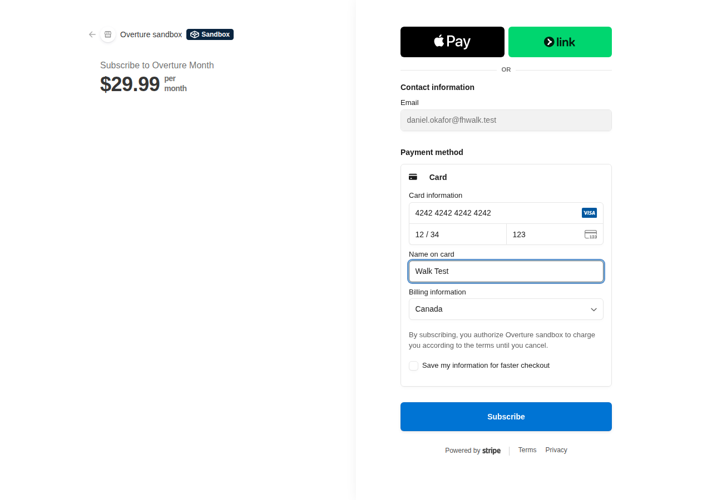

# End-to-end acceptance walk — three people, three plans (#710)

Date: 2026-11-27. Run on merged `main` at `a6ead312` (the #710 wiring PR #753), local instance
`http://devbox:3423`, `NODE_ENV=development`, `OVERTURE_DRY_SUBMIT=1`, freehire free tier (no API key),
Claude Haiku 5.5, Stripe sandbox. Three fresh accounts from the 26 Nov harness resumes:
software engineer (Free trial), teacher (Weekly), admin (Monthly).

**Headline: the three plans and every screen up to Review/Ready work end to end, but no Application reached
Submit in this run.** The blockers are product bugs on the live send path, filed as #756, #757, #758 and #759;
they are listed under [Known limits](#known-limits). The owner gate (#710) is therefore **not met yet**.

The two blockers found and fixed during the walk shipped in #753: onboarding AI was spend-gated before a plan
(`SpendGate.allowsOnboarding`), and the live Haiku score schema was rejected by the Anthropic API (`minItems`).

## What the three walks share

- Sign-up by magic link, resume upload with the real Haiku resume reader (12 facts read for Maya, 10 for
  Amina, 11 for Daniel), only the truly missing gap fields asked, preferences by freehire category and canonical
  place ids.
- A real freehire pull per person, then one Claude Haiku score per job (live Messages API, not Batches).
  Pulls: 100 jobs fetched per person, 99 / 100 / 99 kept after dedupe and sendable-ATS filtering; 298 unique
  jobs stored overall, 252 English.
- Scored pools (visible match count): **88** software, **36** education, **81** admin.
- Plan grants were correct in Stripe sandbox: trial 3, Weekly 50, Monthly 250; the paid grants arrived through
  a signed `invoice.paid` webhook built from the real sandbox subscription.
- Picks are stored before Stripe and land on the Tracker; Review is grouped per application; Ready shows the
  prepared card with the exact answers and the PDF.
- Haiku cost for the whole walk: **$0.0212** (100 calls, 33,059 input / 241,770 cached / 73,130 output tokens).
  Browser Use spend was ~$0: every cloud session stopped immediately (see known limits), so the walk used
  local Chromium.

## User 1 — Maya Chen, software engineer, Free trial

Preferences: Software engineering, Backend, Full-stack, DevOps, Data engineering; Canada. Resume reader filled
name, email, phone, city/country, work authorization, current employer, languages, GitHub; gaps asked only for
salary, notice, relocation, LinkedIn and the sponsorship confirmation.

Pull 100 fetched / 99 kept · pool **88** · 85 scored. The visible top 10 (owner rates these):

| # | Score | Role | Company | Place | ATS | Why (stored reason, shortened) |
|---|---|---|---|---|---|---|
| 1 | 82 | Backend Engineer | USMobile | Toronto | Lever | Backend and platform services matching Shopwise/Northpeak |
| 2 | 80 | Senior Platform Engineer | Jobgether | Canada | Lever | Platform work, remote Canada |
| 3 | 80 | Senior AI-Native Software Developer | Geotab | Oakville/Toronto/Waterloo | Greenhouse | Senior developer, 7 years backend/platform |
| 4 | 80 | Founding Engineer - Infra Development | hireVouch | Toronto | Catsone | Storage/search adjacent to Go, Kafka, platform |
| 5 | 80 | Senior Software Developer, AI Platform | Jobgether | Canada | Lever | Senior title matches 7 years backend/platform |
| 6 | 80 | Senior Software Engineer, Security | Forward Financing | Remote Ontario | Ashby | Senior engineering with a security focus |
| 7 | 80 | Senior Platform Engineer | Robots and Pencils | Remote Canada | Greenhouse | Remote Canada fits Ottawa base and citizenship |
| 8 | 80 | Senior Full Stack Engineer II | Jobgether | Canada | Lever | Full-stack target, adjacent to backend focus |
| 9 | 80 | Founding Engineer | Jobgether | Canada | Lever | Full-stack ownership from architecture to deployment |
| 10 | 80 | Senior Developer, Fullstack - Platform Ecosystem | Fullscript | Ottawa | Lever | TypeScript/Node/React plus Go backend |

Plan screen: Free trial preselected, “card check only, nothing charged”, all 3 sent at once; Stripe sandbox
Setup card confirmed (4242), trial grant 3. Picks: USMobile (Lever), Planet (Greenhouse), Flexstaf IT (Manatal).

Outcome: Planet reached **Ready** after two Review rounds (4 questions, then 2 more found on the live form:
Country, Location). USMobile was approved and attempted; preflight stopped it with `form_changed`
(`value_mismatch:phone, field_missing:resume, option_not_selected:country, option_not_selected:candidate-location`).
Flexstaf (Manatal) stayed preparing (`form_unreadable`). No Submit.

Review questions per application: Planet 6 (all select: how did you hear ×2, previously worked, sanctioned
countries, country, city) — the only application above the ≤4 target; USMobile 1 from live preflight; Flexstaf 0.

What this proves: a software engineer can go from a fresh account to a scored freehire list, a trial card,
three durable picks, Review and Ready on two ATS families, and the exactly-once trial grant. It does not prove a
send: the live-form preflight stops before any filling.

Screens: [sign-up](swe-01-signup-1280.png) · [resume](swe-02-resume-1280.png) ·
[gaps](swe-03-gaps-1280.png) · [preferences](swe-04-preferences-1280.png) ·
[matches 1280](swe-05-matches-1280.png) · [matches 390](swe-05-matches-390.png) ·
[matches dark](swe-05-matches-1280-dark.png) · [tracker](swe-06-tracker-1280.png) ·
[Review](review-1280.png) · [Ready](swe-07-ready-1280.png) · [scheduled](swe-08-scheduled-1280.png) ·
[final tracker](swe-09-tracker-final-1280.png)

## User 2 — Amina Yusuf, teacher, Weekly

Preferences: Education; Ottawa + UAE, Saudi Arabia, Qatar, Kuwait, Bahrain, Oman. Gaps: phone, salary, notice,
relocation, languages (English/Arabic).

Pull 100 fetched / 100 kept · pool **36** · 35 scored. Visible list (6 scored roles, the whole education pool):

| # | Score | Role | Company | Place | ATS | Why |
|---|---|---|---|---|---|---|
| 1 | 75 | English Teacher 2026-2027 | Elite Private School | Abu Dhabi | BambooHR | B.Ed. and Ontario certification meet the ask |
| 2 | 65 | PYP PHE Teacher | International School of London Qatar | Doha | BambooHR | IB PYP experience, primary years |
| 3 | 65 | Islamic Studies Teacher | International School of London Qatar | Doha | BambooHR | Same teaching role family, 9 years Grades 3–10 |
| 4 | 65 | PE Teacher – Al Maharat | International Community Schools | Abu Dhabi | Zoho Recruit | Teaching role, subject adjacent (math/science) |
| 5 | 59 | Teacher Assistant | Hayat Universal School | Doha | Workable | Doha target, assistant level |
| 6 | 57 | Electrical Engineering Instructor/Lecturer | BAE Systems | Doha | Zoho Recruit | Instructor role, Qatar target |

Plan: Weekly $9.99 Checkout completed in Stripe sandbox; the signed invoice granted **50 applications** and the
plan shows Weekly on the Tracker. Picks: 10 (7 international-school roles). Outcome: 4 BambooHR, 3 Zoho and 1
Manatal stuck `preparing` with `form_unreadable`; 2 Workable skipped by the ATS kill switch. Zero reached Ready,
so no approval, no send and the 5-minute spacing was not observable for this user.

Review questions per application: 0 (no form was read).

What this proves: a teacher in the Gulf can complete onboarding, a real paid Checkout and a 50-application
Weekly grant on the rebuilt flow. It also proves the supply problem: the education pool is almost entirely on
ATSes whose forms the reader cannot read, so a Weekly user gets nothing to send today.

Screens: [sign-up](teacher-01-signup-1280.png) · [resume](teacher-02-resume-1280.png) ·
[gaps](teacher-03-gaps-1280.png) · [preferences](teacher-04-preferences-1280.png) ·
[matches 1280](teacher-05-matches-1280.png) · [matches 390](teacher-05-matches-390.png) ·
[matches dark](teacher-05-matches-1280-dark.png) · [tracker](teacher-06-tracker-1280.png) ·
[Ready](teacher-07-ready-1280.png) · [final tracker](teacher-09-tracker-final-1280.png)

## User 3 — Daniel Okafor, admin, Monthly

Preferences: Administration, Operations; Canada + Ottawa. Gaps: phone, salary, notice, relocation, languages.

Pull 100 fetched / 99 kept · pool **81**. Visible top 10:

| # | Score | Role | Company | Place | ATS | Why |
|---|---|---|---|---|---|---|
| 1 | 75 | Medical Secretary | Durham Community Health Centre | Oshawa | Workable | Adjacent admin support |
| 2 | 72 | Patient Administrative Coordinator | Sailor Health | Canada (remote) | Ashby | Admin coordination, remote Canada |
| 3 | 67 | Medical Office Assistant | MedSpa Partners | Vancouver | Recruitee | Admin support in a clinic |
| 4 | 67 | HR Administrator & Office Coordinator | aaisolutions | Mississauga | BambooHR | Office coordination plus HR admin |
| 5 | 65 | Scheduling Coordinator | srgroupofcompanies | Cambridge | SmartRecruiters | Scheduling and records |
| 6 | 59 | Reception/Admin Assistant | ltlgroup | Thunder Bay | BambooHR | Front-desk admin |
| 7 | 57 | Operations Manager | Jobgether | Canada | Lever | Operations target |
| 8 | 52 | Battery Operations Specialist | Moment Energy | Surrey | Greenhouse | Operations-adjacent |
| 9 | 52 | Buyer – Building Mechanical Systems | Kolostat | Newmarket | BambooHR | Admin/operations in procurement |
| 10 | 52 | GTM Enablement & Operations Specialist | Varicent | Toronto | Greenhouse | Operations target |

Plan: Monthly $29.99 Checkout completed in Stripe sandbox; the signed invoice granted **250 applications**.
Ten picks were saved before Checkout (7 BambooHR, 1 JazzHR, 1 Jobvite, 1 Workable). One JazzHR application
(CMHA Thames Valley) reached Ready and was approved; the rest stayed preparing (`form_unreadable`) or were
skipped (Workable kill switch). The approved JazzHR card never sent: dispatch classifies its liveness as
`unknown` and blocks it (#756). Paid spacing therefore showed one scheduled card 12.8 minutes after approval
(a retry backoff), not the intended 5-minute cadence.

Review questions per application: 0 (no readable form).

What this proves: a Monthly Checkout and the 250-application grant work, the Tracker holds 10 durable picks,
and the owner sees exactly why each card is stuck. It also shows the admin pool is dominated by ATSes the
rebuilt send path cannot read or liveness-check today.

Screens: [sign-up](admin-01-signup-1280.png) · [resume](admin-02-resume-1280.png) ·
[gaps](admin-03-gaps-1280.png) · [preferences](admin-04-preferences-1280.png) ·
[matches 1280](admin-05-matches-1280.png) · [matches 390](admin-05-matches-390.png) ·
[matches dark](admin-05-matches-1280-dark.png) · [tracker](admin-06-tracker-1280.png) ·
[Ready](admin-07-ready-1280.png) · [scheduled](admin-08-scheduled-1280.png) ·
[final tracker](admin-09-tracker-final-1280.png)

## Stripe sandbox

One Checkout card page is captured (Setup for the trial, then Subscription for Weekly/Monthly). No live key was
used; the return URL, the Setup session and the real subscription invoice were verified against the sandbox API.
The two paid grants (50 and 250) and the trial grant (3) are the proof the webhook path works.

## Known limits

- **No Application reached Submit, so there is no pre-Submit screenshot and no dry-submit outcome in this
  run.** #757 (preflight stops Greenhouse/Lever on a hidden resume input, untouched location selects and a phone
  format difference) and #756 (every ATS whose liveness is `unknown` is never claimed) are the direct causes.
- **BambooHR, Zoho Recruit and Manatal forms return no questions** (#758), so most teacher and admin picks stay
  in preparation. This is a supply gap, not a walk artefact.
- **Browser Use cloud sessions stopped immediately** (`status: stopped`, `cdpUrl: null`, ~2 s after create), so
  the walk fell back to local Chromium, which the brief allows when Browser Use is unavailable. No Browser Use
  spend was incurred. A second person's capture jobs on the same account showed the same stop pattern.
- **Paid new-job batch scoring is 400ing** with `requests.0.custom_id: String should have at most 64 characters`;
  a separate fix is landing on main. Onboarding scoring (live Messages API) is unaffected and this walk's scores
  are live.
- **Two same-employer Applications** (International School of London Qatar ×3) show the one-open-application
  rule is not enforced across a pick batch (#759).
- The walk used test routes to bound the run: `jobs.pull_max_pages=1` (100 jobs per pull instead of the default
  5), and the pull/score jobs were triggered through the real handlers because `ENABLE_TEST_ROUTES` disables the
  automatic queue. The pull, scoring, preparation and Review code paths are the shipped ones.
- Screenshots are light at 390 and 1280; the onboarding matches screens also have a dark pair. The plan screen
  is part of the matches screen. `05-matches-*` light captures are the after-onboarding Matches page because the
  onboarding route redirects an onboarded account; the dark pair is the exact onboarding matches screen.

## Reproduce

The harness is in [walk/issue-710-walk.spec.ts.txt](walk/issue-710-walk.spec.ts.txt) with
[walk/playwright.walk.config.ts.txt](walk/playwright.walk.config.ts.txt). It drives the real UI with Playwright,
reads no seeded job data, and keeps the screenshots in this folder. Copy both files back to
`test/walk/issue-710-walk.test.ts` and `playwright.walk.config.ts`, start the app with the env in the #710 brief,
then run `bun node_modules/playwright/cli.js test -c playwright.walk.config.ts`.
